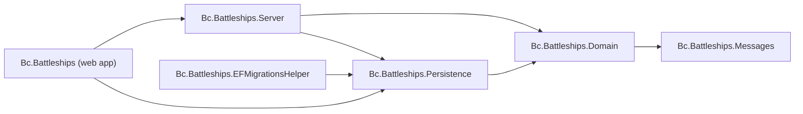

# Bc.Battleships

A one-sided Battleships game: the computer places its fleet at random, and you shoot at it until every ship is sunk. The computer does not shoot back (two-sided play is a stretch goal, see Phase 5 in the modernization plan). The shots, hits, sinkings and game-over state are all kept on the server and stored in SQLite.

This is a 2022 proof of concept (.NET 6 + Create React App) that is being modernized in phases. See [docs/MODERNIZATION.md](docs/MODERNIZATION.md) for the plan and current status.

[](https://github.com/bcichonski/Bc.Battleships/actions/workflows/ci.yml)

## Architecture

The solution is `Bc.Battleships.slnx` at the repository root. Production projects live under `src/` and test projects under `tests/`.

* **Domain** (`src/Bc.Battleships.Domain`): the game model (`Game`, players, ships, shots) and its rules.
* **Messages** (`src/Bc.Battleships.Messages`): the commands and queries exchanged with the API.
* **Persistence** (`src/Bc.Battleships.Persistence`): EF Core with SQLite.
* **Server** (`src/Bc.Battleships.Server`): command and query handlers, dispatched through MediatR (CQRS).
* **Web app** (`src/Bc.Battleships`): ASP.NET Core API controllers, Swagger, and the React client in `ClientApp/`.
* **EF migrations helper** (`src/Bc.Battleships.EFMigrationsHelper`): design-time support for EF Core migrations.



Test projects (`tests/`):

* **UnitTests.Domain**: domain unit tests.
* **Tests.Integration.Database**: persistence tests against SQLite.
* **Tests.Integration.API**: API tests.
* **Tests.Common**: helpers shared by the test projects.

## Prerequisites

* **.NET 10 SDK** (10.0.100 or a later 10.0.x feature band). `global.json` pins the SDK and allows roll-forward within the 10.0 feature bands. The solution format (`.slnx`) needs SDK 10.
* **Node.js** with npm, for the React client.

The projects still target `net6.0` and run on the .NET 8 or .NET 10 runtime through roll-forward (`RollForward=Major`). This is temporary and will be removed when the projects move to a supported target framework.

## Running the app

From the repository root:

```bash
dotnet run --project src/Bc.Battleships
```

A Debug build installs the client's npm packages automatically when `src/Bc.Battleships/ClientApp/node_modules` is missing. The app then starts the React dev server (`npm start`) through SpaProxy.

Ports (from `src/Bc.Battleships/Properties/launchSettings.json`):

* `https://localhost:7191` and `http://localhost:5191`: the ASP.NET Core app. In Development, Swagger UI is served at the root of this address.
* `https://localhost:44463`: the React dev server started by SpaProxy (`SpaProxyServerUrl`).

To run from Visual Studio or Rider, open `Bc.Battleships.slnx` and start the `Bc.Battleships` profile.

## Running the tests

Backend, from the repository root:

```bash
dotnet build
dotnet test
```

`dotnet test` runs 38 tests: 27 domain unit tests, 6 database integration tests and 5 API integration tests.

Client, from `src/Bc.Battleships/ClientApp`:

```bash
npm ci
npm run lint
npm test
```

## Continuous integration

GitHub Actions (`.github/workflows/ci.yml`) builds and tests the backend, collects coverage, and runs the client lint and tests on pushes to `main` and on every pull request. Dependabot (`.github/dependabot.yml`) proposes updates for NuGet, npm and GitHub Actions dependencies.

## License

Released under the [MIT License](LICENSE).
