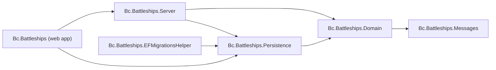

# Bc.Battleships

A one-sided Battleships game: the computer places its fleet at random, and you shoot at it until every ship is sunk. The computer does not shoot back (two-sided play is a stretch goal, see Phase 5 in the modernization plan). The shots, hits, sinkings and game-over state are all kept on the server and stored in SQLite.

This is a 2022 proof of concept (originally .NET 6 + Create React App) that is being modernized in phases. The client is now built with Vite, React 19 and TypeScript. See [docs/MODERNIZATION.md](docs/MODERNIZATION.md) for the plan and current status.

[](https://github.com/bcichonski/Bc.Battleships/actions/workflows/ci.yml)

## Architecture

The solution is `Bc.Battleships.slnx` at the repository root. Production projects live under `src/` and test projects under `tests/`.

* **Domain** (`src/Bc.Battleships.Domain`): the game model (`Game`, players, ships, shots) and its rules.
* **Messages** (`src/Bc.Battleships.Messages`): the commands and queries exchanged with the API.
* **Persistence** (`src/Bc.Battleships.Persistence`): EF Core with SQLite.
* **Server** (`src/Bc.Battleships.Server`): command and query handlers, dispatched through Mediator (CQRS, source-generated).
* **Web app** (`src/Bc.Battleships`): minimal API endpoints (`Infrastructure/GameEndpoints.cs`), the OpenAPI document and Scalar UI (Development only), and the React client in `ClientApp/`.
* **EF migrations helper** (`src/Bc.Battleships.EFMigrationsHelper`): design-time support for EF Core migrations.



Test projects (`tests/`):

* **UnitTests.Domain**: domain unit tests.
* **Tests.Integration.Database**: persistence tests against SQLite.
* **Tests.Integration.API**: API tests.
* **Tests.Common**: helpers shared by the test projects.

## Prerequisites

* **.NET 10 SDK** (10.0.100 or a later 10.0.x feature band). All projects target `net10.0`. `global.json` pins the SDK and allows roll-forward within the 10.0 feature bands only. The solution format (`.slnx`) needs SDK 10.
* **Node.js 22** with npm (the version CI uses), for the React client. A backend build does not need Node.
* **Playwright Chromium** for the e2e tests: `npx playwright install chromium` (run in `src/Bc.Battleships/ClientApp`).

## Running the app

In Development, run the backend and the client separately.

Backend, from the repository root:

```bash
dotnet run --project src/Bc.Battleships
```

* `https://localhost:7191` and `http://localhost:5191`: the ASP.NET Core app (from `src/Bc.Battleships/Properties/launchSettings.json`).
* In Development only: the OpenAPI document at `https://localhost:7191/openapi/v1.json` and the Scalar UI at `https://localhost:7191/scalar/v1`. The root URL serves the client's `index.html`.

Client, in a second terminal, from `src/Bc.Battleships/ClientApp`:

```bash
npm ci
npm run dev
```

* `http://localhost:44463`: the Vite dev server (plain HTTP, `strictPort`). Open the game here. It forwards `/game` to the backend. The proxy target is the first URL in `ASPNETCORE_URLS` when that is set, and otherwise `http://localhost:5191` (the HTTP profile of the backend). To proxy to a different backend, start the client with that address, for example `ASPNETCORE_URLS=https://localhost:7191 npm run dev`. The proxy accepts self-signed certificates.
* `vite.config.ts` honours an optional `VITE_CACHE_DIR` environment variable. Only set it where `node_modules/.vite` is not writable.

Other client scripts, from `src/Bc.Battleships/ClientApp`: `npm run build` (TypeScript typecheck, then the production bundle into `ClientApp/build`), `npm run preview` (serves that bundle locally) and `npm run lint`.

Production is unchanged: `dotnet publish` runs `npm run build` and copies `ClientApp/build` into `wwwroot`, and the app serves it with static files and the `index.html` fallback.

To run from Visual Studio or Rider, open `Bc.Battleships.slnx` and start the `Bc.Battleships` profile. This starts the backend only, so start the client with `npm run dev` as well.

## Running the tests

Backend, from the repository root:

```bash
dotnet build
dotnet test
```

`dotnet test` runs 63 tests: 44 domain unit tests, 8 database integration tests and 11 API integration tests (5 of them are HTTP endpoint tests through `WebApplicationFactory`).

Client, from `src/Bc.Battleships/ClientApp`:

```bash
npm ci
npm run lint
npm test
```

`npm test` runs the Vitest unit and component tests (`src/**/*.test.{ts,tsx}`) once, with jsdom and Testing Library.

End-to-end smoke tests, from `src/Bc.Battleships/ClientApp`:

```bash
npm run test:e2e
```

This needs the .NET SDK and the Playwright Chromium browser (`npx playwright install chromium`). Playwright starts the backend with `dotnet run` on `http://127.0.0.1:5191` and the Vite dev server on `http://localhost:44463`, so no separate terminal is needed. The backend uses a throw-away SQLite file in the OS temp directory, so the e2e run never touches your `battleships.db`. Outside CI, servers already listening on those ports are reused. The HTML report is written to `ClientApp/playwright-report` and is not opened automatically.

## Continuous integration

GitHub Actions (`.github/workflows/ci.yml`) runs on pushes to `main` and on every pull request:

* **Backend**: builds and tests the solution, collects coverage and publishes a coverage report.
* **Client**: `npm ci`, `npm run lint`, `npm run build` (includes the typecheck) and `npm test`.
* **Client e2e**: sets up .NET (from `global.json`) and Node 22, installs Chromium and runs `npm run test:e2e`. The Playwright report is uploaded as an artifact when the job fails.

Dependabot (`.github/dependabot.yml`) proposes updates for NuGet, npm and GitHub Actions dependencies.

## License

Released under the [MIT License](LICENSE).
