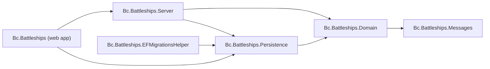

# Bc.Battleships

A one-sided Battleships game: the computer places its fleet at random, and you shoot at it until every ship is sunk. The computer does not shoot back (two-sided play is a stretch goal, see Phase 5 in the modernization plan). The shots, hits, sinkings and game-over state are all kept on the server and stored in SQLite.

This is a 2022 proof of concept (.NET 6 + Create React App) that is being modernized in phases. See [docs/MODERNIZATION.md](docs/MODERNIZATION.md) for the plan and current status.

[](https://github.com/bcichonski/Bc.Battleships/actions/workflows/ci.yml)

## Architecture

The solution is `Bc.Battleships.slnx` at the repository root. Production projects live under `src/` and test projects under `tests/`.

* **Domain** (`src/Bc.Battleships.Domain`): the game model (`Game`, players, ships, shots) and its rules.
* **Messages** (`src/Bc.Battleships.Messages`): the commands and queries exchanged with the API.
* **Persistence** (`src/Bc.Battleships.Persistence`): EF Core with SQLite.
* **Server** (`src/Bc.Battleships.Server`): command and query handlers, dispatched through Mediator (CQRS, source-generated).
* **Web app** (`src/Bc.Battleships`): minimal API endpoints (`Infrastructure/GameEndpoints.cs`), the OpenAPI document and Scalar UI (Development only), and the React client in `ClientApp/`.
* **EF migrations helper** (`src/Bc.Battleships.EFMigrationsHelper`): design-time support for EF Core migrations.



Test projects (`tests/`):

* **UnitTests.Domain**: domain unit tests.
* **Tests.Integration.Database**: persistence tests against SQLite.
* **Tests.Integration.API**: API tests.
* **Tests.Common**: helpers shared by the test projects.

## Prerequisites

* **.NET 10 SDK** (10.0.100 or a later 10.0.x feature band). All projects target `net10.0`. `global.json` pins the SDK and allows roll-forward within the 10.0 feature bands only. The solution format (`.slnx`) needs SDK 10.
* **Node.js** with npm, for the React client. A backend build does not need Node.

## Running the app

In Development, run the backend and the client separately.

Backend, from the repository root:

```bash
dotnet run --project src/Bc.Battleships
```

* `https://localhost:7191` and `http://localhost:5191`: the ASP.NET Core app (from `src/Bc.Battleships/Properties/launchSettings.json`).
* In Development only: the OpenAPI document at `https://localhost:7191/openapi/v1.json` and the Scalar UI at `https://localhost:7191/scalar/v1`. The root URL serves the client's `index.html`.

Client, in a second terminal, from `src/Bc.Battleships/ClientApp`:

```bash
npm start
```

* `https://localhost:44463`: the CRA dev server (`PORT` in `ClientApp/.env`). Open the game here. It forwards `/game` to the backend through `src/setupProxy.js`. The proxy target is `ASPNETCORE_URLS` (or `ASPNETCORE_HTTPS_PORT`) when set, and otherwise `http://localhost:42160`, so point it at the backend's address (for example `ASPNETCORE_URLS=https://localhost:7191`) when you start the client.

Production is unchanged: `dotnet publish` builds the client into `wwwroot`, and the app serves it with static files and the `index.html` fallback.

To run from Visual Studio or Rider, open `Bc.Battleships.slnx` and start the `Bc.Battleships` profile. This starts the backend only, so start the client with `npm start` as well.

## Running the tests

Backend, from the repository root:

```bash
dotnet build
dotnet test
```

`dotnet test` runs 63 tests: 44 domain unit tests, 8 database integration tests and 11 API integration tests (5 of them are HTTP endpoint tests through `WebApplicationFactory`).

Client, from `src/Bc.Battleships/ClientApp`:

```bash
npm ci
npm run lint
npm test
```

## Continuous integration

GitHub Actions (`.github/workflows/ci.yml`) builds and tests the backend, collects coverage, and runs the client lint and tests on pushes to `main` and on every pull request. Dependabot (`.github/dependabot.yml`) proposes updates for NuGet, npm and GitHub Actions dependencies.

## License

Released under the [MIT License](LICENSE).
