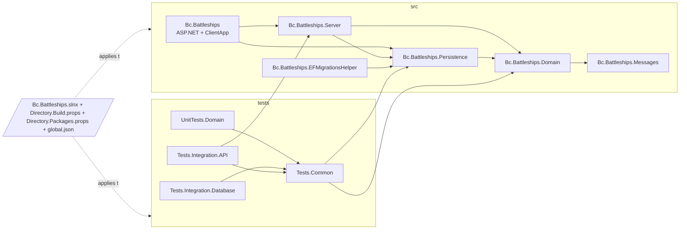
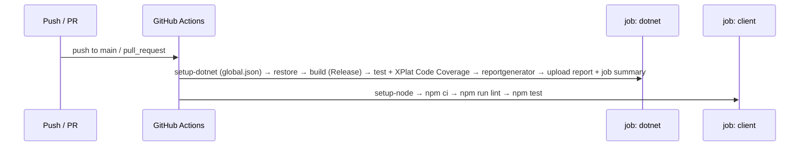

# Modernization Phase 1 — Repo Hygiene and CI Plan

**Plan Status**: `FINAL`

**Story Type**: `Internal`

> This plan captures **what** to build and **why** — domain, architecture, decisions, and verified facts.
> It deliberately does **not** contain implementation code, pseudocode, line numbers, mock setups, or test bodies.
> The implementation agent discovers the **how** against live code. See §4 Task Breakdown.

---

## 1. Problem Statement

*   **Context**: `Bc.Battleships` is a .NET 6 + CRA/React 17 proof of concept from 2022 (see `docs/MODERNIZATION.md`, Phase 0 done). The solution sits three folders deep (`Bc.Battleships/Bc.Battleships/Bc.Battleships`), uses a classic `.sln`, has no shared build settings, each test project pins its own (mismatched) xunit / Test.Sdk / coverlet versions, 101 tracked files start with a UTF-8 BOM, there is no `global.json`, `.editorconfig` or `.gitattributes`, the README has a stale `[...]BcBattleships\...` path, and there is no CI at all.
*   **Goal**: Groundwork for the later phases, with **no behaviour change**: a flat `src/` + `tests/` layout with a root `.slnx`, shared build settings and central package management, normalized line endings/encoding, an accurate README, a GitHub Actions pipeline (build, test, coverage, client lint/test) and Dependabot.
*   **In scope**: every checkbox of issue #1.
*   **Out of scope** (later phases, do **not** do here): retargeting away from `net6.0`, upgrading any package version (beyond aligning the test packages to one version each), replacing CRA/Vite, moving `ClientApp` out of the web project, any refactor or bug fix listed in Phase 4.

### 1.1 Technical Summary

*   **Touched projects**: all 6 production projects and 4 test projects (moved, csproj trimmed), plus new repo-root build files.
*   **New patterns / abstractions**: `Directory.Build.props` (repo-wide MSBuild defaults), `Directory.Packages.props` (NuGet Central Package Management), `.slnx` solution format.
*   **Infrastructure changes**: new `.github/workflows/ci.yml` and `.github/dependabot.yml`. No runtime infrastructure.
*   **End-state observable behavior**: from the repo root, `dotnet build` and `dotnet test` succeed with zero warnings-as-errors failures and 38/38 tests passing; `npm ci && npm run lint && npm test` in the client folder succeed; the CI workflow runs the same on every push/PR and publishes a coverage report. Application behaviour is unchanged.

---

## 2. Architecture & Design

### 2.1 Architecture Overview

#### Involved services & owners

| Service | Technical Owner |
| :--- | :--- |
| `Bc.Battleships` (whole repo) | bcichonski |

#### C2 diagram (target layout — project dependencies unchanged)

#### Flow diagram (CI happy path)

### 2.2 External Contracts & Evidence

`N/A — Internal story`

### 2.3 Affected Areas

| Area / File (pointer) | Role in this change | Likely action |
| :--- | :--- | :--- |
| `Bc.Battleships/Bc.Battleships.sln` | Classic solution, 10 projects + a `Tests` solution folder | Replace with root `Bc.Battleships.slnx` |
| `Bc.Battleships/Bc.Battleships.*/` (6 production projects incl. the web project `Bc.Battleships/Bc.Battleships/`) | Production code | Move to `src/<ProjectName>/` with `git mv` |
| `Bc.Battleships/Tests/*` (4 projects) | Test code | Move to `tests/<ProjectName>/` with `git mv` |
| `*.csproj` (all 10) | Per-project TFM, Nullable, package versions | Remove `Version=` attributes (CPM) and settings hoisted into `Directory.Build.props`; fix relative `ProjectReference` paths |
| `Bc.Battleships/Bc.Battleships/ClientApp/` | CRA client; `SpaRoot` is relative to the web project | Moves with the web project (stays `src/Bc.Battleships/ClientApp`) |
| `Bc.Battleships/Bc.Battleships/Properties/launchSettings.json`, `appsettings*.json` | Run config | Moves with the web project; check for absolute/relative paths |
| `Bc.Battleships.Domain/InternalsVisibleToAssemblyInfo.cs` | Grants test assemblies access by assembly name | Reference only — assembly names don't change |
| `.gitignore` (root) and `Bc.Battleships/Bc.Battleships/.gitignore` | Root one lists per-project `bin`/`obj` paths of the old layout | Simplify root to layout-independent patterns; keep the VS template one with the web project or merge it into the root |
| `readme.md` | Stale run instructions | Rewrite (rename to `README.md`) |
| `docs/MODERNIZATION.md` | Phase plan | Reference; tick Phase 1 boxes is **not** required (human does it on merge) |
| new: `Directory.Build.props`, `Directory.Packages.props`, `global.json`, `.editorconfig`, `.gitattributes`, `.github/workflows/ci.yml`, `.github/dependabot.yml` | Repo-wide settings and automation | New |

### 2.4 Key Algorithms & Behaviour

*   **Verified baseline (2026-10-21, sandbox, SDK 10.0.402, no global.json)**: `dotnet build` of the old `.sln` succeeds with exactly **8 × `NETSDK1138`** (net6.0 is out of support) and no other warnings; `DOTNET_ROLL_FORWARD=Major dotnet test` → **27 + 6 + 5 = 38 passed**. Client: `npm run lint` → 0 errors, 1 warning (`no-unused-vars` in `src/components/Game.js`); `npm test` → 1 suite / 1 test passed.
*   **Only the .NET 8 and 10 runtimes exist** in the sandbox (and on `ubuntu-latest` runners unless installed). Tests and the app run on a net6.0 TFM only via roll-forward. The repo must make this work **without** an environment variable, so a plain `dotnet test` from the root passes (that is what the downstream verifier runs).
*   **Debug build side effect**: the web project's `DebugEnsureNodeEnv` target runs `npm install` in `ClientApp` when `node_modules` is missing. `npm install` rewrites `package-lock.json` (observed: −60 lines). Never commit a lockfile changed by a build; CI builds in `Release` (target is Debug-only) and the client job uses `npm ci`.
*   **Warnings policy**: with `TreatWarningsAsErrors` on, every warning the build currently emits must be either fixed (only when the fix is behaviour-neutral) or explicitly excluded in `Directory.Build.props` with a comment naming the phase that removes the exclusion. Expected exclusions: the EOL-TFM check (Phase 2) and NuGet vulnerability-audit warnings `NU1901–NU1904` kept as warnings, not errors (package upgrades are Phase 2). Do not blanket-suppress anything else; do not add `#pragma` suppressions to source.
*   **Encoding normalization** is a byte-level change only: strip the leading BOM, store LF in the index. No re-formatting, no reordering of usings, no whitespace edits beyond what EOL normalization implies.

---

## 3. Key Decisions & Assumptions

*   **Decision — layout**: `src/<ProjectName>/` for the 6 production projects, `tests/<ProjectName>/` for the 4 test projects, `Bc.Battleships.slnx` at the repo root with `/src/` and `/tests/` solution folders. Project and assembly names are unchanged. Use `git mv` so history follows. The old `Bc.Battleships/` folder must be gone afterwards.
*   **Decision — client location**: `ClientApp` stays inside the web project (`src/Bc.Battleships/ClientApp`). Moving it to a top-level `web/` is Phase 3 (Vite) work; doing it now would mean rewriting the SpaProxy wiring for a client that is about to be replaced.
*   **Decision — keep `net6.0`**: retargeting is Phase 2. To let the net6 assemblies run on the installed .NET 8/10 runtimes, `Directory.Build.props` sets `RollForward` to `Major` for every project (documented as temporary until Phase 2). This only affects which installed runtime hosts the app when 6.0 is missing; the code does not change.
*   **Decision — SDK pin**: `global.json` pins SDK `8.0.400` with `rollForward: latestFeature` (stays on the 8.0 SDK band, C# 12). Rationale: net6.0 is a supported *target* for SDK 8; SDK 10 would bring C# 14 (`field` keyword etc.) under `LangVersion latest`, a needless risk in a no-behaviour-change phase. Phase 2 bumps it to 10.
*   **Decision — `Directory.Build.props` content**: `Nullable` enable, `ImplicitUsings` enable (only where projects already enable it — test projects currently do **not**; keep each project's current ImplicitUsings setting so no new global usings change name resolution), `LangVersion latest`, `TreatWarningsAsErrors true`, `EnableNETAnalyzers true`, `AnalysisLevel latest`, `AnalysisMode Default`, `EnforceCodeStyleInBuild false`, `RollForward Major`, `CheckEolTargetFramework false` (Phase 2 removes it), `WarningsNotAsErrors NU1901;NU1902;NU1903;NU1904`. If enabling analyzers surfaces new warnings, fix them only if behaviour-neutral; otherwise list the rule IDs in a commented `NoWarn` with "revisit in Phase 4".
*   **Decision — central package management**: `Directory.Packages.props` with `ManagePackageVersionsCentrally`. Production package versions stay **exactly** as they are today. Test packages are aligned to the highest version already used in the repo: `Microsoft.NET.Test.Sdk 17.2.0`, `xunit 2.4.1`, `xunit.runner.visualstudio 2.4.5`, `coverlet.collector 3.1.2`, `FluentAssertions 6.7.0`, `NSubstitute 4.3.0`, `Microsoft.Extensions.DependencyInjection 6.0.0`.
*   **Decision — line endings / encoding**: `.gitattributes` `* text=auto eol=lf` with binary markers for images/ico/db; `.editorconfig` root with `charset = utf-8`, `end_of_line = lf`, `insert_final_newline = true`, 4-space indent for C#/MSBuild, 2-space for JS/JSON/YAML. Strip the BOM from every tracked text file. `package-lock.json` is excluded from any manual edit.
*   **Decision — CI**: one workflow `ci.yml`, triggers `push` to `main` and `pull_request`, `permissions: contents: read`, two jobs on `ubuntu-latest`: **dotnet** (setup-dotnet from `global.json`, restore, build `-c Release`, test with `--collect "XPlat Code Coverage"`, ReportGenerator → HTML + Markdown summary appended to `$GITHUB_STEP_SUMMARY`, upload the report as an artifact) and **client** (setup-node 22 with npm cache keyed on the client lockfile, `npm ci`, `npm run lint`, `npm test`, working-directory `src/Bc.Battleships/ClientApp`). No coverage gate yet (Phase 4). Actions pinned to major tags (`actions/checkout@v4`, `actions/setup-dotnet@v4`, `actions/setup-node@v4`, `actions/upload-artifact@v4`); Dependabot keeps them current.
*   **Decision — Dependabot**: `version: 2`, weekly, ecosystems `nuget` (`/`), `npm` (`/src/Bc.Battleships/ClientApp`), `github-actions` (`/`). Group minor+patch updates per ecosystem to limit PR noise; open-PR limit 5.
*   **Decision — README**: rename `readme.md` → `README.md`; sections: what it is (one-sided Battleships vs. a computer-placed fleet, PoC being modernized — link `docs/MODERNIZATION.md`), architecture sketch (project list + mermaid dependency diagram, CQRS via MediatR, EF Core + SQLite), prerequisites (.NET SDK per `global.json`, Node), how to run (from repo root: `dotnet run --project src/Bc.Battleships`), how to test (backend + client), CI badge, license.
*   **Assumption** — "CI is green on `main`" (issue Done-when) can only be observed after merge; this run verifies it on the PR's CI build instead. Low stakes; no OQ needed.
*   **Assumption** — the untracked `docs/CHANGELOG.md`, `docs/changelog-entry-template.md` and `docs/specs/**` in the working tree are the owner's workflow scaffolding and are committed with this PR (the plan and its state files live there). Low stakes.

### 3.1 Decision Lock (Constants & Policies)

| Constant / Policy | Selected Value | Why | Where it lives |
| :--- | :--- | :--- | :--- |
| Target framework | `net6.0` (unchanged) | Retarget is Phase 2 | each csproj / props |
| SDK pin | `8.0.400`, `latestFeature` | net6 targeting without C# 14 risk | `global.json` |
| Runtime roll-forward | `Major` | only 8/10 runtimes installed | `Directory.Build.props` |
| Test package versions | Test.Sdk 17.2.0, xunit 2.4.1, runner 2.4.5, coverlet.collector 3.1.2 | highest already in repo; no upgrades | `Directory.Packages.props` |
| Warnings as errors | on; EOL check off; NU1901–1904 not-as-errors | upgrades are Phase 2 | `Directory.Build.props` |
| Node in CI | 22 | current LTS line supported by CRA 5 | `ci.yml` |
| Coverage gate | none | Phase 4 adds it | — |
| Client location | `src/Bc.Battleships/ClientApp` | Phase 3 replaces the client | layout |

### 3.2 Open Questions

No open questions.

---

## 4. Task Breakdown

| Task | Title | Depends on | Complexity |
| :--- | :--- | :--- | :--- |
| `T1` | Flatten layout into `src/` + `tests/` and switch to `.slnx` | — | `Medium` |
| `T2` | Shared build settings, central package management, `global.json` | `T1` | `Medium` |
| `T3` | `.editorconfig`, `.gitattributes`, BOM/EOL normalization | `T2` | `Low` |
| `T4` | GitHub Actions CI + Dependabot | `T3` | `Medium` |
| `T5` | README rewrite | `T3` | `Low` |

### T1 — Flatten layout into `src/` + `tests/` and switch to `.slnx`

*   **Goal**: The 10 projects live under `src/` and `tests/` at the repo root, a root `Bc.Battleships.slnx` replaces the old `.sln`, and everything builds and tests exactly as before.
*   **Depends on**: `—`.
*   **Complexity**: `Medium`.
*   **Pointers**: `Bc.Battleships/Bc.Battleships.sln`, all `*.csproj` `ProjectReference` paths, root `.gitignore`, `Bc.Battleships/Bc.Battleships/.gitignore`, `launchSettings.json`, `EFMigrationsHelper` (design-time paths, if any). `dotnet sln migrate` can produce the `.slnx`; adjust paths/folders afterwards.
*   **Definition of Done**: `git mv` used (renames show in `git status`); old `Bc.Battleships/` folder no longer tracked; root `.slnx` lists all 10 projects in `/src/` and `/tests/` folders and no `.sln` remains; root `.gitignore` uses layout-independent `bin/` `obj/` patterns and still ignores `battleships.db*`, `node_modules`, `.vs`; `dotnet build` and `dotnet test` from the repo root succeed (use `DOTNET_ROLL_FORWARD=Major` for the test run until T2 lands) with 38/38 passing; `package-lock.json` unchanged; no source file content changed other than relative paths.
*   **Tests expected**: no new tests; the existing 38 must pass unchanged.

### T2 — Shared build settings, central package management, `global.json`

*   **Goal**: Repo-wide `Directory.Build.props`, `Directory.Packages.props` and `global.json` per §3 / §3.1, with csproj files trimmed of what is now centralized, and a warning-free build under `TreatWarningsAsErrors`.
*   **Depends on**: `T1`.
*   **Complexity**: `Medium`.
*   **Pointers**: all 10 `*.csproj`; new root `Directory.Build.props`, `Directory.Packages.props`, `global.json`. Keep per-project specifics (OutputType, Sdk, SpaProxy properties, `PrivateAssets`/`IncludeAssets` metadata) in the csproj.
*   **Definition of Done**: no `Version=` attribute on any `PackageReference`; every package version defined once in `Directory.Packages.props` (production versions identical to before, test packages aligned per §3.1); `TargetFramework`, `Nullable`, `LangVersion`, analyzer and warnings settings come from `Directory.Build.props`; plain `dotnet build` (no env vars) from the root succeeds with 0 warnings and 0 errors; plain `dotnet test` (no env vars) from the root runs on the installed runtime and passes 38/38; every suppression/exclusion added carries a comment naming the phase that removes it; no `#pragma` added; `package-lock.json` unchanged.
*   **Tests expected**: no new tests; existing 38 pass. If an analyzer finding requires a code edit, it must be behaviour-neutral and covered by the existing tests.

### T3 — `.editorconfig`, `.gitattributes`, BOM/EOL normalization

*   **Goal**: Encoding and line endings are consistent and enforced: UTF-8 without BOM, LF in the repository.
*   **Depends on**: `T2`.
*   **Complexity**: `Low`.
*   **Pointers**: new root `.editorconfig`, `.gitattributes`; every tracked text file starting with a BOM (101 at baseline, mostly `.cs`/`.csproj`). After adding `.gitattributes`, `git add --renormalize .` re-stages EOLs.
*   **Definition of Done**: `.gitattributes` and `.editorconfig` per §3; no tracked text file starts with a UTF-8 BOM; `git ls-files --eol` shows no `i/crlf` or `i/mixed`; binary files (e.g. `favicon.ico`) marked binary and byte-identical; diff is limited to BOM removal/EOL (check with `git diff --ignore-all-space --ignore-cr-at-eol` showing only the BOM byte); `dotnet build` + `dotnet test` still green (38/38); client `npm run lint` + `npm test` still green; `package-lock.json` content unchanged.
*   **Tests expected**: none new; re-run the full backend and client suites.

### T4 — GitHub Actions CI + Dependabot

*   **Goal**: Every push to `main` and every PR builds, tests (with coverage report) the backend and lints/tests the client; Dependabot watches NuGet, npm and Actions.
*   **Depends on**: `T3`.
*   **Complexity**: `Medium`.
*   **Pointers**: new `.github/workflows/ci.yml`, `.github/dependabot.yml`; `global.json`; `src/Bc.Battleships/ClientApp/package.json` scripts (`lint`, `test` already exist — `test` already sets `CI=true`).
*   **Definition of Done**: workflow per §3 (two jobs, least-privilege `permissions`, `concurrency` cancelling superseded PR runs, Release build so the Debug-only `npm install` target does not run); coverage collected from all test projects and merged by ReportGenerator into HTML (artifact) + Markdown summary (job summary); Dependabot per §3; both YAML files are syntactically valid (parse them locally, e.g. with a YAML parser available in Node); every command the workflow runs has been run locally from a clean state and succeeds (`dotnet restore` / `build -c Release` / `test -c Release --no-build --collect "XPlat Code Coverage"` / ReportGenerator, and `npm ci` / `npm run lint` / `npm test`); `package-lock.json` unchanged.
*   **Tests expected**: none new; the local dry-run of each workflow step is the verification. The real proof is the PR's CI run.

### T5 — README rewrite

*   **Goal**: A README that tells a newcomer what the app is, how it is built, and how to run and test it from the new layout.
*   **Depends on**: `T3`.
*   **Complexity**: `Low`.
*   **Pointers**: `readme.md` (rename to `README.md` via `git mv`), `docs/MODERNIZATION.md`, `src/Bc.Battleships/Program.cs` / `Infrastructure/` (for the architecture sketch), `src/Bc.Battleships/ClientApp/package.json`, `global.json`, `LICENSE`.
*   **Definition of Done**: sections per §3 Decision — README; no stale `[...]BcBattleships\...` path; commands are correct for the new layout and were actually run (build, test, client lint/test); architecture sketch matches the real project references; CI badge points at `.github/workflows/ci.yml` on `bcichonski/Bc.Battleships`; file is UTF-8 without BOM, LF.
*   **Tests expected**: none (docs only); commands in it verified by running them.

---

## 5. Verification

*   **Build**: `dotnet build` from the repo root (picks up `Bc.Battleships.slnx`) — 0 warnings, 0 errors, no env vars needed.
*   **Unit + integration tests**: `dotnet test` from the repo root — 38/38 passed (27 domain unit, 6 DB integration, 5 API integration).
*   **Client**: in `src/Bc.Battleships/ClientApp`: `npm ci`, `npm run lint` (0 errors), `npm test` (1/1).
*   **Hygiene**: no tracked file under the old `Bc.Battleships/` folder; no BOMs; `git ls-files --eol` all `i/lf` (or `-text`); `package-lock.json` unchanged versus `main`.
*   **Observable behaviour**: the PR's GitHub Actions run shows both jobs green and a coverage summary; application code paths unchanged (diff of `*.cs` is path moves + BOM removal + any behaviour-neutral analyzer fix).

---

## 6. Fact-Integrity Checklist

| Check | Yes / No / N/A | Notes |
| :--- | :--- | :--- |
| External contracts verified from producer/contract source | N/A | Internal story |
| Evidence sources are reproducible | N/A | Internal story |
| Identifier directionality / ordering / freshness meaning evidenced | N/A | Internal story |
| Every `Assumption` is linked to an Open Question (§3.2) | Yes | The two assumptions are low-stakes and do not affect correctness |
| No unresolved Open Questions (for `FINAL`) | Yes | |
| Each Decision states a single committed approach | Yes | |
| Tasks are independent, each with a Definition of Done and test expectations | Yes | Sequenced T1→T2→T3→{T4,T5} because each later task touches files the earlier one moves/rewrites |
| Required infra reflected (toggle / bicep) | N/A | No toggle key, no Service Bus |

**Self-review note**: The baseline (build warnings, test counts, client lint/test) was measured in the sandbox, so the warning policy is grounded — but enabling `AnalysisLevel latest` may surface new CA warnings that the T2 agent must triage without changing behaviour. The riskiest mechanical points are the roll-forward needed to run net6 assemblies on .NET 8/10 (must work with a plain `dotnet test`) and the Debug-build `npm install` that silently rewrites `package-lock.json`. T3's BOM strip touches ~100 files; reviewers should check the diff is byte-level only.
