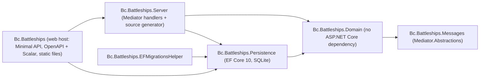

# Modernization Phase 2: Platform Upgrade to .NET 10 Plan

**Plan Status**: `FINAL`

**Story Type**: `Internal`

> This plan captures **what** to build and **why** — domain, architecture, decisions, and verified facts.
> It deliberately does **not** contain implementation code, pseudocode, line numbers, mock setups, or test bodies.
> The implementation agent discovers the **how** against live code. See §4 Task Breakdown.

---

## 1. Problem Statement

*   **Context**: After Phase 1 (#1, PR #6), the solution is flattened into `src/` + `tests/`, builds with SDK 10 (`global.json` pins 10.0.100, `latestFeature`), and uses central package management. It still targets **net6.0** (EOL), runs only through `RollForward=Major` with `CheckEolTargetFramework=false`, and depends on old or now-commercial packages: EF Core 6.0.6, Swashbuckle 6.3, `Microsoft.AspNetCore.SpaProxy` 6, MediatR 10 (MediatR ≥ 13 is commercial), FluentAssertions 6.7 (FA ≥ 8 is commercial), xunit 2.4, Ensure.That, and `Microsoft.AspNetCore.Http.Abstractions` 2.2 inside the Domain project. The API is an MVC `GameController`.
*   **Goal**: Upgrade the platform **while keeping behaviour identical**. Everything targets `net10.0`, no commercially licensed packages remain, and all existing tests stay green (issue #2 "Done when").
*   **In scope** (the issue's checklist, all of it):
    *   net6.0 → net10.0; remove the roll-forward and EOL-check workarounds from Phase 1.
    *   EF Core 6.0.6 → 10.x (SQLite kept); the 2022 `InitialMigration` must still apply.
    *   Swashbuckle → built-in `Microsoft.AspNetCore.OpenApi` + Scalar UI.
    *   Remove `Microsoft.AspNetCore.SpaProxy`; static files in production.
    *   MediatR 10 → Mediator 3.x (martinothamar, MIT, source-generated); remove `MediatR.Extensions.Microsoft.DependencyInjection`.
    *   FluentAssertions → AwesomeAssertions; xunit 2.4 → xunit v3.
    *   Ensure.That → BCL guards.
    *   MVC `GameController` → Minimal API endpoint group.
    *   Remove `Microsoft.AspNetCore.Http.Abstractions` from Domain (see Decision D7: done here with a seam; the static bus itself stays).
*   **Out of scope**:
    *   The CRA → Vite migration of the client and any client code change (Phase 3, #3). See Decision D5.
    *   Removing the static `DomainEventBus` / fire-and-forget sinking event, bug fixes, `/games/{id}` resource design (Phase 4, #4).
    *   Any change to the public HTTP contract (routes, verbs, JSON shape) or to game rules.

### 1.1 Technical Summary

*   **Touched projects**: all of them. `Directory.Build.props`, `Directory.Packages.props`, `src/Bc.Battleships` (web host), `Bc.Battleships.Server` (handlers), `Bc.Battleships.Messages` (requests), `Bc.Battleships.Domain` (event handler, guards, event bus), `Bc.Battleships.Persistence` / `EFMigrationsHelper` (EF Core 10), the three test projects and `Tests.Common`.
*   **New patterns / abstractions**: source-generated Mediator instead of reflection-based MediatR; a Minimal API endpoint group instead of an MVC controller; a delegate seam that lets the web host give Domain's static event bus its request-scoped `IBus`, without Domain referencing ASP.NET Core.
*   **Infrastructure changes**: none. Same SQLite schema; no new migration unless EF Core 10 reports real model drift (see Decision D3).
*   **End-state observable behaviour**: `GET /game`, `POST /game`, `PUT /game` behave exactly as before (same routes, status codes, JSON field names and values). In Development, the OpenAPI document is at `/openapi/v1.json` and the Scalar UI at `/scalar/v1`. The app no longer starts the React dev server itself.

---

## 2. Architecture & Design

### 2.1 Architecture Overview

#### Involved services & owners

| Service | Technical Owner |
| :--- | :--- |
| `Bc.Battleships` (single repo, web host + libraries) | @bcichonski |

#### C2 diagram

Project dependencies are unchanged by this phase. Only the packages under them change.



#### Flow diagram

The happy path of a shot, after the upgrade. It is the same flow as today, with the transport swapped.

```mermaid
sequenceDiagram
    participant C as React client (CRA)
    participant E as Minimal API /game group
    participant M as Mediator (source-generated)
    participant H as ShootCommandHandler
    participant G as Game aggregate
    participant B as DomainEventBus (static)
    C->>E: PUT /game {column,row}
    E->>M: Send(ShootCommand)
    M->>H: Handle
    H->>G: Shoot(coordinates)
    G-->>B: Publish AbandonTheShipDomainEvent (only when a ship sinks; fire-and-forget, unchanged)
    B-->>M: Publish via request-scoped IBus
    H-->>E: ShootResult {hit,currentHitPoints}
    E-->>C: 200 JSON
```

### 2.2 External Contracts & Evidence

N/A — Internal story. No external repositories or external APIs are involved. Package versions were checked against nuget.org on 2026-10-21 (see §3.1). They are build inputs, not contracts.

### 2.3 Affected Areas

| Area / File (pointer) | Role in this change | Likely action |
| :--- | :--- | :--- |
| `Directory.Build.props` | Shared `TargetFramework`, the temporary `RollForward` / `CheckEolTargetFramework` workarounds, NU190x audit carve-out. | Change |
| `Directory.Packages.props` | Every package version lives here (CPM). | Change |
| `src/Bc.Battleships.Persistence/Migrations/*` | The 2022 `InitialMigration` and its model snapshot. | Reference (D3) |
| `src/Bc.Battleships.Persistence/Infrastructure/DatabaseMigrator.cs` | Applies migrations at app start. EF Core 9+ fails `Migrate` when the model has pending changes. | Reference / verify |
| `src/Bc.Battleships.EFMigrationsHelper/*` | Design-time `DbContext` factory for `dotnet ef`. | Change (package only) |
| `src/Bc.Battleships.Messages/{IEvent.cs,Commands/*,Queries/*}` | Request and notification marker interfaces, currently from MediatR. | Change |
| `src/Bc.Battleships.Server/{Infrastructure/*,CommandHandlers/*,QueryHandlers/*}` | MediatR registration, `Bus` (`IBus` → `IMediator.Publish`), the three handlers (`CreateNewGameCommandHandler` is an `AsyncRequestHandler`). | Change |
| `src/Bc.Battleships.Domain/EventHandlers/AbandonTheShipDomainEventHandler.cs` | A notification handler that lives in the **Domain** assembly and must still be discovered and dispatched. | Change |
| `src/Bc.Battleships.Domain/Events/DomainEventBus.cs` | Static service locator. Resolves `IBus` through `IHttpContextAccessor`, which is the only reason Domain references `Microsoft.AspNetCore.Http.Abstractions`. | Change (D7) |
| `src/Bc.Battleships.Domain/{Services/NumberToLettersConverter.cs,ValueObjects/Length.cs,AggregateRoots/Games/Players/ComputerPlayer.cs}`, `src/Bc.Battleships.Messages/DTOs/BoardDto.cs` | Ensure.That call sites. | Change (D8) |
| `src/Bc.Battleships/Controllers/GameController.cs` | The MVC API: `GET`/`PUT`/`POST /game`. | Remove → endpoint group |
| `src/Bc.Battleships/Infrastructure/{Services.cs,App.cs}`, `Program.cs` | DI and pipeline: controllers, Swagger, static files, SPA fallback, bus seam. | Change |
| `src/Bc.Battleships/Pages/*` | Razor `Error` page left over from the template. Never mapped (no `AddRazorPages` / `MapRazorPages`), so it is unreachable. | Remove (D6) |
| `src/Bc.Battleships/Bc.Battleships.csproj`, `Properties/launchSettings.json`, `appsettings.Development.json` | SpaProxy properties, the hosting-startup env var, the SpaProxy log category; the publish target that copies `ClientApp/build` into `wwwroot`. | Change |
| `src/Bc.Battleships/ClientApp/src/setupProxy.js`, `.env.development` | The CRA dev server already proxies `/game` to the backend on its own. | Reference only (no change) |
| `tests/*/*.csproj`, `tests/**/*.cs` | xunit / FluentAssertions / NSubstitute / Test.Sdk / coverlet usage; `ApiTestContext` exposes MediatR's `IMediator`. | Change |
| `.github/workflows/ci.yml` | Runs `dotnet test … --collect "XPlat Code Coverage"` and the client job. | Reference; change only if the test stack forces it |
| `README.md`, `docs/MODERNIZATION.md` | Prerequisites and run instructions (net6 / roll-forward / SpaProxy / Swagger text), phase status. | Change |

### 2.4 Key Algorithms & Behaviour

*   **HTTP contract preservation (the main correctness rule).** Today the API is exactly:
    *   `GET /game` → 200, body is the `GameDto` JSON: `board` (`boardSize`, `boardRows[].row[]` with `BoardFieldState` as **numbers**), `currentHitPoints`, `isGameActive`. When there is no game, the body is `isGameActive: false, board: null, currentHitPoints: 0`.
    *   `POST /game` → 200 with an **empty body**. It stops the current game and creates a new one. The client sends an empty body with no content type.
    *   `PUT /game` with JSON `{ "column": n, "row": n }` (camelCase, 0-based) → 200 with `{ "hit": bool, "currentHitPoints": n }`.

    The Minimal API group must produce the same routes, verbs, status codes and JSON (System.Text.Json web defaults: camelCase output, case-insensitive input, enums as numbers). `ShootCommand` has get-only properties and a parameterized constructor. Body binding must still populate it. The client (`ClientApp/src/logic/backend.js`) is the consumer, and it must keep working unchanged.
*   **Mediator dispatch semantics.**
    *   Requests: one handler per request, the same as before. `CreateNewGameCommand` has no response (MediatR `IRequest` / `AsyncRequestHandler`). It maps to Mediator's request-without-response form, whose handler returns `Unit`.
    *   Notifications: `IEvent` (and therefore `IDomainEvent`) becomes a Mediator notification. `Bus.Publish` publishes through `IMediator`, and `AbandonTheShipDomainEventHandler` (Domain assembly) must still receive `AbandonTheShipDomainEvent`. The source generator must therefore see the Domain assembly's handlers, not only the Server assembly's.
    *   Lifetime: **Scoped** (the handlers depend on the scoped `BattleshipsDbContext` / `IGamesRepository`, the same as MediatR's default registration today).
    *   The domain event is still published fire-and-forget from `Ship` (not awaited). That is a known Phase 4 bug and is preserved as-is here.
*   **EF Core 10 migration rule.** At startup, `DatabaseMigrator` calls `MigrateAsync` when migrations are pending. Since EF Core 9, `Migrate` throws when the model differs from the latest snapshot (`PendingModelChangesWarning` is an error by default). After the upgrade, applying migrations to an **empty** SQLite database must succeed, and the model must report no pending changes. See D3 for what to do when EF Core 10 reports drift.
*   **Guards.** Replacing Ensure.That must keep the **exception types** each guard throws today, so callers and tests see no difference: argument-range checks stay `ArgumentOutOfRangeException`, null/whitespace/length checks stay `ArgumentException` (or `ArgumentNullException` for null), `Length`'s custom `NegativeLengthValueException` stays, and the state check in `ComputerPlayer` keeps throwing the same exception type it throws now. The implementation agent must check what Ensure.That actually throws for each call before replacing it.
*   **Event-bus seam (D7).** `DomainEventBus.Instance` keeps its current behaviour. It resolves the `IBus` registered in the **current request's** service scope, and `DomainEventBus.Use(bus)` keeps working for tests. The only change is *how* the request scope is reached: through a delegate that the web host supplies at startup, instead of an `IHttpContextAccessor` that Domain holds.

---

## 3. Key Decisions & Assumptions

*   **D1 — Upgrade order: retarget first, then tests, then libraries, then the web host.** All tasks touch `Directory.Packages.props`, so they run **sequentially** (T1 → T6). Retargeting first, with the old libraries still in place (MediatR 10, FA 6, xunit 2 all run on net10), isolates TFM and EF problems from library-API problems.
*   **D2 — Pin current stable versions, not ranges.** Versions are listed in §3.1. If one of them proves incompatible at implementation time, the agent may move to the nearest compatible **stable** version of the same package and must record it in the progress notes. Switching to a different package is not allowed.
*   **D3 — Never edit or regenerate the 2022 `InitialMigration`.** After moving to EF Core 10, run `dotnet ef migrations has-pending-model-changes` (via `EFMigrationsHelper`). (a) None → done. (b) Drift that only touches the **snapshot** (a scaffolded migration would have empty `Up`/`Down`) → regenerate the snapshot only, no new migration. (c) Real schema operations → add **one new** migration on top, and record each operation and its cause in the progress notes and the PR. The 2022 migration must still apply as the first step on an empty database in every case.
*   **D4 — OpenAPI and Scalar in Development only, at framework-default paths.** Today Swagger is registered only in Development. Keep that: `MapOpenApi()` (document at `/openapi/v1.json`, document title "Battleships API") and the Scalar UI at its default `/scalar` route (`/scalar/v1`). The old Swagger UI at the site root goes away. In Development it competed with the SPA fallback, and the root must belong to the SPA (`index.html`).
*   **D5 — SpaProxy removal does not touch the client; Vite stays in #3.** The issue's "SpaProxy → Vite dev-server proxy" depends on the frontend phase (#3, CRA → Vite). The conservative split for this phase:
    *   Remove the `Microsoft.AspNetCore.SpaProxy` package, the `SpaProxyServerUrl` / `SpaProxyLaunchCommand` properties, the `ASPNETCORE_HOSTINGSTARTUPASSEMBLIES` env var in `launchSettings.json`, and the SpaProxy log category.
    *   Development: run the backend (`dotnet run`) and the client (`npm start` in `ClientApp`) **separately**. CRA's existing `setupProxy.js` already forwards `/game` to the backend. Phase 3 replaces this with a Vite proxy.
    *   Production: unchanged. The publish target builds the client into `wwwroot`, and the host serves it with static files and the `index.html` fallback.
    *   The Debug-only `DebugEnsureNodeEnv` target existed to feed SpaProxy, so it is removed with it. A backend build no longer needs Node. Keep the publish target.
*   **D6 — Remove MVC entirely.** With `GameController` gone, drop `AddControllersWithViews` / `MapControllerRoute` and delete the unreachable template Razor page under `Pages/` (it is never mapped, so behaviour is identical).
*   **D7 — Remove `Microsoft.AspNetCore.Http.Abstractions` from Domain now, through a seam, and keep the static bus.** The issue allows doing this together with the bus removal in #4. Doing it here is cheap and keeps behaviour identical. Domain exposes a way to set a "resolve the current request's `IBus`" delegate, and the web host wires it at startup from `IHttpContextAccessor` (the web project already registers `AddHttpContextAccessor`). Phase 4 then deletes the static bus without touching package references.
*   **D8 — BCL guards, same exceptions.** Use the BCL throw-helpers (`ArgumentNullException.ThrowIfNull`, `ArgumentOutOfRangeException.ThrowIfNegativeOrZero` / `ThrowIfGreaterThan`, `ArgumentException.ThrowIfNullOrWhiteSpace`, …) where their exception type matches today's behaviour. Otherwise use an explicit `throw` of the same type. Remove `Ensure.That` from `Directory.Packages.props`.
*   **D9 — Keep Mediator's request/notification shapes (`IRequest`, `IRequestHandler`, `INotification`, `INotificationHandler`).** They are the closest 1:1 port, with the smallest diff and no CQRS re-labelling. `ICommand` / `IQuery` are not introduced in this phase.
*   **D10 — xunit v3 through VSTest, so CI stays unchanged.** Use the `xunit.v3` package with `xunit.runner.visualstudio`, so `dotnet test … --collect "XPlat Code Coverage"` (coverlet.collector, used by CI) keeps working. Do not opt the repo into Microsoft.Testing.Platform mode in this phase.
*   **D11 — Add HTTP-level contract tests for the new endpoints.** The existing "API" tests call handlers through the mediator, not over HTTP. The controller → Minimal API swap is the riskiest behaviour change, so T5 adds `WebApplicationFactory`-based tests for the three `/game` endpoints (`Microsoft.AspNetCore.Mvc.Testing`). They complement the existing 38 tests and do not replace any of them. Replacing the old tests is Phase 4.
*   **D12 — Turn the NuGet audit carve-out off at the end.** `WarningsNotAsErrors` for NU1901–NU1904 was added in Phase 1 "until Phase 2". Remove it in T5, after the last package change. If an audit warning still remains then (for example a transitive vulnerability with no fixed version), keep the carve-out for that code only and record why.
*   **Assumption A1 (low stakes, no OQ needed)**: "xunit v3" in the issue means the xunit **v3 architecture** (the `xunit.v3` NuGet package), whose current major is 4.x. Rationale: there is no `xunit.v4` package, and the `xunit.v3` package line (1.x → 4.x) is all v3-architecture. If 4.x conflicts with VSTest/coverlet, use the latest 3.2.x per D2.
*   **Assumption A2 (low stakes)**: The current `.NET 10 SDK` (10.0.402 locally, `latestFeature` in `global.json`) and the CI image's SDK 10 are enough. No `global.json` change is needed.

### 3.1 Decision Lock (Constants & Policies)

| Constant / Policy | Selected Value | Why | Where it lives |
| :--- | :--- | :--- | :--- |
| Target framework | `net10.0` (all projects) | Issue AC; LTS | `Directory.Build.props` |
| EF Core (+ Sqlite, Design) | `10.0.13` | Latest stable 10.x on 2026-10-21 | `Directory.Packages.props` |
| `Microsoft.AspNetCore.OpenApi` | `10.0.13` | Built-in OpenAPI doc generation | `Directory.Packages.props` |
| `Scalar.AspNetCore` | `2.18.2` | Scalar UI for the OpenAPI doc | `Directory.Packages.props` |
| `Mediator.Abstractions` / `Mediator.SourceGenerator` | `3.0.2` | Issue AC (Mediator 3.x, MIT) | `Directory.Packages.props` |
| Mediator service lifetime | `Scoped` | Handlers use the scoped DbContext; the issue says so | Server DI registration |
| Source generator placement | The project that calls `AddMediator` (Server), configured to also discover the Domain assembly's handlers | `AbandonTheShipDomainEventHandler` lives in Domain | Server csproj / DI |
| `AwesomeAssertions` | `9.6.0` | FA ≥ 8 is commercial | `Directory.Packages.props` |
| `xunit.v3` / `xunit.runner.visualstudio` | `4.0.2` / `4.0.1` (fallback per A1: `3.2.2` / `3.1.5`) | Issue AC (xunit v3) | `Directory.Packages.props` |
| `Microsoft.NET.Test.Sdk` | `18.11.0` | Current | `Directory.Packages.props` |
| `NSubstitute` | `6.2.0` | Current; 4.3 predates net10 | `Directory.Packages.props` |
| `coverlet.collector` | `10.1.0` | Current; CI uses `--collect "XPlat Code Coverage"` | `Directory.Packages.props` |
| `Microsoft.Extensions.DependencyInjection` (tests) | `10.0.x`, matching the shared framework | Was 6.0.0 | `Directory.Packages.props` |
| `Microsoft.AspNetCore.Mvc.Testing` | `10.0.13` | D11 endpoint tests | `Directory.Packages.props` |
| Packages removed | `MediatR`, `MediatR.Extensions.Microsoft.DependencyInjection`, `FluentAssertions`, `xunit`, `Ensure.That`, `Microsoft.AspNetCore.Http.Abstractions`, `Microsoft.AspNetCore.SpaProxy`, `Swashbuckle.AspNetCore*` | Issue AC | `Directory.Packages.props` |
| Build workarounds removed | `RollForward=Major`, `CheckEolTargetFramework=false`; NU1901–1904 carve-out per D12 | Phase 1 marked them "removed in Phase 2" | `Directory.Build.props` |
| HTTP contract | `GET/POST/PUT /game`, unchanged status codes and JSON | "keep behaviour identical" | Endpoint group |
| OpenAPI / Scalar paths | `/openapi/v1.json`, `/scalar/v1`, Development only | D4 | Web host |
| Suppressions | No new `#pragma warning disable` / `NoWarn` to get the build green; fix the warning instead | `TreatWarningsAsErrors` is on | Whole repo |

### 3.2 Open Questions

No open questions.

Resolution attempts for the AC gaps: the SpaProxy/Vite coupling was resolved from the issue's own "coordinate with the frontend phase" wording and `docs/MODERNIZATION.md`'s phase split (D5). The Http.Abstractions timing was resolved from the issue's "can be done together" and the fact that only `DomainEventBus` uses it (D7). The meaning of "xunit v3" was resolved from the NuGet package line (A1). The behaviour of the OpenAPI UI location was resolved from the existing Development-only Swagger registration (D4).

---

## 4. Task Breakdown

All tasks are backend (`.cs` / `.csproj` / `.props` / docs) in this repo. They are sequential because each one edits `Directory.Packages.props` (D1). **Every task ends with `dotnet build Bc.Battleships.slnx` with zero warnings and `dotnet test Bc.Battleships.slnx` fully green, with no existing test deleted, skipped, or weakened.**

| Task | Title | Depends on | Complexity |
| :--- | :--- | :--- | :--- |
| `T1` | Retarget to net10.0 and upgrade EF Core to 10 | — | `Medium` |
| `T2` | Test stack: xunit v3, AwesomeAssertions, current Test.Sdk / NSubstitute / coverlet | `T1` | `Medium` |
| `T3` | MediatR 10 → Mediator 3 (source-generated) | `T2` | `High` |
| `T4` | Ensure.That → BCL guards; remove Http.Abstractions from Domain | `T3` | `Medium` |
| `T5` | Web host: Minimal API endpoint group, OpenAPI + Scalar, SpaProxy removal, endpoint tests | `T4` | `Medium` |
| `T6` | Docs: README and MODERNIZATION status | `T5` | `Low` |

### T1 — Retarget to net10.0 and upgrade EF Core to 10

*   **Goal**: Every project targets `net10.0` without roll-forward or EOL workarounds, and EF Core is on 10.x with the 2022 migration still applying cleanly.
*   **Depends on**: `—`.
*   **Complexity**: `Medium`.
*   **Pointers**: `Directory.Build.props`, `Directory.Packages.props`, `src/Bc.Battleships.Persistence/**` (incl. `Migrations/`, `Infrastructure/DatabaseMigrator.cs`), `src/Bc.Battleships.EFMigrationsHelper/**`, `tests/Bc.Battleships.Tests.Integration.Database/**`. Leave MediatR, Swashbuckle, SpaProxy, FA and xunit at their current versions in this task. If one of them blocks the net10 build, bump it to the minimum version that builds on its current major, and note it.
*   **Definition of Done**:
    *   `TargetFramework` is `net10.0`. `RollForward` and `CheckEolTargetFramework` are gone from `Directory.Build.props`.
    *   EF Core packages (`Microsoft.EntityFrameworkCore`, `.Sqlite`, `.Design`) are at the §3.1 version. Test-side `Microsoft.Extensions.DependencyInjection` is on 10.x.
    *   Any new analyzer or nullable warnings surfaced by net10 are fixed without suppressions.
    *   The D3 procedure has been run and its outcome is recorded in the progress notes: `has-pending-model-changes` result, and snapshot/new migration if any. The 2022 migration files are byte-for-byte unchanged.
    *   The app starts (`dotnet run --project src/Bc.Battleships`, with the default Development connection string) against a fresh SQLite file and applies migrations without error. Stop it afterwards; leave no process running.
*   **Tests expected**: Database integration layer. A new test applies **migrations** (not `EnsureCreated`) to a fresh SQLite database, then asserts that the model has no pending changes and that a game round-trips through the repository. All existing tests stay green.

### T2 — Test stack: xunit v3, AwesomeAssertions, current Test.Sdk / NSubstitute / coverlet

*   **Goal**: Every test project runs on xunit v3 with AwesomeAssertions and current test tooling, and CI's `dotnet test … --collect "XPlat Code Coverage"` still produces coverage.
*   **Depends on**: `T1`.
*   **Complexity**: `Medium`.
*   **Pointers**: `Directory.Packages.props` (Tests group), `tests/*/*.csproj`, every `tests/**/*.cs` that uses `FluentAssertions` / `Xunit`. The assembly-level `CollectionBehavior(DisableTestParallelization = true)` in the API test project must keep its effect: the tests share one SQLite file. Check xunit v3's form of it. `.github/workflows/ci.yml` is for reference.
*   **Definition of Done**:
    *   `FluentAssertions` and `xunit` (v2) are gone from the repo. AwesomeAssertions, `xunit.v3`, `xunit.runner.visualstudio`, `Microsoft.NET.Test.Sdk`, `NSubstitute` and `coverlet.collector` are at the §3.1 versions, or the A1 fallback, with the reason noted.
    *   Whatever project shape xunit v3 requires (for example the test projects' output type) is in place.
    *   The same test count as before passes, plus T1's new test(s).
    *   Running the exact CI command (`dotnet test Bc.Battleships.slnx -c Release --collect "XPlat Code Coverage" --results-directory <dir>`) after a Release build yields `coverage.cobertura.xml` files.
*   **Tests expected**: No new behaviour. Port the existing tests mechanically; the assertion semantics stay identical. Watch for AwesomeAssertions / xunit v3 API differences (async lifetime, `Assert` changes, test-context cancellation analyzers) and fix them, rather than suppressing them.

### T3 — MediatR 10 → Mediator 3 (source-generated)

*   **Goal**: All in-process messaging runs on Mediator 3.x, with identical dispatch behaviour, and no MediatR package remains.
*   **Depends on**: `T2`.
*   **Complexity**: `High`. The notification handler lives in a different assembly than the generator. The domain-event path (sinking → `AbandonTheShipDomainEvent` → game stopped) runs through a static bus and must keep working. A mis-registration here fails silently, because the event is fire-and-forget.
*   **Pointers**: `src/Bc.Battleships.Messages/**` (`IEvent`, commands, queries), `src/Bc.Battleships.Server/**` (`Infrastructure/Services.cs`, `Infrastructure/Bus.cs`, the handlers), `src/Bc.Battleships.Domain/EventHandlers/AbandonTheShipDomainEventHandler.cs`, `src/Bc.Battleships/Controllers/GameController.cs` (its `IMediator` usage only; T5 replaces the controller), `tests/Bc.Battleships.Tests.Integration.API/ApiTestContext.cs` and the tests that call `Mediator.Send`.
*   **Definition of Done**:
    *   `MediatR` and `MediatR.Extensions.Microsoft.DependencyInjection` are removed. `Mediator.Abstractions` is referenced where the message/handler contracts live, and `Mediator.SourceGenerator` is referenced by the project that registers Mediator.
    *   Mediator is registered with `Scoped` lifetime, and its generated registration includes the Server **and** Domain assemblies' handlers (§2.4).
    *   The handlers use Mediator's `ValueTask`-returning signatures. `CreateNewGameCommandHandler` is no longer an `AsyncRequestHandler`.
    *   `IBus.Publish` still publishes notifications through the mediator.
    *   The web app still compiles and serves `/game` through the (still MVC) controller.
*   **Tests expected**: API integration layer (through the mediator, as today). All existing tests stay green. Add a test proving the cross-assembly notification wiring: publishing `AbandonTheShipDomainEvent` through the registered `IBus` / mediator, for a game whose computer player has 0 hit points, results in that game being stopped. Use a real container, not a substitute.

### T4 — Ensure.That → BCL guards; remove Http.Abstractions from Domain

*   **Goal**: Domain and Messages no longer depend on Ensure.That or on any ASP.NET Core package, and the guards and the event bus behave exactly as before.
*   **Depends on**: `T3`.
*   **Complexity**: `Medium`.
*   **Pointers**: the Ensure.That call sites listed in §2.3; `src/Bc.Battleships.Domain/Events/DomainEventBus.cs`; `src/Bc.Battleships/Infrastructure/Services.cs` (where `SetHttpContextAccessor` is called at startup); the Domain and Messages `.csproj` files; the test bases that call `DomainEventBus.Use(...)` (they must keep working unchanged, or with a trivial rename only).
*   **Definition of Done**:
    *   No `EnsureThat` usage or package reference remains. Every replaced guard throws the same exception type under the same condition as before (D8).
    *   `Microsoft.AspNetCore.Http.Abstractions` is gone from Domain and from `Directory.Packages.props`. Domain has no ASP.NET Core reference.
    *   The web host wires the D7 delegate at startup, so `DomainEventBus.Instance` still resolves the current request's `IBus`.
*   **Tests expected**: Domain unit layer. Add tests for each guard boundary that existing tests don't already cover: the valid edge passes, the invalid edge throws the expected exception type. These cover `NumberToLettersConverter` (both directions), `Length`, and `BoardDto` (row count ≠ board size). All existing tests stay green.

### T5 — Web host: Minimal API endpoint group, OpenAPI + Scalar, SpaProxy removal, endpoint tests

*   **Goal**: The web host is MVC-free and Swashbuckle-free, serves the same `/game` API from a Minimal API endpoint group, exposes OpenAPI + Scalar in Development, and no longer depends on SpaProxy.
*   **Depends on**: `T4`.
*   **Complexity**: `Medium`.
*   **Pointers**: `src/Bc.Battleships/{Program.cs,Infrastructure/App.cs,Infrastructure/Services.cs,Controllers/GameController.cs,Pages/**,Bc.Battleships.csproj,Properties/launchSettings.json,appsettings.Development.json}`; `Directory.Packages.props`; `Directory.Build.props` (D12); `tests/Bc.Battleships.Tests.Integration.API/**` (or wherever endpoint tests fit best). `Program` must be reachable by `WebApplicationFactory`.
*   **Definition of Done**:
    *   `GameController` and `Pages/` are deleted. There is no `AddControllers*` / `MapControllerRoute`.
    *   A `/game` endpoint group exposes `GET`, `POST` and `PUT` with exactly the §2.4 contract.
    *   Swashbuckle packages are removed. `AddOpenApi` / `MapOpenApi` and Scalar are wired in Development only (D4).
    *   SpaProxy is removed per D5: package, csproj properties, `DebugEnsureNodeEnv` target, launchSettings env var, log category. The publish target and the static files plus `index.html` fallback stay.
    *   D12 is applied.
    *   Running the app in Development: `GET /game` returns 200 JSON, `/openapi/v1.json` returns a document listing the three `/game` operations, and `/scalar/v1` returns 200. Stop the app afterwards.
*   **Tests expected**: HTTP integration layer through `WebApplicationFactory` (D11), against an isolated SQLite database. Cover:
    *   `POST /game` → 200 with an empty body.
    *   `GET /game` → 200 with the camelCase `GameDto` shape (`isGameActive`, `currentHitPoints`, `board.boardSize`, `board.boardRows[].row[]` as numbers), both with no game and with an active game.
    *   `PUT /game` with `{column,row}` → 200 with `{hit,currentHitPoints}`; a miss leaves hit points unchanged.

    All existing tests stay green.

### T6 — Docs: README and MODERNIZATION status

*   **Goal**: The docs describe the upgraded platform accurately.
*   **Depends on**: `T5`.
*   **Complexity**: `Low`.
*   **Pointers**: `README.md`, `docs/MODERNIZATION.md`.
*   **Definition of Done**:
    *   The README states that projects target `net10.0`, and the roll-forward paragraph is gone.
    *   The README's "Running the app" section describes running the backend and `npm start` (CRA, proxying `/game`) separately in Development, and names the OpenAPI/Scalar URLs instead of Swagger at the root.
    *   The architecture bullets say "Mediator" instead of "MediatR" and "Minimal API endpoints" instead of "API controllers".
    *   The test count is updated to the real number from `dotnet test`.
    *   `docs/MODERNIZATION.md` Phase 2 is marked done, in the same style as Phase 0, with a one-line note for each deviation recorded in progress notes (e.g. D3 outcome, A1 fallback if used).
*   **Tests expected**: None (docs only). The build and tests still pass.

---

## 5. Verification

*   **Build**: `dotnet build Bc.Battleships.slnx -c Release` — no errors, no warnings (`TreatWarningsAsErrors`).
*   **Tests**: `dotnet test Bc.Battleships.slnx -c Release --collect "XPlat Code Coverage"` — all green: the original 38 plus the new ones from T1, T3, T4 and T5. Cobertura files are produced.
*   **Client**: `npm ci && npm run lint && npm test` in `src/Bc.Battleships/ClientApp` — unchanged and green. No client file is modified in this story.
*   **Package audit**: `dotnet list package --vulnerable --include-transitive` shows none. Alternatively, D12's recorded exception applies. `Directory.Packages.props` contains none of the removed packages listed in §3.1.
*   **Observable behaviour**: in Development, `GET /game`, `POST /game`, `PUT /game` behave as in §2.4. `/openapi/v1.json` and `/scalar/v1` respond. A fresh `battleships.db` is created by migrations at startup.

---

## 6. Fact-Integrity Checklist

| Check | Yes / No / N/A | Notes |
| :--- | :--- | :--- |
| External contracts (routes, payload type ids, DTO fields, identifier types) verified from producer/contract source — not story text | N/A | Internal story. The repo's own HTTP contract was read from `GameController`, the DTOs and `ClientApp/src/logic/backend.js`. |
| Evidence sources are reproducible (exact repo file path/symbol) | N/A | Internal story |
| Identifier directionality / ordering / freshness **meaning** evidenced separately from field shape, or moved to an Open Question | N/A | Internal story |
| Every `Assumption` is linked to an Open Question (§3.2) | Yes | A1 and A2 are low-stakes and have a defined fallback (D2), so they don't affect correctness and need no OQ. |
| No unresolved Open Questions (for `FINAL`) | Yes | |
| Each Decision states a single committed approach | Yes | |
| Tasks are independent, each with a Definition of Done and test expectations | Yes | Sequential by design (D1, shared `Directory.Packages.props`). Each one is self-verifying. |
| Required infra reflected: toggle-gated where the story carries a toggle key; new Service Bus subscription/queue ⇒ a task updates `infrastructure.bicep` | N/A | No toggle key, no messaging infrastructure. |

**Self-review note**: The riskiest points are:
*   T3's cross-assembly notification discovery. A missed Domain handler fails silently, because the sinking event is fire-and-forget. That is why T3 must prove the wiring with a real-container test.
*   EF Core 10's pending-model-changes check against a snapshot generated by EF Core 6 (D3).

The SpaProxy/Vite split (D5) and the early Http.Abstractions removal (D7) are judgment calls taken conservatively from the issue's own wording. The implementation agent should treat the `/game` JSON contract (§2.4) as fixed and check it over HTTP in T5, not only through the mediator.
