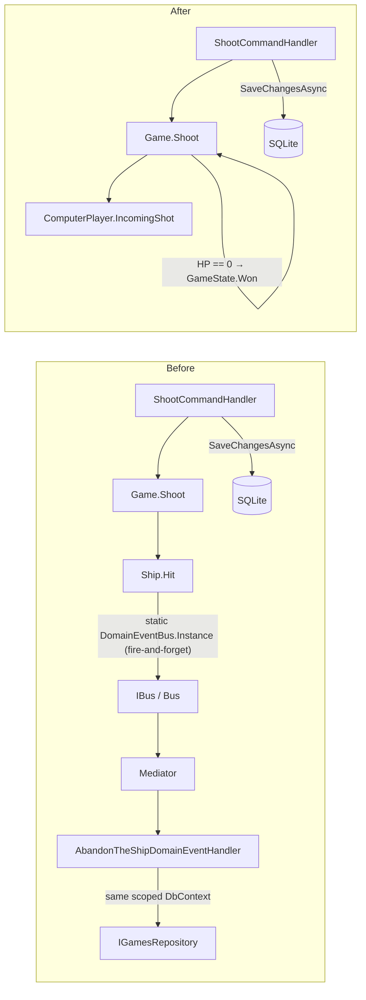
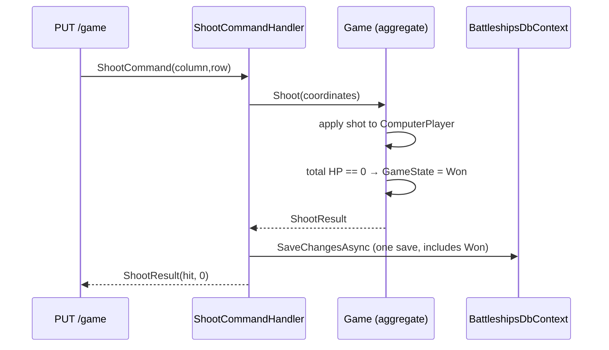

# Modernization Phase 4a: Remove Static Service Locator, Game-over as Aggregate Invariant Plan

**Plan Status**: `FINAL`

**Story Type**: `Internal`

> This plan captures **what** to build and **why** — domain, architecture, decisions, and verified facts.
> It deliberately does **not** contain implementation code, pseudocode, line numbers, mock setups, or test bodies.
> The implementation agent discovers the **how** against live code. See §4 Task Breakdown.

---

## 1. Problem Statement

*   **Context**: Issue #25 was split out of #4 on 2026-10-23 (see `docs/MODERNIZATION.md`, Phase 4, bug 2). Today, game-over is detected by a fire-and-forget domain event. When a ship's hit points reach 0, `Ship` calls `DomainEventBus.Instance.Publish(new AbandonTheShipDomainEvent(Owner?.Game?.Id))` without awaiting it. `DomainEventBus.Instance` resolves `IBus` through a static resolver, set by the web host at startup from `IHttpContextAccessor` (the "bus-resolver seam", D7 of Phase 2). `Bus` forwards the event to Mediator, and `AbandonTheShipDomainEventHandler` (in the Domain assembly) reloads the game through `IGamesRepository` on the **same scoped DbContext**, then calls `Game.Stop()`. This runs while `ShootCommandHandler` is inside `SaveChangesAsync`, which risks concurrent DbContext use. Whether game-over gets persisted is a race.
    *   Also, the event fires for **every** ship sunk, not only the last one. The handler then checks the total HP.
    *   `Ship.Owner` and `ComputerPlayer.Game` back-references exist only so the event can carry the game id. They complicate the EF owned-type mapping (`WithOwner(...)` navigations) and the test builders (`SetOwner` calls).
*   **Goal**: Game-over becomes an invariant of the `Game` aggregate. When a shot leaves the computer fleet with 0 total hit points, `Game.Shoot` sets the game state to `Won`. The command handler's single `SaveChangesAsync` persists it. No event, no bus, no static.
*   **In scope**:
    *   Add a `Won` game state, set by `Game.Shoot`.
    *   Delete `DomainEventBus`, `IDomainEventBus`, `IDomainEvent`, `AbandonTheShipDomainEvent`, `AbandonTheShipDomainEventHandler` and the bus-resolver seam in the web host (`SetCurrentBusResolver` plus `AddHttpContextAccessor`, if nothing else uses it).
    *   Delete the now-unused `IBus` / `Bus` / `IEvent` messaging plumbing.
    *   Remove `Ship.Owner` and `ComputerPlayer.Game` (and their `SetOwner` methods and owner-taking constructors), simplify the EF mapping, and add a migration only if the relational model changes.
    *   Regression tests: domain, persistence round-trip through the shoot command, and DB round-trip of the `Won` state.
*   **Out of scope** (other issues): `AlreadyShot` / `Sunk` shot results and row/column-10 / placement bugs (#4); `/games/{id}` resources, project consolidation, `HumanPlayer` removal, the repository owning `SaveChanges`, the static `GameContextProvider`, the remaining `#pragma` cleanup, modern-C# sweep (#26); HTTP integration tests + coverage gate (#27). No client changes.

### 1.1 Technical Summary

*   **Touched projects**: `Bc.Battleships.Domain`, `Bc.Battleships.Server` (Mediator registration, `Bus`), `Bc.Battleships.Messages` (`IBus`, `IEvent`), `Bc.Battleships.Persistence` (EF mapping, possibly a migration), `Bc.Battleships` (web host DI/startup), the test projects (`Tests.Common` builders, `UnitTests.Domain`, `Tests.Integration.Database`, `Tests.Integration.API`).
*   **New patterns / abstractions**: none. This removes an abstraction: the aggregate enforces its own invariant.
*   **Infrastructure changes**: none expected. `GameState` is stored as an integer column, so a new enum member needs no schema change. A migration is added only if EF reports pending model changes after the mapping is simplified.
*   **End-state observable behavior**: sinking the last ship makes the game `Won` in the database in the same request. `GET /game` then reports no active game with 0 HP, and the client already renders that as "win" (`useGame.selectView`). The contract is unchanged.

---

## 2. Architecture & Design

### 2.1 Architecture Overview

#### Involved services & owners

| Service | Technical Owner |
| :--- | :--- |
| `Bc.Battleships` (single repo: API + domain + persistence + ClientApp) | bcichonski |

#### C2 diagram

Before → after (only the parts that change):

#### Flow diagram

### 2.2 External Contracts & Evidence

N/A — Internal story.

#### Source Conflict Log

| Topic | Source A | Source B | Conflict | Chosen Handling |
| :--- | :--- | :--- | :--- | :--- |
| Terminal state name | Issue #25: "`Game.Shoot` sets `Won`" | Code: `GameState` has only `Active`, `Ended`, and the event handler sets `Ended` | No `Won` member exists | Add `GameState.Won` (D1). `Ended` keeps its current meaning: abandoned when a new game starts. |
| Migration | Issue: "add a migration if the model changes" | Removing navigations on owned types may not change the relational model | Unknown until EF is asked | Let EF decide (D4): add a migration only when EF reports pending model changes. |

### 2.3 Affected Areas

| Area / File (pointer) | Role in this change | Likely action |
| :--- | :--- | :--- |
| `src/Bc.Battleships.Domain/ValueObjects/Enums/GameState.cs` | Game state enum (`Active`, `Ended`). | Change: add `Won` with an explicit value. |
| `src/Bc.Battleships.Domain/AggregateRoots/Games/Game.cs` | Aggregate root; `Shoot` delegates to `ComputerPlayer.IncomingShot`; `CreateNewGame` wires `SetOwner`. | Change: enforce the game-over invariant in `Shoot`; drop owner wiring. |
| `src/Bc.Battleships.Domain/AggregateRoots/Games/Players/ComputerPlayer.cs` | Holds ships and shots; has a `Game` back-reference used to build `FleetFactory`. | Change: remove `Game`, `SetOwner`, and the game ctor parameter; fleet positioning gets the `GameContext` from the caller. |
| `src/Bc.Battleships.Domain/AggregateRoots/Games/Ships/Ship.cs` | Emits the sinking event; has an `Owner` back-reference. | Change: remove `Owner`, `SetOwner`, the owner-taking ctor, and `EmitEventOnSinking`. Shot semantics stay as they are (the re-shot bug is #4). |
| `src/Bc.Battleships.Domain/Services/FleetFactory/FleetFactory.cs` | Builds ships from a `Game`, passing `ComputerPlayer` as owner. | Change: depend on what it actually uses (`GameContext`); build ships without an owner. |
| `src/Bc.Battleships.Domain/Events/**`, `src/Bc.Battleships.Domain/EventHandlers/**` | Static bus, event interface, sinking event, handler. | Delete. |
| `src/Bc.Battleships.Domain/Bc.Battleships.Domain.csproj` | References `Bc.Battleships.Messages` only for the event plumbing. | Change: drop the reference if nothing else in Domain needs it. |
| `src/Bc.Battleships.Messages/IBus.cs`, `IEvent.cs` | Messaging abstractions used only by the domain event path. | Delete. |
| `src/Bc.Battleships.Server/Infrastructure/Bus.cs`, `Services.cs` | `Bus` implementation; Mediator `Assemblies` include Domain (`IDomainEvent`) and Messages (`IEvent`). | Delete `Bus`; Mediator scans only the assemblies that still hold handlers/messages. |
| `src/Bc.Battleships/Infrastructure/Services.cs` | `AddHttpContextAccessor` + `DomainEventBus.SetCurrentBusResolver` (D7 seam). | Change: remove both (keep the accessor only if something else uses it). |
| `src/Bc.Battleships.Persistence/Configurations/GameConfiguration.cs` | Owned-type mapping uses `WithOwner(y => y.Game)` and `WithOwner(z => z.Owner)`. | Change: owner relationships without navigations. |
| `src/Bc.Battleships.Persistence/Migrations/` | Initial migration + snapshot. | Reference / New only if EF reports pending changes. |
| `src/Bc.Battleships.Persistence/Repositories/GamesRepository.cs` | `Get` returns the `Active` game. | Reference: a `Won` game is no longer "current"; no change. |
| `tests/Bc.Battleships.Tests.Common/Builders/*` | Builders call `SetOwner` / pass a game to `ComputerPlayer`. | Change: drop owner wiring. |
| `tests/Bc.Battleships.Tests.Integration.Database/IntegrationTestBase.cs`, `Ships/WhenBeingShootAt.cs` | Substitute `IBus`, `DomainEventBus.Use`, event assertions. | Change / replace event tests with state-based tests. |
| `tests/Bc.Battleships.Tests.Integration.API/ApiIntegrationTestBase.cs`, `ApiTestContext.cs`, `Games/WhenAbandoningTheShip.cs` | Substitute bus, `Bus` accessor, event-driven game-over test. | Change / replace with a shoot-command round-trip test. |
| `tests/Bc.Battleships.UnitTests.Domain/Games/*` | Domain tests for shooting. | Change: add game-over invariant tests. |
| `src/Bc.Battleships/ClientApp/src/hooks/useGame.ts` | `selectView` returns `win` when a previously loaded game reports HP ≤ 0. | Reference only: confirms no client change is needed. |
| `docs/MODERNIZATION.md` | Phase 4 bug list; Phase 2 notes the D7 seam stays "until Phase 4". | Change: mark bug 2 / back-reference removal done (#25). |

### 2.4 Key Algorithms & Behaviour

*   **Game-over invariant**: after `Game.Shoot` applies a shot, if the computer player's total current hit points are 0, the game state becomes `Won`. The check runs on every shot, so the rule doesn't depend on which ship sank.
*   **Monotonic terminal state**: once `Won`, a game never goes back to `Active`. `Shoot` on a `Won` game doesn't change its state. Shot validation for finished games is not part of this story; the API can't reach a finished game anyway, because `GamesRepository.Get` returns only `Active` games.
*   **`Ended` vs `Won`**: `Stop()` (called by `CreateNewGameCommandHandler` on the current active game) keeps setting `Ended`. `Won` means the fleet was destroyed. Neither is "current".
*   **Single unit of work**: the shoot request performs exactly one `SaveChangesAsync`, in `ShootCommandHandler`. Nothing else touches the DbContext during the request.
*   **API behaviour after the last hit**: `PUT /game` returns `ShootResult(hit: true, currentHitPoints: 0)`. A following `GET /game` returns the "no active game" DTO (`isGameActive: false`, `board: null`, `currentHitPoints: 0`), which the client's `selectView` shows as the win screen. The previous design intended exactly this, through `Ended`.
*   **No-data behaviour**: not applicable (no external data).

---

## 3. Key Decisions & Assumptions

*   **D1 — Add `GameState.Won` (explicit value `2`).** The issue names `Won`. `Ended` stays as "abandoned by starting a new game". The explicit numeric value keeps existing rows (`0`, `1`) stable.
*   **D2 — The invariant lives in `Game.Shoot`.** The aggregate root owns state transitions. `ComputerPlayer` and `Ship` stay unaware of the game.
*   **D3 — Delete the whole messaging path, not just the static.** With the sinking event gone, `IDomainEvent`, `IDomainEventBus`, `DomainEventBus`, `AbandonTheShipDomainEvent`, the handler, `IBus`, `Bus`, `IEvent` and the D7 resolver seam have no remaining producer or consumer. Keeping them would be dead code that #26 would have to delete anyway. Mediator stays: commands and queries still use it.
*   **D4 — Migration only on EF evidence.** After the mapping changes, the agent asks EF whether the model has pending changes (`dotnet ef migrations has-pending-model-changes` via `Bc.Battleships.EFMigrationsHelper`, or the equivalent `migrations add` dry check). Pending changes → add a migration named for this story. Otherwise → no migration. A `Won` enum member alone is not a schema change.
*   **D5 — Fleet positioning takes the `GameContext` explicitly.** `ComputerPlayer.PositionShips` currently reaches `Game` only to hand it to `FleetFactory`, which only reads `GameContext` and `ComputerPlayer`. Passing the game context in removes the need for the back-reference. Injecting `Random` / replacing the static `GameContextProvider` is not done here (#4 / #26).
*   **D6 — Regression tests first.** Per the issue, a failing regression test is written before the fix. The progress notes record its observed failure (e.g. state stays `Active` after the last ship sinks).
*   **Assumption A1 — No client change.** Verified from `useGame.selectView`: a win is shown when a game that had a board reports HP ≤ 0, and the "no active game" DTO carries HP 0. Not correctness-blocking.
*   **Assumption A2 — The checkout leftovers from the pre-split #4 run are gone.** The #4 plan (PostgreSQL, project consolidation) is not on `main` and does not apply. This plan builds on `main` (`8bd5e8b`) only.

### 3.1 Decision Lock (Constants & Policies)

| Constant / Policy | Selected Value | Why | Where it lives |
| :--- | :--- | :--- | :--- |
| New terminal state | `GameState.Won = 2` | Issue wording; keeps stored values stable | `GameState` enum |
| Game-over trigger | total computer HP == 0 after a shot | Aggregate invariant; independent of which ship sank | `Game.Shoot` |
| Saves per shoot request | exactly 1 (`ShootCommandHandler`) | Removes concurrent DbContext use | Server command handler |
| Migration policy | only if EF reports pending model changes | Avoid empty migrations | Persistence/Migrations |

### 3.2 Open Questions

No open questions.

---

## 4. Task Breakdown

| Task | Title | Depends on | Complexity |
| :--- | :--- | :--- | :--- |
| `T1` | Game-over as aggregate invariant (`Won`) + regression tests | — | `Medium` |
| `T2` | Delete the event bus, service-locator seam and back-references; simplify the EF mapping | `T1` | `Medium` |

### T1 — Game-over as aggregate invariant (`Won`) + regression tests

*   **Goal**: Sinking the last ship sets the game to `Won` inside the aggregate, and the shoot command persists it in its single save.
*   **Depends on**: `—`.
*   **Complexity**: `Medium`.
*   **Pointers**: `GameState.cs`, `Game.cs`, `ShootCommandHandler.cs` (reference), `tests/Bc.Battleships.UnitTests.Domain/Games/`, `tests/Bc.Battleships.Tests.Integration.API/Games/`, `tests/Bc.Battleships.Tests.Integration.Database/Games/`, `tests/Bc.Battleships.Tests.Common/Builders/`.
*   **Definition of Done**:
    *   Regression tests are written first and observed failing on the unchanged code (record the failure in the task notes).
    *   `GameState.Won` exists with explicit value `2`; existing values are unchanged.
    *   `Game.Shoot` sets `Won` when the computer player's total HP reaches 0. It never changes a `Won` game back.
    *   `Stop()` / `Ended` behaviour is unchanged.
    *   The event plumbing may still exist after this task (T2 removes it). The new tests must not depend on it.
    *   Solution builds with warnings-as-errors; all existing tests pass.
*   **Tests expected**:
    *   **Unit (domain)**: sinking the last remaining ship → `Won`. Sinking a ship while another is afloat → still `Active`. Hit on a non-final compartment and a miss → `Active`. Shooting a `Won` game keeps it `Won`.
    *   **Integration (API project, real Mediator + DbContext)**: a stored game with one compartment left. Sending the `ShootCommand` that sinks it, then reloading the game in a fresh scope, gives `GameState.Won` and HP 0. This is the persistence round-trip the issue asks for. It replaces the intent of `WhenAbandoningTheShip`, which T2 deletes.
    *   **Integration (Database)**: a `Won` game round-trips through the DbContext (stored and reloaded with state `Won`), and `GamesRepository.Get` does not return it as the current game.

### T2 — Delete the event bus, service-locator seam and back-references; simplify the EF mapping

*   **Goal**: No static service locator, domain event, or bus remains. `Ship` and `ComputerPlayer` no longer point back to their owners. The EF mapping uses owned types without back-navigations.
*   **Depends on**: `T1`.
*   **Complexity**: `Medium`.
*   **Pointers**: `src/Bc.Battleships.Domain/Events/**`, `src/Bc.Battleships.Domain/EventHandlers/**`, `Ship.cs`, `ComputerPlayer.cs`, `Game.cs`, `FleetFactory.cs`, `Bc.Battleships.Domain.csproj`, `src/Bc.Battleships.Messages/IBus.cs`, `IEvent.cs`, `src/Bc.Battleships.Server/Infrastructure/Bus.cs`, `Services.cs`, `src/Bc.Battleships/Infrastructure/Services.cs`, `GameConfiguration.cs`, `src/Bc.Battleships.Persistence/Migrations/`, `src/Bc.Battleships.EFMigrationsHelper/`, test builders and test bases (§2.3), `docs/MODERNIZATION.md`.
*   **Definition of Done**:
    *   Deleted: `DomainEventBus`, `IDomainEventBus`, `IDomainEvent`, `AbandonTheShipDomainEvent`, `AbandonTheShipDomainEventHandler`, `IBus`, `Bus`, `IEvent`. No reference to them remains in `src/` or `tests/`.
    *   The web host no longer sets a bus resolver. `AddHttpContextAccessor` is removed unless something else needs it.
    *   Mediator registration scans only the assemblies that still contain handlers or messages. Commands and queries work end to end (existing API/HTTP tests pass).
    *   `Ship.Owner`, `Ship.SetOwner`, the owner-taking `Ship` ctor, `ComputerPlayer.Game` and `ComputerPlayer.SetOwner` are removed. `ComputerPlayer`'s public ctor no longer takes a game. Fleet positioning receives the `GameContext` (D5).
    *   Domain no longer references `Bc.Battleships.Messages` (unless something non-event still needs it, which must be justified in the task notes). Domain has no Mediator dependency.
    *   `GameConfiguration` maps the owned `ComputerPlayer` / `Ships` without back-navigations, and the column/table names are unchanged.
    *   EF pending-model-changes check run per D4. Result recorded in the task notes, and a migration added only when changes are reported. `WhenApplyingMigrations` still passes.
    *   Event-based tests (`Ships/WhenBeingShootAt` event assertions, `WhenAbandoningTheShip`) are deleted or rewritten as state-based tests. Builders no longer wire owners. No `NSubstitute` bus substitutes remain (drop the package reference only if nothing else uses it).
    *   `docs/MODERNIZATION.md`: Phase 4 bug 2 and the "remove the back-references" bullet are marked done (#25), and the Phase 2 note that the static event bus stays "until Phase 4" is updated to say it was removed.
    *   Solution builds with warnings-as-errors. All .NET tests and the client lint/build/test pass. No client source changes.
*   **Tests expected**:
    *   **Unit (domain)**: fleet positioning still produces the configured fleet without an owner reference (existing positioning tests, adjusted).
    *   **Integration (Database)**: a game with ships and shots round-trips through EF after the mapping change, with compartments and shot coordinates intact. Migrations apply on an empty database.
    *   T1's regression tests still pass unchanged in intent.

---

## 5. Verification

*   **Build**: `dotnet build Bc.Battleships.slnx` with no errors or warnings (TreatWarningsAsErrors is on).
*   **Tests**: `dotnet test Bc.Battleships.slnx`, all green (domain unit, Database integration, API integration including the HTTP tests).
*   **Client**: in `src/Bc.Battleships/ClientApp`: `npm ci`, `npm run lint`, `npm run build`, `npm test`. All green, with no client source changes.
*   **Static check**: no matches for `DomainEventBus|IDomainEvent|AbandonTheShip|IBus|SetOwner|HttpContextAccessor` in `src/` and `tests/` (except a justified, documented `HttpContextAccessor` use).
*   **Observable behaviour**: in the shoot-command integration test, after the sinking shot a fresh scope loads the game with `GameState.Won`.

---

## 6. Fact-Integrity Checklist

| Check | Yes / No / N/A | Notes |
| :--- | :--- | :--- |
| External contracts (routes, payload type ids, DTO fields, identifier types) verified from producer/contract source — not story text | N/A | Internal story |
| Evidence sources are reproducible (exact repo file path/symbol) | N/A | Internal story |
| Identifier directionality / ordering / freshness **meaning** evidenced separately from field shape, or moved to an Open Question | N/A | Internal story |
| Every `Assumption` is linked to an Open Question (§3.2) | Yes | A1 was verified from `useGame.ts`; A2 is a scope note. Neither affects correctness. |
| No unresolved Open Questions (for `FINAL`) | Yes | |
| Each Decision states a single committed approach | Yes | D4 commits to a rule (EF decides), not to two options |
| Tasks are independent, each with a Definition of Done and test expectations | Yes | T2 depends on T1 by design (tests first) |
| Required infra reflected: toggle-gated where the story carries a toggle key; new Service Bus subscription/queue ⇒ a task updates `infrastructure.bicep` | N/A | No toggle, no messaging infrastructure |

**Self-review note**: The main uncertainty is whether removing the owned-type back-navigations changes EF's relational model. D4 lets EF decide, and the T2 agent should check the generated migration (if any) for unexpected column renames of the shadow owner keys. The other area needing care is Mediator's source-generated registration: after Domain stops containing handlers, `options.Assemblies` must still include the assemblies with commands, queries and handlers, or requests will fail at runtime. The existing API/HTTP tests catch that.
