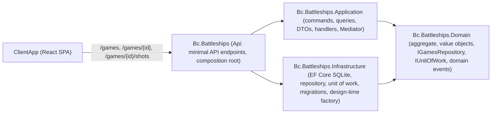
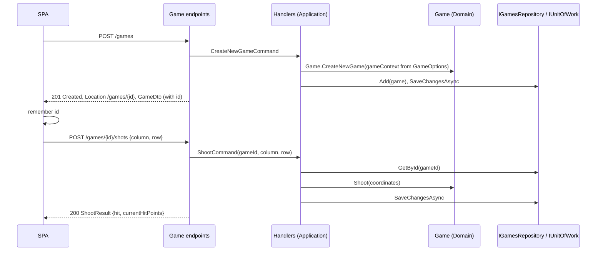

# Modernization Phase 4c: Design Refactoring Plan

**Plan Status**: `FINAL`

**Story Type**: `Internal`

> This plan captures **what** to build and **why** — domain, architecture, decisions, and verified facts.
> It deliberately does **not** contain implementation code, pseudocode, line numbers, mock setups, or test bodies.
> The implementation agent discovers the **how** against live code. See §4 Task Breakdown.

---

## 1. Problem Statement

*   **Context**: Issue #26 was split out of #4 and covers the **Design** items of `docs/MODERNIZATION.md` → Phase 4. Its dependencies are merged on `main` (`860845d`): #25 (static service locator and back-references removed) and #4 (domain bug fixes: explicit shot results, injectable `Random`, whole-board placement). Verified against the code on `main`:
    1.  **One global "current game".** `GameEndpoints` maps `GET/PUT/POST /game`. `IGamesRepository.Get` returns the first game with `GameState.Active`; `CreateNewGameCommandHandler` stops it and creates a new one. Two browsers share and fight over one game.
    2.  **Static game context.** `GameContextProvider` is a `static` class holding a board size of 10. `Game.GameContext` is initialised from it and is ignored by EF. `GameContext` hard-codes the ship blueprints (4, 4, 5).
    3.  **`#pragma warning disable CS8618/CS8601`** blocks in `Game`, `ComputerPlayer`, `ShotCoordinates`, `Ship` and `ShipCompartment` around the EF private constructors.
    4.  **`ShootCommandHandler` depends on `BattleshipsDbContext`** to call `SaveChangesAsync`. `GamesRepository.Add` saves on its own.
    5.  **Six projects for ~1k LoC**: `Domain`, `Messages`, `Server`, `Persistence`, `EFMigrationsHelper` (an `Exe` with a "Hello, World!" `Program.cs` that only hosts the `IDesignTimeDbContextFactory`), and the web app `Bc.Battleships`. `Domain` references `Messages` only for `IEvent` / `IBus`.
    6.  **Six near-identical `ValueConverter` classes** in `Persistence/Configurations/Converters` (four Guid ids, `Coordinates`, `Length`), wired per property in `GameConfiguration`. `GameId` is a `record` class with a public setter; `PlayerId`, `ShipId` and `ShipCompartmentId` are mutable `struct`s.
    7.  **Old C# style**: block-scoped namespaces everywhere, explicit constructors and fields, `new List<…>()` initialisers.
*   **Goal**: Implement every checklist item of #26: game resources (`POST /games`, `GET /games/{id}`, `POST /games/{id}/shots`) with the client and e2e updated, `GameContextProvider` replaced by options, no nullable suppressors, a unit of work that owns `SaveChanges`, consolidated projects, one strongly-typed-id convention, and modern C# — with no change to gameplay rules.
*   **In scope**: all `src/` backend projects, the solution file, the ClientApp API client, state hook and tests, the Playwright e2e, the Vite dev proxy, README, `docs/MODERNIZATION.md` and `docs/specs/memory/design-decisions.md`.
*   **Out of scope**: `HumanPlayer` stays (decided in #4 for the two-sided game, #5) — no behaviour is added to it. Two-sided play (#5). The coverage gate and the remaining test work (#27). Renaming the web project to `Bc.Battleships.Api` or moving the client to `web/` (see Decision D3). Listing games, deleting games, authentication or game ownership.

### 1.1 Technical Summary

*   **Touched projects**: `Bc.Battleships.Domain`; new `Bc.Battleships.Application` (from `Messages` + `Server`); `Bc.Battleships.Persistence` renamed to `Bc.Battleships.Infrastructure` (absorbs `EFMigrationsHelper`); the web app `Bc.Battleships` (the API, plus `ClientApp`); all four test projects.
*   **New patterns / abstractions**: REST game resources addressed by `GameId`; `IUnitOfWork` owning `SaveChangesAsync`; `GameOptions` bound from configuration; one generic Guid-id `ValueConverter` applied by convention in `ConfigureConventions`.
*   **Infrastructure changes**: no database schema change and **no new migration** (the EF model must stay identical; checked with `dotnet ef migrations has-pending-model-changes`). The CI workflow needs no change (it builds the solution file; ClientApp paths are unchanged).
*   **End-state observable behaviour**: `POST /games` returns `201 Created` with a `Location` of `/games/{id}` and the new game in the body. `GET /games/{id}` returns that game, or `404`. `POST /games/{id}/shots` returns the shot result, `404` for an unknown game and `409` for a game that is no longer active. Two browsers play independent games. The SPA remembers its game id across a reload.

---

## 2. Architecture & Design

### 2.1 Architecture Overview

#### Involved services & owners

| Service | Technical Owner |
| :--- | :--- |
| `Bc.Battleships` (single ASP.NET Core app + Vite SPA) | bcichonski |

#### C2 diagram (target project graph)

`Application` does **not** reference `Infrastructure`. `Domain` references nothing but `Mediator.Abstractions` (for `IEvent : INotification`, D4).

#### Flow diagram (happy path: new game, then a shot)

### 2.2 External Contracts & Evidence

N/A — Internal story. The only contract is this app's own HTTP API, consumed by its own SPA (both change together); it is locked in §3.1.

#### Source Conflict Log

| Topic | Story text | Repository | Resolution |
| :--- | :--- | :--- | :--- |
| `EFMigrationsHelper` destination | "→ `IDesignTimeDbContextFactory` in Persistence" | Target layout names `Infrastructure`, not `Persistence` | Persistence **is** renamed Infrastructure (D3); the factory goes there. Same intent. |
| Project target "Api" | "Target: Domain / Application / Infrastructure / Api" | Web project `Bc.Battleships` hosts `ClientApp`; CI, Dependabot, README and Playwright use `src/Bc.Battleships/ClientApp` | The web project plays the Api role under its current name (D3). |
| `IEvent` / `IBus` | Messages → Application | `Domain` depends on them (`IDomainEvent : IEvent`, `DomainEventBus` uses `IBus`) | They move into `Domain/Events` (D4), not Application, or the dependency would point inwards-out. |

### 2.3 File Pointers

*   Endpoints: `src/Bc.Battleships/Infrastructure/GameEndpoints.cs`; composition root `src/Bc.Battleships/Infrastructure/Services.cs`, `App.cs`, `ConfigurationProvider.cs`, `appsettings.json`.
*   Handlers / messages: `src/Bc.Battleships.Server/**`, `src/Bc.Battleships.Messages/**` → `src/Bc.Battleships.Application/**`.
*   Persistence: `src/Bc.Battleships.Persistence/**` → `src/Bc.Battleships.Infrastructure/**`; `src/Bc.Battleships.EFMigrationsHelper/BattleshipsDbContextFactory.cs`, `DesignTimePersistenceConfigurationProvider.cs`.
*   Domain: `src/Bc.Battleships.Domain/AggregateRoots/Games/**`, `Services/GameContextProvider.cs`, `ValueObjects/GameContext/**`, `ValueObjects/Ids/**`, `Repositories/IGamesRepository.cs`, `Events/**`, `InternalsVisibleToAssemblyInfo.cs`.
*   Solution: `Bc.Battleships.slnx`, `Directory.Packages.props`.
*   Client: `src/Bc.Battleships/ClientApp/src/api/gameApi.ts` (+ test), `src/hooks/useGame.ts`, `src/logic/types.ts`, `src/App.test.tsx`, `vite.config.ts` (dev proxy), `e2e/smoke.spec.ts`, `playwright.config.ts` (its comment mentions `GET /game`).
*   Tests: `tests/Bc.Battleships.Tests.Integration.API/**` (HTTP tests in `GameEndpointsTests.cs`, Mediator-level tests under `Games/`), `tests/Bc.Battleships.Tests.Integration.Database/**`, `tests/Bc.Battleships.UnitTests.Domain/**`, `tests/Bc.Battleships.Tests.Common/**`.
*   Docs: `README.md` (project list and mermaid graph), `docs/MODERNIZATION.md` (Phase 4 Design checklist), `docs/specs/memory/design-decisions.md` (domain events section names `Messages` / `Server`).

### 2.4 Key Algorithms / Behaviour

*   **Game lookup** is always by id. The repository's "first active game" query goes away. Creating a game no longer stops any other game.
*   **Shot on a non-active game** (`Won` or `Ended`) is rejected before the aggregate is touched: no shot is recorded, nothing is saved, the API answers `409`. Shots on an active game behave exactly as today (`Miss / Hit / Sunk / AlreadyShot` mapped to `{hit, currentHitPoints}` as in #4).
*   **`isGameActive`** in `GameDto` reflects `GameState == Active` (today it is always `true` for a loaded game, because only active games could be loaded). A won game returned by `GET /games/{id}` therefore has `isGameActive: false`, its board, and `currentHitPoints: 0`.
*   **Game context**: the board size and ship lengths come from `GameOptions`. `Game` no longer reads a static; whoever creates a game passes the `GameContext` built from options. The board size used to render a loaded game also comes from options (D6).
*   **Strongly-typed ids**: every Guid id type shares one shape (an immutable value type wrapping a `Guid`, with a factory for a new id) so a **single generic converter** maps any of them, applied once per id type in `ConfigureConventions`. `Coordinates` and `Length` keep their own conversions but are registered in `ConfigureConventions` too, so `GameConfiguration` no longer names converters per property.

---

## 3. Key Decisions & Assumptions

*   **D1 — Resource API replaces `/game` outright.** `GET/PUT/POST /game` are removed, not kept as aliases. The SPA is the only client and changes in the same PR.
*   **D2 — The SPA remembers its game id in `localStorage`** (key locked in §3.1), read and written inside `try/catch`. On load: no stored id → the "No game in progress" view with no request at all; a stored id → `GET /games/{id}`; a `404` clears the stored id and shows the "No game in progress" view (not an error). `POST /games` stores the new id. Rationale: the smallest change that keeps today's behaviour (a reload resumes the game) without a global current game. A URL-based id (`/?game=…`) was considered and rejected for this story: it adds routing to a single-screen app that dropped react-router in #3.
*   **D3 — Project layout: `Domain`, `Application`, `Infrastructure`, and the web project `Bc.Battleships` as the Api.** `Messages` + `Server` merge into `Bc.Battleships.Application`; `Persistence` is renamed `Bc.Battleships.Infrastructure` (project, folder, namespaces, `InternalsVisibleTo`, test references) and gains the design-time factory; `EFMigrationsHelper` is deleted. The web project keeps its name: renaming it moves `ClientApp` and touches CI, Dependabot, Playwright and README paths for no design gain, and the "(+ `web/`)" client move in `docs/MODERNIZATION.md` is a separate step. Record this deviation in `docs/MODERNIZATION.md`.
*   **D4 — `IEvent` and `IBus` move into `Domain/Events`**, and `Domain` takes a package reference on `Mediator.Abstractions`. The domain-events infrastructure (`IEvent`, `IBus`, `IDomainEvent`, `IDomainEventBus`, `DomainEventBus`, the Mediator-backed `Bus` and its DI wiring) is **kept** — owner decision recorded in `design-decisions.md`; do not delete any of it as dead code. `Bus` (Mediator adapter) lives in Application. Update the domain-events section of `design-decisions.md` with the new project names.
*   **D5 — Unit of work.** `IUnitOfWork` (one method, `SaveChangesAsync(CancellationToken)`) is declared next to `IGamesRepository` in Domain and implemented in Infrastructure over the scoped `BattleshipsDbContext`. `IGamesRepository.Add` only tracks the game (no save). Handlers call `IUnitOfWork.SaveChangesAsync` once per command. No handler references `BattleshipsDbContext` or any Infrastructure type, which the project graph (D3) enforces at compile time.
*   **D6 — `GameOptions`** (section name and defaults locked in §3.1) replaces `GameContextProvider`, which is deleted. Bound with the options pattern and validated on start (board size ≥ 1, at least one ship, each ship length ≥ 1 and ≤ board size). The default values reproduce today's game exactly, so no configuration file needs the section. Board size is **not** persisted per game (no schema change); changing the configuration while games exist is unsupported. **Assumption**: acceptable for a single-instance demo app — a low-stakes call, not an Open Question.
*   **D7 — Error shape.** `404` and `409` responses use ASP.NET Core `ProblemDetails` (`Results.NotFound()` / `Results.Conflict()` with problem details, or `TypedResults`), no custom error DTO. Handlers report "not found" / "not active" through their return value (e.g. a nullable result or a small outcome type), not exceptions; the endpoint maps it to the status code. The `GAME_ENDED = -1` sentinel in `ShootResult` is removed.
*   **D8 — No Vogen.** The single generic converter covers the four Guid ids without a new source-generator dependency. Ids become immutable (`readonly record struct` style), so the public setters on `Value` go away.
*   **D9 — Pragmas.** Remove every `#pragma warning disable CS8618/CS8601` in `src/`. Prefer EF constructor binding where it fits; otherwise `= null!` on the members set only by EF, scoped to the private parameterless constructor's members. `ComputerPlayer.Ships` stays nullable-before-positioning only if positioning still needs it; otherwise make it non-null. Behaviour must not change.
*   **D10 — Modern C# sweep** covers `src/` and `tests/`, excluding the generated EF files in `Migrations/` (their namespace changes with D3 but their bodies stay generated). File-scoped namespaces, primary constructors where they replace plain field-assigning constructors, records for value objects, collection expressions. No behaviour change, no public-contract change. `EnforceCodeStyleInBuild` stays `false`.
*   **Assumption (AC gap)**: The issue does not specify status codes, the response body of `POST /games`, or what shooting a finished game does. §3.1 locks the most conventional REST reading; none of it is a product decision.

### 3.1 Decision Lock (Constants & Policies)

| Constant / Policy | Selected Value | Why | Where it lives |
| :--- | :--- | :--- | :--- |
| Create game | `POST /games` → `201 Created`, `Location: /games/{id}`, body = `GameDto` with `id` | Saves the SPA a follow-up GET | `GameEndpoints` |
| Read game | `GET /games/{id}` → `200 GameDto`; unknown id → `404` | REST | `GameEndpoints` |
| Shoot | `POST /games/{id}/shots`, body `{ column, row }` (0-based, as today) → `200 { hit, currentHitPoints }`; unknown id → `404`; game not `Active` → `409` | Keeps the shot body and result unchanged | `GameEndpoints`, `ShootCommandHandler` |
| Malformed id in route | `{id:guid}` route constraint → `404` from routing | No custom parsing | `GameEndpoints` |
| `GameDto` JSON | `{ id, isGameActive, currentHitPoints, board }` (`id` added, a Guid string) | Client needs the id | `Application` DTOs, `ClientApp/src/logic/types.ts` |
| `isGameActive` | `GameState == Active` | §2.4 | DTO converter |
| Removed routes | `GET`, `PUT`, `POST` `/game` | D1 | — |
| Game id storage (SPA) | `localStorage` key `battleships.gameId` | D2 | `useGame.ts` (or a tiny helper next to it) |
| Vite dev proxy | proxies `/games` (replacing `/game`) | Route rename | `vite.config.ts` |
| Options section | `Game` with `BoardSize` (default `10`) and `ShipLengths` (default `[4, 4, 5]`) | Today's values | `GameOptions` (Application or Domain), bound in the composition root |
| Error body | `ProblemDetails` | D7 | `GameEndpoints` |
| EF model | unchanged; no new migration | Schema stays | `Infrastructure` |
| Project names | `Bc.Battleships.Domain`, `Bc.Battleships.Application`, `Bc.Battleships.Infrastructure`, `Bc.Battleships` (Api) | D3 | `Bc.Battleships.slnx` |

### 3.2 Open Questions

No open questions. Resolution attempts: the AC (issue body) fixes the routes, the project targets and the `HumanPlayer` decision; `docs/MODERNIZATION.md` → Phase 4 Design supplies the rest; `design-decisions.md` settles the domain-events question (keep the infrastructure). Status codes, the id storage and the options shape are conventional engineering choices locked in §3.1, not stakeholder decisions.

---

## 4. Task Breakdown

| Task | Title | Depends on | Complexity |
| :--- | :--- | :--- | :--- |
| `T1` | Consolidate projects: Application, Infrastructure, design-time factory | — | `Medium` |
| `T2` | Strongly-typed id convention and nullable-suppressor removal | `T1` | `Medium` |
| `T3` | `GameOptions` replaces the static `GameContextProvider` | `T2` | `Medium` |
| `T4` | Game resources API and unit of work (backend) | `T3` | `High` |
| `T5` | Client and e2e on the game resources API | `T4` | `Medium` |
| `T6` | Modern C# sweep and docs | `T4` | `Medium` |

### T1 — Consolidate projects: Application, Infrastructure, design-time factory

*   **Goal**: The solution has exactly four `src/` projects — `Domain`, `Application`, `Infrastructure`, and the web app — with no behaviour change.
*   **Depends on**: `—`.
*   **Complexity**: `Medium`.
*   **Pointers**: §2.3 (Handlers / messages, Persistence, Domain events, Solution); D3, D4. `Bc.Battleships.slnx`; every `*.csproj` `ProjectReference` in `src/` and `tests/`; `Server/Infrastructure/Services.cs` (Mediator `options.Assemblies`); `Domain/InternalsVisibleToAssemblyInfo.cs` and any `InternalsVisibleTo` on the moved projects (`ShootCommandHandler` is `internal`); `src/Bc.Battleships/Infrastructure/Services.cs` (aliases `HandlersServices` / `PersistenceServices`).
*   **Definition of Done**:
    *   `Bc.Battleships.Application` contains what was in `Messages` and `Server`; both old projects are deleted from disk and from the solution. The Mediator source generator runs in Application and still discovers handlers in Application and Domain.
    *   `IEvent` and `IBus` live in `Domain/Events`; `Domain` no longer references any other project and references `Mediator.Abstractions`. All domain-events types are kept (D4).
    *   `Bc.Battleships.Persistence` is renamed `Bc.Battleships.Infrastructure` (folder, project, root namespace, namespaces of all its files including the `Migrations/` files and model snapshot). The migration ids and bodies are unchanged.
    *   The `IDesignTimeDbContextFactory<BattleshipsDbContext>` lives in Infrastructure; `EFMigrationsHelper` is deleted. `dotnet ef migrations has-pending-model-changes --project src/Bc.Battleships.Infrastructure` (run from the repo root, with `--startup-project` set to Infrastructure or the web project, whichever works) reports **no pending changes**. Record the working command in the README.
    *   `Application` does not reference `Infrastructure`. Today `ShootCommandHandler` uses `BattleshipsDbContext`; until T4 introduces the unit of work, the smallest bridge is acceptable **only inside T1** if needed to compile (e.g. a temporary `IUnitOfWork` may be introduced here already — if so, T4 just reuses it). It must not leave Application referencing Infrastructure.
    *   Solution builds with `TreatWarningsAsErrors`; all existing tests pass unchanged in behaviour (test project references updated).
    *   README project list and mermaid graph show the new layout. `design-decisions.md` domain-events section uses the new project names.
*   **Tests expected**: none new; the full existing suite is the regression net. Add one assertion-light check only if useful (e.g. the Mediator wiring test still resolves `IDomainEventBus`).

### T2 — Strongly-typed id convention and nullable-suppressor removal

*   **Goal**: One generic converter maps every Guid id by convention, ids are immutable, and no `#pragma warning disable CS8618/CS8601` remains in `src/`.
*   **Depends on**: `T1`.
*   **Complexity**: `Medium`.
*   **Pointers**: `Domain/ValueObjects/Ids/*`; `Infrastructure/Configurations/Converters/*`, `GameConfiguration.cs`, `BattleshipsDbContext.cs` (`ConfigureConventions`); entity classes listed in §1 item 3; `tests/Bc.Battleships.Tests.Common/Extensions/PrivateMembersExtensions.cs` and builders (they may set ids or private members); D8, D9.
*   **Definition of Done**:
    *   `GameId`, `PlayerId`, `ShipId`, `ShipCompartmentId` share one immutable shape; a single generic `ValueConverter` handles all four, registered once per type in `ConfigureConventions`. The four per-id converter classes are deleted. `Coordinates` and `Length` conversions are registered in `ConfigureConventions`; `GameConfiguration` no longer calls `HasConversion` with a per-property converter class (the shadow `OwnerGameId` key may still need its type configured — keep whatever EF requires).
    *   `dotnet ef migrations has-pending-model-changes` reports **no pending changes** (same command as T1). If EF reports a difference, fix the mapping, do not add a migration.
    *   No `#pragma warning disable` for CS8618/CS8601 anywhere in `src/` (`rg 'pragma warning disable CS86' src` is empty); no `!`-suppression added on public members.
    *   All tests pass.
*   **Tests expected**: database integration tests round-trip a game (ids, coordinates, lengths, compartment states) through SQLite — extend `tests/Bc.Battleships.Tests.Integration.Database` with one round-trip assertion on id equality if none exists. Domain unit tests: id equality/value semantics if the type shape changed.

### T3 — `GameOptions` replaces the static `GameContextProvider`

*   **Goal**: Board size and fleet come from configuration with today's defaults; no static game context remains.
*   **Depends on**: `T2`.
*   **Complexity**: `Medium`.
*   **Pointers**: `Domain/Services/GameContextProvider.cs` (delete), `Domain/ValueObjects/GameContext/*`, `Game.cs` (`GameContext` property and `CreateNewGame`), `FleetFactory.cs`, `CreateNewGameCommandHandler`, `GameToGameDtoConverter`, the web app composition root; unit tests `WhenPositioningFleet*`, `Tests.Common` builders; D6, §3.1 options row.
*   **Definition of Done**:
    *   `GameOptions` (`BoardSize`, `ShipLengths`) bound from section `Game`, validated on start (D6); defaults equal today's game (10, `[4, 4, 5]`).
    *   `GameContext` is built from options and passed to game creation; `GameContext` no longer hard-codes blueprints. `Game` no longer exposes a statically-initialised `GameContext` (EF ignore entry removed if the property goes).
    *   The DTO converter takes the board size from the options-built context, not from a static.
    *   `GameContextProvider` is deleted; `rg GameContextProvider` finds nothing in `src/` or `tests/`.
    *   EF model unchanged (same check as T1).
*   **Tests expected**: unit — fleet placement honours a non-default context (e.g. a smaller board or different ship lengths); options validation rejects an invalid configuration (board size 0, ship longer than the board). API (HTTP, `WebApplicationFactory`) — overriding `Game:BoardSize` in configuration yields a board of that size.

### T4 — Game resources API and unit of work (backend)

*   **Goal**: The API exposes `POST /games`, `GET /games/{id}`, `POST /games/{id}/shots` per §3.1, handlers persist through `IUnitOfWork`, and the global current game is gone.
*   **Depends on**: `T3`.
*   **Complexity**: `High` — it changes the public contract and the game lifecycle.
*   **Pointers**: `GameEndpoints.cs`; Application commands, queries, DTOs and handlers (`CreateNewGameCommand`, `ShootCommand`, `GetCurrentGameQuery` → a by-id query, `ShootResult`, `GameDto`, `GameToGameDtoConverter`); `IGamesRepository`, `GamesRepository`, Infrastructure `Services.cs`; API tests `GameEndpointsTests.cs` and `Games/*`; D1, D5, D7, §2.4, §3.1.
*   **Definition of Done**:
    *   Routes, status codes, `Location` header and bodies exactly as §3.1; `/game` routes removed. `{id:guid}` route constraint.
    *   `IGamesRepository` has no "current/first active game" method; lookup is by id. `Add` does not save.
    *   `IUnitOfWork.SaveChangesAsync` implemented in Infrastructure, registered scoped, used by both command handlers; no handler or Application type references `BattleshipsDbContext`.
    *   Creating a game does not change any other game's state.
    *   Shooting a non-active game returns `409`, records nothing and saves nothing. Unknown id → `404` on read and shoot.
    *   `GameDto.isGameActive` reflects the game state; `GameDto.id` present.
    *   The `GAME_ENDED` sentinel is gone.
    *   OpenAPI document (Development) lists the three operations with their response types.
*   **Tests expected**: API integration over HTTP (`WebApplicationFactory`, per-test SQLite file as in `GameEndpointsTests`): create returns 201 + Location + body with id and board; get by id returns the same game; get unknown id → 404; get malformed id → 404; shot on unknown id → 404; a shot changes only the targeted game (two games created, one shot, the other game unchanged); shot after the game is won → 409 and hit points unchanged; a won game reads back with `isGameActive: false`. Convert or delete the existing Mediator-level `/game`-era tests under `Games/` so nothing still exercises the removed "current game" path. Database integration: `Add` + `SaveChangesAsync` through the unit of work persists; `Add` alone does not.

### T5 — Client and e2e on the game resources API

*   **Goal**: The SPA plays through the new routes, keeps its game id across reloads (D2), and the Playwright smoke test passes against the real backend.
*   **Depends on**: `T4`.
*   **Complexity**: `Medium`.
*   **Pointers**: `ClientApp/src/api/gameApi.ts` (+ test), `src/hooks/useGame.ts`, `src/logic/types.ts`, `src/App.test.tsx`, `vite.config.ts`, `e2e/smoke.spec.ts`, `playwright.config.ts`; §3.1 client rows; memory notes for this repo: run npm only in the foreground, never leave background npm/vite processes, set `VITE_CACHE_DIR` to a scratchpad dir for dev server / Playwright runs.
*   **Definition of Done**:
    *   API client: `createGame()` → `POST /games`, returns the `GameDto` (with id); `getGame(id)` → `GET /games/{id}`; `shoot(id, command)` → `POST /games/{id}/shots`. `ApiError` keeps the method/status message shape, with the actual path.
    *   `useGame`: D2 behaviour (no request without a stored id; 404 clears it and shows "No game in progress"; create stores the id; no follow-up GET after create). The double-click guard and win detection keep working; a reload of a won game shows "You win!".
    *   Vite proxy forwards `/games`; nothing in `ClientApp/src` or `e2e` references `/game` as a route.
    *   `npm run lint`, `npm run build`, `npm test` and `npm run test:e2e` pass. The e2e also covers: reload mid-game resumes the same board (hit points unchanged after reload).
*   **Tests expected**: Vitest — API client calls per route (method, path, body), error status propagation; App/hook — initial load without stored id sends no request, with stored id sends `GET /games/{id}`, 404 clears the id and shows the no-game view, start new game sends exactly one `POST /games` and no GET, shots go to `/games/{id}/shots`. Playwright — the existing full-game smoke on the new API, plus the reload-resume check.

### T6 — Modern C# sweep and docs

*   **Goal**: All C# in `src/` and `tests/` (except generated migration bodies) uses file-scoped namespaces, primary constructors, records for value objects and collection expressions; docs reflect the finished phase.
*   **Depends on**: `T4` (sweeps the final backend code; may run in parallel with `T5`, which touches only `ClientApp`).
*   **Complexity**: `Medium` (mechanical but wide; `TreatWarningsAsErrors` and analyzers must stay green).
*   **Pointers**: every `*.cs` under `src/` and `tests/`; D10; `docs/MODERNIZATION.md` Phase 4 Design list and the Phase 4 heading; `README.md`.
*   **Definition of Done**:
    *   No block-scoped `namespace … {` in `src/` or `tests/` outside `Migrations/` (`rg -n '^namespace .*[^;]$' src tests -g '!**/Migrations/**'` is empty).
    *   Plain field-assigning constructors in handlers, repositories, services and tests converted to primary constructors where it does not hide validation (null-guard constructors may keep their guards or drop them where DI guarantees non-null — behaviour unchanged).
    *   Value objects (`Coordinates`, `Length`, `HitPoints`, ids, `GameContext`, `ShipBlueprint`) are records; list initialisers use collection expressions where the analyzer allows.
    *   No public API or JSON contract change; full suite green.
    *   `docs/MODERNIZATION.md`: Phase 4 Design items ticked with "(done in #26)", the D3 project-name deviation recorded, the `Recommended order` line about `/games/{id}` left accurate. README updated if T1 left anything stale.
*   **Tests expected**: none new; existing suites must pass unchanged.

---

## 5. Verification

*   **Build**: `dotnet build Bc.Battleships.slnx -c Release` — no errors, no warnings (`TreatWarningsAsErrors`).
*   **Tests**: `dotnet test Bc.Battleships.slnx -c Release` — all green (domain unit, database integration, API integration).
*   **EF model**: `dotnet ef migrations has-pending-model-changes` (command from the README, T1) — no pending changes; `Migrations/` contains only the 2022 migration and snapshot.
*   **Client**: from `src/Bc.Battleships/ClientApp`: `npm ci`, `npm run lint`, `npm run build`, `npm test`, `npm run test:e2e`.
*   **Structure**: `Bc.Battleships.slnx` lists four `src/` projects; `rg -n 'GameContextProvider|pragma warning disable CS86|BattleshipsDbContext' src/Bc.Battleships.Application` is empty; `rg -n '"/game"' src` is empty.
*   **Observable behaviour**: two clients each `POST /games` and shoot their own game without affecting the other; `GET /games/{unknown}` → 404; shooting a won game → 409.

---

## 6. Fact-Integrity Checklist

| Check | Status | Notes |
| :--- | :--- | :--- |
| Every AC item maps to a task | Yes | Resources → T4/T5; options → T3; pragmas → T2; unit of work → T4 (D5); `HumanPlayer` kept → out of scope note; consolidation → T1; id convention → T2; modern C# → T6 |
| Facts about current code verified against `main` | Yes | §1 items 1–7 read from source at `860845d` |
| External contracts verified | N/A | Internal story |
| No unresolved Open Questions | Yes | §3.2 |
| No `Assumption` blocks in §2.2 | Yes | N/A |
| Decisions are single-choice, no hedging | Yes | D1–D10 |
| Each task has Depends on, Complexity, Definition of Done, test expectations | Yes | T1–T6 |
| Required infra reflected (toggle, bicep) | N/A | No toggle key, no Service Bus |

**Self-review note**: The riskiest part is keeping the EF model byte-identical while renaming the Persistence namespace (T1) and reshaping the id types (T2) — `has-pending-model-changes` is the gate; a pending change means the mapping is wrong, not that a migration is due. T4 changes the game lifecycle: be careful that the 409 check happens before `Game.Shoot` mutates state. The domain-events types look unused but are kept by owner decision (D4). Board size from options at read time (D6) is a deliberate simplification.
