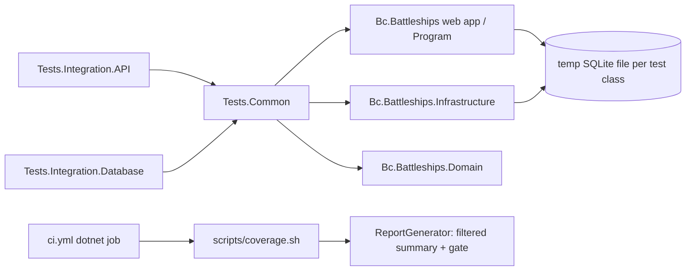
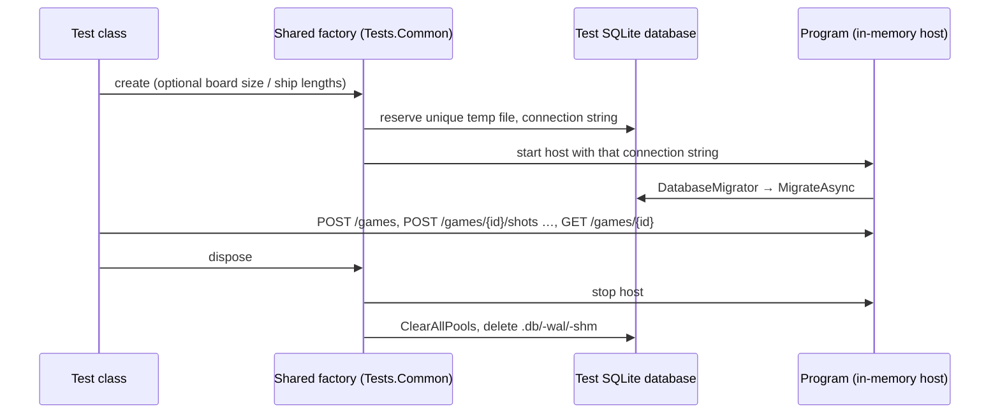

# Modernization Phase 4d: HTTP Integration Tests and Coverage Gate Plan

**Plan Status**: `FINAL`

**Story Type**: `Internal`

> This plan captures **what** to build and **why** — domain, architecture, decisions, and verified facts.
> It deliberately does **not** contain implementation code, pseudocode, line numbers, mock setups, or test bodies.
> The implementation agent discovers the **how** against live code. See §4 Task Breakdown.

---

## 1. Problem Statement

*   **Context**: Issue #27 was split out of #4 and covers the **Tests** items of `docs/MODERNIZATION.md` → Phase 4. Its predecessor #26 (design refactoring, `/games/{id}` API) is merged on `main` (`e964b8e`). Verified against the code on `main`:
    1.  **Two kinds of "API integration tests".** `tests/Bc.Battleships.Tests.Integration.API` holds `GameEndpointsTests` (16 HTTP tests through `WebApplicationFactory<Program>`) **and** mediator-driven tests (`Games/WhenCreatingNewGame`, `WhenRequestingGameState`, `WhenShooting`, `WhenShootingTheLastShip`, plus `DomainEventBusWiringTests`) built on `ApiIntegrationTestBase` / `ApiTestContext`, which wire `PersistenceServices` + `HandlersServices` into a bare `ServiceCollection` and call `IMediator.Send` directly. The bus is no longer substituted (#25 removed that), but these tests never go through HTTP.
    2.  **Schema via `EnsureCreated`.** `ApiIntegrationTestBase` and `Tests.Integration.Database/IntegrationTestBase` create the schema with `EnsureDeletedAsync` + `EnsureCreatedAsync`, so most tests never run the real migrations. Only `WhenApplyingMigrations` (Database) and the HTTP tests (the app's `App.Initialize` → `DatabaseMigrator.ApplyMigrationsIfNeeded` → `MigrateAsync`) use migrations.
    3.  **`TestConfigurationProvider` is broken.** Its `ConnectionString` is an expression-bodied property that returns a **new random file name on every read** (`battleships.tests.{random}.db`, relative to the working directory). Isolation and cleanup work only by accident of when EF reads it; files can be left in the test output directory.
    4.  **Duplicated SQLite lifecycle code**: temp-file naming, `SqliteConnection.ClearAllPools()` and file deletion live separately in `GameEndpointsTests` (deletes `-shm`/`-wal` too) and `WhenApplyingMigrations` (a private `FixedConfigurationProvider`). Nothing is shared in `Tests.Common`.
    5.  **No coverage gate.** CI (`.github/workflows/ci.yml`, job `dotnet`) collects `XPlat Code Coverage`, runs ReportGenerator (`Html;MarkdownSummaryGithub`), publishes the summary and uploads the report, but never fails on low coverage. The raw merged numbers (70.9 % line) are diluted by generated code (Mediator source generator, OpenAPI source generator, EF migrations) and by `Tests.Common` itself.
*   **Goal**: Every checklist item of #27: HTTP-only API integration tests covering new game → shoot → sink → game over; each test class on its own isolated SQLite database created by **applying the migrations**; temp files cleaned up after pools are cleared; the factory/DB setup shared in `Tests.Common`; a coverage gate that fails CI.
*   **In scope**: the three test projects under `tests/` that touch the database (`Tests.Common`, `Tests.Integration.API`, `Tests.Integration.Database`), `.github/workflows/ci.yml`, a new `scripts/coverage.sh`, `.gitignore` (coverage output), README test section, `docs/MODERNIZATION.md` Phase 4 → Tests checkboxes.
*   **Out of scope**: production code changes (no API shape change; in particular the shot response is **not** extended with a "sunk" flag — see D4). Testcontainers / a server database (owner's decision 2026-10-23 in the issue body). `UnitTests.Domain` (untouched). Client (Vitest) and Playwright coverage. The EF `InMemory` provider (explicitly forbidden by the AC).

### 1.1 Technical Summary

*   **Touched projects**: `tests/Bc.Battleships.Tests.Common`, `tests/Bc.Battleships.Tests.Integration.API`, `tests/Bc.Battleships.Tests.Integration.Database`; CI workflow; new `scripts/coverage.sh`.
*   **New patterns / abstractions**: a shared **test SQLite database** (unique temp file, migrations applied, pools cleared and files deleted on dispose) and a shared **`WebApplicationFactory<Program>` subclass** that owns one such database and accepts game-option overrides — both in `Tests.Common`.
*   **Infrastructure changes**: no schema change, no new migration, no production code change. CI's `dotnet` job runs the coverage script, which fails the job below the locked thresholds.
*   **End-state observable behaviour**: `dotnet test` leaves no `*.db` / `-wal` / `-shm` files in the temp dir or the test output; the API test project contains only HTTP tests (plus the DI wiring check for the domain event bus, resolved from the factory's host); `scripts/coverage.sh` prints the filtered line/branch coverage and exits non-zero when it is below 90 % line or 85 % branch, and CI fails accordingly.

---

## 2. Architecture & Design

### 2.1 Architecture Overview

#### Involved services & owners

| Service | Technical Owner |
| :--- | :--- |
| `Bc.Battleships` test projects + CI | bcichonski (repo owner) |

#### C2 diagram (target test-project graph)

#### Flow diagram (happy path: one HTTP test class)

### 2.2 External Contracts & Evidence

N/A — Internal story.

#### Source Conflict Log

| Topic | Source A | Source B | Conflict | Chosen Handling |
| :--- | :--- | :--- | :--- | :--- |
| "bus substituted" | Issue task 1 / MODERNIZATION.md: mediator tests run "with the bus substituted" | Code on `main`: no substitution since #25; tests wire real services | Description is stale; the intent (go through HTTP) still holds | Replace the mediator tests with HTTP tests regardless (T3) |
| Testcontainers | #4 earlier note: Testcontainers | #27 body (owner, 2026-10-23): real SQLite, no Testcontainers | Superseded | SQLite temp files only |

### 2.3 Affected Areas

| Area / File (pointer) | Role in this change | Likely action |
| :--- | :--- | :--- |
| `tests/Bc.Battleships.Tests.Common/TestConfigurationProvider.cs` | Broken per-read random connection string | Replace with the shared test database (delete or make it hold one fixed value) |
| `tests/Bc.Battleships.Tests.Common/` (new types) | Shared test SQLite database + shared web application factory | New |
| `tests/Bc.Battleships.Tests.Common/Bc.Battleships.Tests.Common.csproj` | Needs the web project (for `Program`), `Microsoft.AspNetCore.Mvc.Testing` and `Microsoft.Data.Sqlite` (via EF Sqlite) | Change |
| `tests/Bc.Battleships.Tests.Integration.API/GameEndpointsTests.cs` | Existing HTTP tests with their own factory + file cleanup | Change: use the shared factory; may be split into several classes |
| `tests/Bc.Battleships.Tests.Integration.API/ApiIntegrationTestBase.cs`, `ApiTestContext.cs`, `Games/*.cs` | Mediator-driven tests | Delete once their behaviours are covered over HTTP |
| `tests/Bc.Battleships.Tests.Integration.API/DomainEventBusWiringTests.cs` | Checks `IDomainEventBus` resolves and publishes | Keep the behaviour, resolve it from the shared factory's host services (do not delete the event infrastructure — `docs/specs/memory/design-decisions.md`) |
| `tests/Bc.Battleships.Tests.Integration.Database/IntegrationTestBase.cs` | `EnsureCreated`/`EnsureDeleted` base | Change: use the shared test database (migrations) |
| `tests/Bc.Battleships.Tests.Integration.Database/Repositories/WhenApplyingMigrations.cs` | Own temp file + `FixedConfigurationProvider` | Change: use the shared test database |
| `src/Bc.Battleships/Infrastructure/ConfigurationProvider.cs` | Reads env var `ConnectionString` before `ConnectionStrings:ConnectionString` | Reference only — the factory overrides configuration; see §2.4 |
| `src/Bc.Battleships.Infrastructure/Infrastructure/DatabaseMigrator.cs` | Applies pending migrations (`MigrateAsync`) | Reference — the shared DB helper reuses it |
| `.github/workflows/ci.yml` (job `dotnet`) | Collects coverage, no gate | Change: call `scripts/coverage.sh` |
| `scripts/coverage.sh` | Runs tests with coverage, filtered report, gate | New |
| `README.md`, `docs/MODERNIZATION.md` | Test docs, Phase 4 Tests checkboxes | Change |

### 2.4 Key Algorithms & Behaviour

*   **Isolation unit**: one SQLite **temp file** per test-class instance (xUnit creates a class instance per test, so effectively per test). The file name is fixed once when the database object is created (never recomputed on read) and lives under `Path.GetTempPath()` with a `battleships.` prefix. Assemblies keep `CollectionPerAssembly` (sequential) as today.
*   **Schema creation**: always through the migrations — `DatabaseMigrator.ApplyMigrationsIfNeeded()` / `Database.MigrateAsync()`. No `EnsureCreated`, no `EnsureDeleted` anywhere in the test projects, and no EF `InMemory` provider.
    *   HTTP tests: the host's own startup (`App.Initialize` → `Services.InitializeAsync`) applies the migrations; the factory just points the host at its temp file.
    *   Database tests: the shared database helper applies the migrations once before the first test body runs.
*   **Cleanup order** on dispose: dispose HTTP clients / derived factories / the host (and any service provider), then `SqliteConnection.ClearAllPools()`, then delete the `.db`, `.db-wal` and `.db-shm` files if they exist. Cleanup must not throw when the file was never created.
*   **Configuration override**: the factory supplies `ConnectionStrings:ConnectionString` and optional `Game:BoardSize` / `Game:ShipLengths:{i}` through in-memory configuration, exactly as `GameEndpointsTests` does today. `ConfigurationProvider` prefers an environment variable named `ConnectionString`; nothing in CI or the tests sets it, so the override wins — the factory must not set that env var either (process-wide, would break isolation).
*   **Deterministic gameplay over HTTP** (fleet placement is random): choose board/fleet configurations where the outcome does not depend on placement, as the existing tests do. The full-flow test uses a board where **every cell is shot in order**, with **two ships**, so the observable sequence is guaranteed: some hits lower `currentHitPoints`; the first ship sinks while the game is still active (`isGameActive` true, HP > 0 — "sink" is observed as the ship's last compartment hit while the game continues, since the API exposes no sunk flag); the last hit brings HP to 0 and the game becomes inactive (game over); a further shot returns `409` and leaves the game unchanged; `GET /games/{id}` after a fresh request shows the won state from SQLite.
*   **Coverage gate**: run all test projects with `XPlat Code Coverage`, merge the Cobertura files with ReportGenerator, **excluding** test assemblies (`Bc.Battleships.Tests.*`, `Bc.Battleships.UnitTests.*`), generated code (`Mediator.*`, `Microsoft.*`, `System.*` classes emitted by source generators) and EF `*.Migrations.*` classes. Read line and branch coverage from ReportGenerator's `JsonSummary` and fail (non-zero exit with a clear message) when below the thresholds. Keep producing the HTML report and the GitHub markdown summary from the same filtered data.

---

## 3. Key Decisions & Assumptions

*   **D1 — Shared setup lives in `Tests.Common`, including the web factory.** `Tests.Common` gains a reference to the web project and `Microsoft.AspNetCore.Mvc.Testing`, so both the API tests and (if useful) the database tests use one database helper, and the factory is not duplicated. The test projects that start the host keep their own `Microsoft.AspNetCore.Mvc.Testing` reference, because its build targets (deps-file copy) must run in the test project. Rationale: the AC asks for shared setup in `Tests.Common`; a separate `Tests.Common.Web` project is extra structure for one class.
*   **D2 — A temp file per test, not a shared in-memory connection.** Both are allowed by the AC; the temp file matches what the app does in production (file database, WAL side files, migrations) and what `GameEndpointsTests` already does, and works with the host's own pooled connections without having to inject a kept-open connection into `AddDbContext`.
*   **D3 — Mediator-driven API tests are deleted, not kept alongside.** Each behaviour they check is either already covered by `GameEndpointsTests` or gets an HTTP equivalent in T3 (create + persisted active, other game unaffected, get by id / unknown id, hit / miss / repeated shot on a hit cell and on water keeps HP, unknown game, shot on a finished game rejected and not recorded, last ship → won state persisted). The only non-HTTP test kept is the `IDomainEventBus` DI wiring check, run against the real host's service provider.
*   **D4 — No production change.** "Sink" is asserted through HP and `isGameActive`, not a new response field. Adding a `sunk` flag to the shot response is an API change outside this story.
*   **D5 — The gate is a repo script that CI calls.** `scripts/coverage.sh` does test → report → gate, so a developer gets the same verdict locally (`bash scripts/coverage.sh`). ReportGenerator has no fail-under option, so the gate reads its `JsonSummary` with `jq` (both are present on `ubuntu-latest`; ReportGenerator is installed as a global tool as CI does today).
*   **D6 — Thresholds are set below the measured baseline with headroom.** Measured on `main` (`e964b8e`) with the §2.4 filters: **97.0 % line (456/470), 94.2 % branch (98/104)**; unfiltered 70.9 % line / 41.4 % branch. Gate at 90 % line / 85 % branch: tight enough to catch a real drop, loose enough not to fail on a small refactor.
*   **Assumption A1**: `ubuntu-latest` provides `jq` and `bash` — standard on GitHub-hosted Ubuntu images; low stakes (the script can fall back to `python3` JSON parsing if `jq` is missing). Not correctness-affecting, no OQ.

### 3.1 Decision Lock (Constants & Policies)

| Constant / Policy | Selected Value | Why | Where it lives |
| :--- | :--- | :--- | :--- |
| Line coverage threshold | 90 % | D6 | `scripts/coverage.sh` (overridable via env var for local experiments, default 90) |
| Branch coverage threshold | 85 % | D6 | `scripts/coverage.sh` (same) |
| Coverage exclusions | assemblies `-Bc.Battleships.Tests.*;-Bc.Battleships.UnitTests.*`; classes `-Mediator.*;-Microsoft.*;-System.*;-*.Migrations.*` | Generated / test code only | `scripts/coverage.sh` |
| Test DB location / name | `Path.GetTempPath()` + `battleships.<purpose>.<random>.db` | Matches existing tests; outside the repo | `Tests.Common` database helper |
| Schema creation | Migrations only (`DatabaseMigrator` / `MigrateAsync`) | AC | `Tests.Common`, host startup |
| Coverage output dirs | `TestResults/`, `CoverageReport/` at repo root, git-ignored | CI artifact paths stay the same | `scripts/coverage.sh`, `.gitignore` |

### 3.2 Open Questions

No open questions.

---

## 4. Task Breakdown

| Task | Title | Depends on | Complexity |
| :--- | :--- | :--- | :--- |
| `T1` | Shared SQLite test database and web application factory in `Tests.Common` | — | `Medium` |
| `T2` | Database integration tests on migrated, shared test databases | `T1` | `Medium` |
| `T3` | HTTP-only API integration tests, incl. new game → shoot → sink → game over | `T1` | `Medium` |
| `T4` | Coverage gate script, CI wiring and docs | `T2`, `T3` | `Low` |

### T1 — Shared SQLite test database and web application factory in `Tests.Common`

*   **Goal**: One reusable test database type and one reusable `WebApplicationFactory<Program>` subclass in `Tests.Common`, and `GameEndpointsTests` moved onto them.
*   **Depends on**: `—`.
*   **Complexity**: `Medium`.
*   **Pointers**: `tests/Bc.Battleships.Tests.Common/` (+ csproj), `TestConfigurationProvider.cs`, `tests/Bc.Battleships.Tests.Integration.API/GameEndpointsTests.cs` (current factory + cleanup + `CreateClient(boardSize, shipLengths)`), `src/Bc.Battleships.Infrastructure/Infrastructure/DatabaseMigrator.cs`, `src/Bc.Battleships/Infrastructure/ConfigurationProvider.cs`, `Directory.Packages.props`.
*   **Definition of Done**:
    *   The database type fixes one unique temp-file path at construction, exposes its connection string, can apply the migrations (through `DatabaseMigrator` or `MigrateAsync`), and on dispose clears SQLite pools and deletes `.db`/`-wal`/`-shm` without throwing if absent.
    *   The factory owns one database instance, points the host at it via configuration (`ConnectionStrings:ConnectionString`), supports board size / ship length overrides (returning a client or derived factory it also disposes), and cleans everything up in the order of §2.4.
    *   `TestConfigurationProvider` no longer returns a different value per read (replaced by the new type or removed; no remaining users of the broken behaviour).
    *   `GameEndpointsTests` uses the shared factory; its private factory/cleanup code is gone; all its tests still pass.
    *   Build has no warnings (`TreatWarningsAsErrors`).
*   **Tests expected**: integration (API project) — existing HTTP tests green on the shared factory; one small test proving the database file exists while in use and is gone after dispose.

### T2 — Database integration tests on migrated, shared test databases

*   **Goal**: The database integration project creates every schema through the migrations using the shared database type, with no `EnsureCreated`/`EnsureDeleted`.
*   **Depends on**: `T1`.
*   **Complexity**: `Medium`.
*   **Pointers**: `tests/Bc.Battleships.Tests.Integration.Database/IntegrationTestBase.cs`, `Repositories/WhenApplyingMigrations.cs` (its `FixedConfigurationProvider`), all classes deriving from `IntegrationTestBase`.
*   **Definition of Done**:
    *   `IntegrationTestBase` provisions one shared test database per instance, applies migrations before tests run, and disposes it (pools cleared, files deleted).
    *   `WhenApplyingMigrations` uses the shared database type; its private provider and cleanup code are gone; it still asserts no pending migrations and no pending model changes on a freshly migrated database.
    *   `rg -n "EnsureCreated|EnsureDeleted|UseInMemoryDatabase" tests/` returns nothing (after T3 too).
    *   All 11 database tests still pass; no `battleships.*.db*` files left in the temp dir or test output after the run.
*   **Tests expected**: integration (Database) — existing behaviours unchanged; no new behaviours required.

### T3 — HTTP-only API integration tests, incl. new game → shoot → sink → game over

*   **Goal**: The API integration project tests the game only over HTTP through the shared factory, including one full-flow test from new game to game over.
*   **Depends on**: `T1`.
*   **Complexity**: `Medium`.
*   **Pointers**: `tests/Bc.Battleships.Tests.Integration.API/` (`ApiIntegrationTestBase.cs`, `ApiTestContext.cs`, `Games/*.cs`, `DomainEventBusWiringTests.cs`, `GameEndpointsTests.cs`), `src/Bc.Battleships/Infrastructure/GameEndpoints.cs` (routes, status codes), §2.4 deterministic-gameplay rule, D3 list of behaviours.
*   **Definition of Done**:
    *   A full-flow HTTP test: `POST /games` on a two-ship board, shoot every cell, observe HP drops on hits, a ship sinks while the game is still active, the final hit sets HP 0 and `isGameActive` false, a further shot returns `409` problem details, and `GET /games/{id}` shows the won game.
    *   Every behaviour listed in D3 is covered by an HTTP test (reuse existing `GameEndpointsTests` cases where they already cover it; add the missing ones, e.g. repeated shot on a hit cell / on water keeps HP and reports the same `hit` value).
    *   `ApiIntegrationTestBase`, `ApiTestContext` and `Games/*.cs` are deleted; no test in the project calls `IMediator` directly.
    *   The `IDomainEventBus` wiring check runs against the shared factory's host services and still passes.
    *   Test helpers (create game, shoot, get game, field-at) are not duplicated across classes if the tests are split into several files.
*   **Tests expected**: integration (API, HTTP) — as above; each class on its own temp database via the shared factory.

### T4 — Coverage gate script, CI wiring and docs

*   **Goal**: CI fails when filtered coverage drops below 90 % line or 85 % branch, using a script that also runs locally.
*   **Depends on**: `T2`, `T3`.
*   **Complexity**: `Low`.
*   **Pointers**: `.github/workflows/ci.yml` (job `dotnet`: Test, Install ReportGenerator, Generate coverage report, Publish summary, Upload), new `scripts/coverage.sh`, `.gitignore`, `README.md` (test section), `docs/MODERNIZATION.md` (Phase 4 → Tests).
*   **Definition of Done**:
    *   `scripts/coverage.sh` (bash, `set -euo pipefail`) runs `dotnet test` on the solution with `XPlat Code Coverage` into `TestResults/` (cleaning stale results first), generates `CoverageReport/` with `Html;MarkdownSummaryGithub;JsonSummary` using the §3.1 filters, prints line/branch values, and exits non-zero with a clear message below the thresholds. Accepts pass-through args for configuration (e.g. `-c Release --no-build`) so CI can reuse its build.
    *   CI's `dotnet` job calls the script in place of its Test + Generate steps; the summary publish and artifact upload still work (upload runs even when the gate fails).
    *   `TestResults/` and `CoverageReport/` are git-ignored.
    *   README documents running the tests and the coverage gate; `docs/MODERNIZATION.md` Phase 4 → Tests marks the HTTP-test conversion and the coverage gate done (the regression-test item was done in #4).
    *   Running the script locally passes with the T2/T3 suite; temporarily setting the threshold above the measured value makes it fail (verified, then reverted).
*   **Tests expected**: none beyond running the script (pass) and the threshold-override check (fail).

---

## 5. Verification

*   **Build**: `dotnet build Bc.Battleships.slnx -c Release` — no errors, no warnings.
*   **Tests**: `dotnet test Bc.Battleships.slnx -c Release` — all green (77 domain unit tests unchanged; Database and API integration counts may change per T2/T3).
*   **Coverage gate**: `bash scripts/coverage.sh` — passes, prints filtered line ≥ 90 % and branch ≥ 85 %.
*   **Isolation/cleanup**: after a full run, no `battleships.*.db*` files in `$TMPDIR` or under the test output directories; `rg -n "EnsureCreated|EnsureDeleted|UseInMemoryDatabase|IMediator" tests/Bc.Battleships.Tests.Integration.*` finds nothing (the `IDomainEventBus` wiring test resolves the bus, not `IMediator`).
*   **Client**: untouched; CI `client` and `e2e` jobs unaffected.

---

## 6. Fact-Integrity Checklist

| Check | Yes / No / N/A | Notes |
| :--- | :--- | :--- |
| External contracts (routes, payload type ids, DTO fields, identifier types) verified from producer/contract source — not story text | N/A | Internal; routes and status codes read from `GameEndpoints.cs` |
| Evidence sources are reproducible (exact repo file path/symbol) | N/A | Internal |
| Identifier directionality / ordering / freshness **meaning** evidenced separately from field shape, or moved to an Open Question | N/A | Internal |
| Every `Assumption` is linked to an Open Question (§3.2) | Yes | A1 is not correctness-affecting (has a stated fallback) |
| No unresolved Open Questions (for `FINAL`) | Yes | |
| Each Decision states a single committed approach | Yes | D1–D6 |
| Tasks are independent, each with a Definition of Done and test expectations | Yes | T2/T3 run in parallel after T1 |
| Required infra reflected: toggle-gated where the story carries a toggle key; new Service Bus subscription/queue ⇒ a task updates `infrastructure.bicep` | N/A | No toggle, no messaging |

**Self-review note**: The baseline numbers (116 tests; 97.0 % / 94.2 % filtered coverage) were measured on `main` before planning. The trickiest part is T1's dependency shape — `Tests.Common` referencing the web project and `Mvc.Testing` must not break the database test project's build or the deps-file copy for the API project. In T3, keep every gameplay assertion independent of random fleet placement (§2.4); a placement-dependent test would be flaky. Do not delete the domain event infrastructure while removing the mediator tests.
