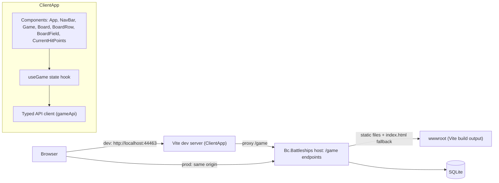
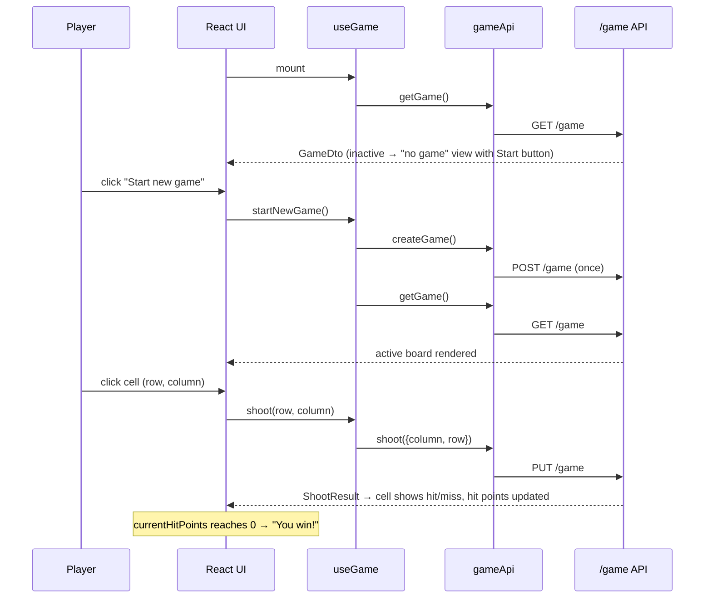

# Modernization Phase 3 – Frontend Rewrite (Vite + React 19 + TypeScript) Plan

**Plan Status**: `FINAL`

**Story Type**: `Internal`

> This plan captures **what** to build and **why** — domain, architecture, decisions, and verified facts.
> It deliberately does **not** contain implementation code, pseudocode, line numbers, mock setups, or test bodies.
> The implementation agent discovers the **how** against live code. See §4 Task Breakdown.

---

## 1. Problem Statement

*   **Context**: After Phase 1 (#1, PR #6) and Phase 2 (#2, PR #22), the backend runs on .NET 10 with a minimal-API `/game` endpoint group, but the client in `src/Bc.Battleships/ClientApp` is still the 2022 Create React App template: React 17, `react-scripts` 5 (deprecated), plain JavaScript, `ReactDOM.render`, and many unused template dependencies (`oidc-client`, `jquery`, `reactstrap`, `react-router-bootstrap`, the whole `workbox-*` set, `lodash`, `merge`, `http-proxy-middleware`, the `aspnetcore-https.js` / `aspnetcore-react.js` dev-cert scripts). The real game UI is about 10 small components and three logic modules.
*   **Bug**: `components/Game.js` calls `newGame()` **during render** whenever the loaded game is not active. That is a side effect in render: StrictMode or any re-render can send several `POST /game` requests. `newGame` then calls `history.go(0)`, a full page reload, instead of refreshing state (MODERNIZATION.md Phase 4 bug 5 points here too).
*   **Goal** (issue #3 AC): the client builds with **Vite + React 19 + TypeScript**, has no unused dependencies, drops react-router (single screen), uses a typed API client, fixes the new-game bug, has Vitest + Testing Library component tests and a Playwright e2e smoke (new game → shoot → hit/miss rendered → game over), and its tests and e2e run in CI.
*   **In scope**: everything under `src/Bc.Battleships/ClientApp`, the client and e2e jobs in `.github/workflows/ci.yml`, client sections of `README.md`, and the Phase 3 status in `docs/MODERNIZATION.md`.
*   **Out of scope**: any backend/domain change, including the Phase 4 bugs (#4) and the `/games/{id}` API redesign; two-sided play; visual redesign beyond what dropping `reactstrap` requires.

### 1.1 Technical Summary

*   **Touched projects**: `src/Bc.Battleships/ClientApp` (rewritten in place), `.github/workflows/ci.yml`, docs. `Bc.Battleships.csproj` is a reference only (see D2).
*   **New patterns / abstractions**: a typed API client module that is the only place knowing the `/game` routes; a game-state hook that owns loading, new game and shooting; Vitest + Testing Library; Playwright with the backend and the Vite dev server started by its `webServer` config.
*   **Infrastructure changes**: none. A new CI job for e2e.
*   **End-state observable behaviour**: `npm run dev` serves the game and proxies `/game` to the backend; `npm run build` emits the production bundle that `dotnet publish` copies into `wwwroot`; starting a new game sends exactly one `POST /game` and updates the board without a page reload; `npm run lint`, `npm test` and `npm run test:e2e` pass locally and in CI.

---

## 2. Architecture & Design

### 2.1 Architecture Overview

#### Involved services & owners

| Service | Technical Owner |
| :--- | :--- |
| `Bc.Battleships` web app (ASP.NET Core host, `/game` API) | bcichonski |
| `ClientApp` (React SPA) | bcichonski |

#### C2 diagram

#### Flow diagram

### 2.2 External Contracts & Evidence

`N/A — Internal story`. The only contract is this repo's own `/game` API. It is recorded in §2.4 from local source (`src/Bc.Battleships/Infrastructure/GameEndpoints.cs`, `src/Bc.Battleships.Messages/DTOs/*`, `src/Bc.Battleships.Messages/CommandsResults/ShootResult.cs`, `src/Bc.Battleships.Messages/Commands/ShootCommand.cs`) and is pinned by `tests/Bc.Battleships.Tests.Integration.API/GameEndpointsTests.cs`.

#### Source Conflict Log

| Topic | Source A | Source B | Conflict | Chosen Handling |
| :--- | :--- | :--- | :--- | :--- |
| Target API shape | Issue #3: "prefer doing this after the domain bug fixes so the UI targets `/games/{id}`" | Repo: Phase 4 (#4) is still open; the API is `GET/POST/PUT /game` | The preferred API does not exist yet | Target the current `/game` API. All route knowledge lives in the typed client so Phase 4 changes one module (D4). |
| Game-over source | Original client: win when `currentHitPoints <= 0` in client state | Backend bug 2 (Phase 4): game-over persistence via fire-and-forget event is unreliable | Server `isGameActive` may lag | Keep the client rule: the win view is driven by `currentHitPoints <= 0` from the latest `GET`/shot result (same as today). |

### 2.3 Affected Areas

| Area / File (pointer) | Role in this change | Likely action |
| :--- | :--- | :--- |
| `src/Bc.Battleships/ClientApp/package.json`, `package-lock.json` | CRA deps and scripts. | Replace (new deps, regenerated lockfile) |
| `ClientApp/public/index.html`, `public/manifest.json`, `public/favicon.ico` | CRA HTML template with `%PUBLIC_URL%` and `<base>`. | Move `index.html` to the ClientApp root in Vite form; keep `favicon.ico` in `public/`; remove `manifest.json` |
| `ClientApp/src/index.js`, `App.js`, `App.test.js`, `reportWebVitals.js`, `service-worker.js`, `serviceWorkerRegistration.js`, `setupProxy.js` | CRA entry, router, PWA and proxy boilerplate. | Remove / replace with `main.tsx` + `App.tsx` |
| `ClientApp/aspnetcore-https.js`, `aspnetcore-react.js`, `.env`, `.env.development`, `README.md` (CRA readme, 108 KB) | CRA/ASP.NET dev-cert and port glue; template readme. | Remove (port moves into the Vite config) |
| `ClientApp/src/components/*.js` | Game UI: `Game`, `Board`, `BoardRow`, `BoardField`, `CurrentHitPoints`, `StartNewGame`, `Layout`, `NavMenu` (+ `NavMenu.css`). | Rewrite as `.tsx` |
| `ClientApp/src/logic/backend.js` | `fetch` calls for `GET/POST/PUT /game`; holds the `history.go(0)` reload. | Replace with the typed API client |
| `ClientApp/src/logic/logic.js`, `constants.js` | Shot-result merge (uses `lodash/cloneDeep`), row letter conversion, field-state symbols. | Rewrite as typed modules |
| `ClientApp/src/custom.css` | Board styles. | Keep (trim unused rules if desired) |
| `src/Bc.Battleships/Bc.Battleships.csproj` | `SpaRoot` = `ClientApp\`; publish target runs `npm install` + `npm run build` and copies `ClientApp/build/**` into `wwwroot`. | Reference only (D2 keeps `build`) |
| `src/Bc.Battleships/Infrastructure/{App.cs,GameEndpoints.cs,ConfigurationProvider.cs}`, `Properties/launchSettings.json` | Static files + `index.html` fallback; `/game` routes; connection string read from env var `ConnectionString` first; dev URL `http://localhost:5191`. | Reference (used by the dev proxy and e2e) |
| `.github/workflows/ci.yml` | `client` job runs `npm ci`, `npm run lint`, `npm test` on Node 22. | Change (typecheck/build + new e2e job) |
| `.github/dependabot.yml` | npm ecosystem points at `/src/Bc.Battleships/ClientApp`. | Reference (path unchanged, D1) |
| `README.md`, `docs/MODERNIZATION.md` | Client run/test instructions (CRA, `npm start`, port 44463 HTTPS); Phase 3 status. | Change |

### 2.4 Key Algorithms & Behaviour

*   **API contract the client consumes (verified from local source, unchanged by this story).** JSON is System.Text.Json web defaults (camelCase, enums as numbers; no `JsonStringEnumConverter` is configured).
    *   `GET /game` → 200 `GameDto`: `isGameActive: boolean`, `currentHitPoints: number`, `board: { boardSize: number, boardRows: { row: BoardFieldState[] }[] } | null`. No game → `isGameActive: false, board: null, currentHitPoints: 0`.
    *   `POST /game` → 200, **empty body** (do not parse JSON). Stops the current game and creates a new one.
    *   `PUT /game` with JSON body `{ column, row }` (0-based) → 200 `ShootResult`: `{ hit: boolean, currentHitPoints: number }`.
    *   `BoardFieldState`: `0` Unknown, `1` Miss, `2` Hit. Board size is 10 (`GameContextProvider`).
    *   Any non-2xx response is an error; the client surfaces it (see below) rather than parsing it.
*   **View selection** (in this order, mirroring today's behaviour minus the side effect): loading → error → win (`currentHitPoints <= 0` **and** a board has been loaded in this session, i.e. a game existed) → active board (`isGameActive`) → "no game in progress" view with a Start button. The no-game view must not send any request by itself.
*   **New game (bug fix).** Starting a game happens only from an explicit user action (the navbar button and the no-game view button). It sends exactly one `POST /game`, then re-reads the game with `GET /game` and replaces state. No page reload, no `history` API. While a new-game request is in flight the Start buttons are disabled, so a double click cannot create two games. Mounting the app (including StrictMode's double effect run in development) sends `GET /game` only.
*   **Shooting.** A cell click sends `PUT /game` with that cell's `{column, row}`. On success, state is updated immutably: that one cell becomes Hit or Miss from `hit`, and `currentHitPoints` takes the response value. No deep-clone library. A cell already marked Hit or Miss is not clickable (disabled), so the client never re-sends a shot to a known cell. A failed shot shows an error message; it must not throw during render.
*   **Row labels.** Rows are labelled with letters from the existing alphabet constant (`ABCDEFGHIJKLMNPQRSTUVWXYZ` — note it skips `O`; keep it), columns 1–N.
*   **Dev proxy.** The Vite dev server proxies `/game` to the backend. Target: the first URL of env `ASPNETCORE_URLS` when set, else `http://localhost:5191` (the HTTP URL in `launchSettings.json`). `secure: false` so an HTTPS dev cert also works.

---

## 3. Key Decisions & Assumptions

*   **D1 — Rewrite in place in `src/Bc.Battleships/ClientApp`.** Keeps `SpaRoot`, the dependabot npm directory and the CI working directory valid. Rejected: a new top-level `web/` folder (MODERNIZATION's Phase 4 target layout) — that move belongs with the Phase 4 project restructure.
*   **D2 — Vite `build.outDir` is `build`.** The csproj publish target and `.gitignore` already use `ClientApp/build`; keeping it means no backend file changes. The publish target's `npm install` + `npm run build` keeps working because `build` is the Vite build script.
*   **D3 — No router.** Single screen; `react-router-dom`, `react-router-bootstrap` and the `<base href>` basename logic are dropped.
*   **D4 — Hand-written typed API client** (one module, e.g. `src/api/gameApi.ts`, plus DTO types mirroring `GameDto`, `BoardDto`, `BoardRowDto`, `BoardFieldState`, `ShootResult`, `ShootCommand`). Rejected: OpenAPI code generation — the document is served in Development only, three endpoints do not justify a generator, and the API shape changes in Phase 4. The client is the only module that knows route strings, so Phase 4 changes it in one place.
*   **D5 — Explicit new-game action, no auto-create.** When there is no active game the UI shows a "no game in progress" view with a Start button instead of creating one automatically. This removes the duplicate-POST class of bug entirely (no effect can race). UX cost: one extra click on a fresh database. Rejected: an auto-create effect with a once-guard (still a hidden write on page load; fragile under StrictMode).
*   **D6 — Keep Bootstrap CSS, drop `reactstrap`.** `bootstrap` is not on the removal list and supplies the navbar/button styles; components use plain elements with Bootstrap classes. No Bootstrap JS (and therefore no jQuery).
*   **D7 — Dev server: HTTP on port 44463** (`strictPort`). The HTTPS dev-cert scripts are removed per the AC; the port is kept so existing habits/docs map over.
*   **D8 — Lint: ESLint 9 flat config** with `typescript-eslint`, `eslint-plugin-react-hooks` and `eslint-plugin-react-refresh` (the Vite React-TS template set). `npm run lint` must pass with no errors or warnings.
*   **D9 — Unit/component tests: Vitest (jsdom) + `@testing-library/react` + `@testing-library/user-event` + `@testing-library/jest-dom`.** The API is faked at the `fetch` boundary or by mocking the API client module — not with a network server — to keep tests fast.
*   **D10 — E2E: `@playwright/test`, Chromium only, under `ClientApp/e2e/`.** `playwright.config.ts` uses `webServer` to start (1) the backend via `dotnet run` on the `Bc.Battleships` project, with `ASPNETCORE_ENVIRONMENT=Development`, `--urls http://127.0.0.1:5191`, and env `ConnectionString` pointing at a throw-away SQLite file (e.g. under the OS temp dir or a git-ignored folder) so e2e never touches `battleships.db`; and (2) the Vite dev server with its proxy aimed at that backend. `reuseExistingServer` only outside CI. CI retries: 2.
*   **D11 — E2E reaches game over by shooting every cell.** Ship positions are random and not exposed, so the smoke test clicks cells until "You win!" is visible (at most 100 shots on the 10×10 board), waiting for each shot's result before the next click. It also asserts a hit or miss symbol appeared after the first shot.
*   **D12 — Use current stable versions** with standard caret ranges, locked by the regenerated `package-lock.json`. React 19 + matching `@types/react`/`@types/react-dom`; Vite and Vitest majors must be compatible with each other; TypeScript `strict: true`.
*   **D13 — CI**: the existing `client` job runs `npm ci`, `npm run lint`, `npm run build` (includes `tsc` typecheck) and `npm test`. A new `e2e` job sets up .NET (from `global.json`) and Node 22, runs `npm ci`, `npx playwright install --with-deps chromium`, then `npm run test:e2e`, and uploads the Playwright report as an artifact on failure. Action versions stay at the ones already used in `ci.yml` (dependabot owns bumps).
*   **Assumption A1 — Phase 4 not done**: confirmed (#4 open), handled by D4. Not correctness-affecting for this story.
*   **Assumption A2 — Backend game-over flakiness.** Backend bugs 2 and 4 (Phase 4) can in rare cases make a sinking shot or a new game return 500. The client's win rule does not depend on the server's game-over persistence (§2.4), and CI retries cover rare placement failures. Not fixed here (out of scope).

### 3.1 Decision Lock (Constants & Policies)

| Constant / Policy | Selected Value | Why | Where it lives |
| :--- | :--- | :--- | :--- |
| Client folder | `src/Bc.Battleships/ClientApp` | D1 | — |
| Vite build output | `build` | D2 (csproj publish target) | `vite.config.ts` |
| Dev server port | `44463`, HTTP, strict | D7 | `vite.config.ts` |
| Proxy target | first of `ASPNETCORE_URLS`, else `http://localhost:5191` | launchSettings HTTP URL | `vite.config.ts` |
| Proxied paths | `/game` | Only API route | `vite.config.ts` |
| E2E backend URL | `http://127.0.0.1:5191` | Matches proxy default | `playwright.config.ts` |
| E2E database | throw-away SQLite via env `ConnectionString` | Never touch the dev DB | `playwright.config.ts` |
| New-game trigger | explicit user action only | D5 / bug fix | `useGame` + components |
| npm scripts | `dev`, `build`, `preview`, `lint`, `test` (single run), `test:e2e` | CI and csproj call these | `package.json` |
| Node in CI | 22 | Already used | `ci.yml` |

### 3.2 Open Questions

No open questions.

---

## 4. Task Breakdown

| Task | Title | Depends on | Complexity |
| :--- | :--- | :--- | :--- |
| `T1` | Vite + React 19 + TypeScript toolchain, dependency cleanup, mechanical TSX port | — | `Medium` |
| `T2` | Typed API client, game state hook, new-game bug fix, component tests | `T1` | `Medium` |
| `T3` | Playwright e2e smoke | `T2` | `Medium` |
| `T4` | CI jobs and documentation | `T3` | `Low` |

### T1 — Vite + React 19 + TypeScript toolchain, dependency cleanup, mechanical TSX port

*   **Goal**: `ClientApp` is a Vite + React 19 + strict TypeScript project with ESLint and Vitest configured, every CRA/PWA/template file and unused dependency removed, and the existing UI ported to `.tsx` with the same behaviour (react-router, reactstrap and lodash no longer used).
*   **Depends on**: —
*   **Complexity**: `Medium`
*   **Pointers**: §2.3 rows for `package.json`, `public/*`, `src/index.js`/`App.js`/PWA files, `aspnetcore-*.js`, `.env*`, CRA `README.md`, `src/components/*`, `src/logic/*`; decisions D1–D3, D6–D9, D12; §3.1.
*   **Definition of Done**:
    *   `package.json` has none of: `react-scripts`, `oidc-client`, `jquery`, `reactstrap`, `react-router-dom`, `react-router-bootstrap`, any `workbox-*`, `lodash`, `merge`, `http-proxy-middleware`, `rimraf`, `cross-env`, `web-vitals`, `ajv`, `nan`, `eslint-config-react-app`, `eslint-plugin-flowtype`. Every remaining dependency is imported somewhere or used by a config/script. `package-lock.json` regenerated.
    *   Files removed: `aspnetcore-https.js`, `aspnetcore-react.js`, `.env`, `.env.development`, the CRA `README.md`, `public/index.html`, `public/manifest.json`, `src/setupProxy.js`, `src/service-worker.js`, `src/serviceWorkerRegistration.js`, `src/reportWebVitals.js`, `src/App.test.js`, and all `.js` sources replaced by `.ts`/`.tsx`.
    *   `vite.config.ts` sets port/proxy/outDir per §3.1; Vitest config (jsdom, Testing Library jest-dom setup) present; `tsconfig` strict; ESLint flat config present. `.gitignore` covers `node_modules`, `build`, `coverage`, Playwright output folders.
    *   React 19 root API (`createRoot`) with `StrictMode`.
    *   `npm run lint`, `npm run build` (typecheck + Vite build into `build/`) and `npm test` all pass. `dotnet build Bc.Battleships.slnx` still succeeds.
*   **Tests expected**: Vitest — a smoke test that `App` renders (with `fetch` stubbed) and the row-letter conversion (including the out-of-alphabet error). Behavioural tests come in T2.
*   **Note to agent**: run npm only in the foreground; leave no background processes. Keep the existing new-game behaviour shape for now only if needed to compile — T2 replaces it; do not spend effort on it here.

### T2 — Typed API client, game state hook, new-game bug fix, component tests

*   **Goal**: All server access goes through a typed API client; a single hook owns game state (load, start new game, shoot); the new-game side effect in render and the page reload are gone; components have Vitest + Testing Library coverage.
*   **Depends on**: `T1`
*   **Complexity**: `Medium`
*   **Pointers**: §2.4 (contract, view selection, new game, shooting); D4, D5, D9; T1's ported `Game`/`Board*`/`NavMenu`/`StartNewGame` components and logic modules.
*   **Definition of Done**:
    *   One API module exposes get game / create game / shoot, typed with DTO types mirroring the backend (§2.4); it is the only file containing the `/game` path; non-2xx responses reject with an error carrying the status; `POST` response body is not parsed.
    *   A game-state hook (or reducer + hook) provides the current view state, `startNewGame` and `shoot`, and is the only caller of the API module.
    *   No request is sent from render. Mount sends one `GET /game`. A new game sends exactly one `POST /game` followed by a `GET /game`; Start buttons are disabled while it is in flight. No `history`/`location` reload anywhere.
    *   Views per §2.4 order, including the "no game in progress" view with a Start button; errors render as a readable message (not `JSON.stringify` of an error object).
    *   Shot results update the board immutably; known cells are disabled.
    *   `npm run lint`, `npm run build`, `npm test` pass.
*   **Tests expected**: Vitest + Testing Library, API faked at `fetch` or by mocking the API module —
    *   API client: correct verb/path/body per call; `POST` with empty body not parsed; non-2xx rejects.
    *   Game flow: loading then board rendered for an active game; inactive game shows the no-game view and sends **no** `POST`; clicking Start sends exactly one `POST` then a `GET` and renders the new board without reload; double-clicking Start still sends one `POST`.
    *   Shooting: clicking a cell sends `{column,row}` for that cell; hit renders the hit symbol and decrements the shown hit points; miss renders the miss symbol; a shot cell is disabled; a failing shot shows an error message.
    *   Win: `currentHitPoints` reaching 0 after a shot shows "You win!".

### T3 — Playwright e2e smoke

*   **Goal**: `npm run test:e2e` starts the real backend (throw-away SQLite) and the Vite dev server, and drives the game through new game → shoot → hit/miss rendered → game over in Chromium.
*   **Depends on**: `T2`
*   **Complexity**: `Medium`
*   **Pointers**: D10, D11; §3.1 e2e rows; `src/Bc.Battleships/Infrastructure/ConfigurationProvider.cs` (env `ConnectionString` wins over appsettings); `Properties/launchSettings.json`; `App.cs` (`UseHttpsRedirection` — use an HTTP-only `--urls`).
*   **Definition of Done**:
    *   `@playwright/test` added as a dev dependency (version matching the Chromium available in the environment where practical); `playwright.config.ts` with `webServer` entries per D10, Chromium project only, `retries` 2 in CI and 0 locally, HTML report not auto-opened.
    *   Spec under `e2e/` covers: start a new game from the UI → board visible → shoot one cell → a hit or miss symbol is rendered in it and the hit-points text is consistent → keep shooting un-shot cells until "You win!" is visible.
    *   The e2e run never writes the developer's `battleships.db`; generated test-result/report folders are git-ignored.
    *   Vitest does not pick up `e2e/` specs, and Playwright does not pick up Vitest tests.
    *   `npm run test:e2e` passes locally.
*   **Tests expected**: the e2e smoke itself (one spec; a second small spec is optional).

### T4 — CI jobs and documentation

*   **Goal**: CI runs the client's lint, typecheck/build, unit tests and the e2e smoke; docs describe the new client workflow and Phase 3 status.
*   **Depends on**: `T3`
*   **Complexity**: `Low`
*   **Pointers**: `.github/workflows/ci.yml`; D13; `README.md` ("Running the app", "Running the tests", "Continuous integration", the intro line mentioning Create React App); `docs/MODERNIZATION.md` Phase 3 section (and the Phase 2 note about the Vite proxy being deferred to Phase 3).
*   **Definition of Done**:
    *   `client` job: `npm ci`, `npm run lint`, `npm run build`, `npm test`.
    *   New `e2e` job per D13, report uploaded on failure. Existing `dotnet` job untouched.
    *   `README.md`: client prerequisites, `npm run dev` on `http://localhost:44463` with the proxy target rule, `npm test`, `npm run test:e2e` (needs the .NET SDK and `npx playwright install chromium`), CI description updated; no remaining CRA/`npm start`/`setupProxy` references.
    *   `docs/MODERNIZATION.md`: Phase 3 marked done with a short status list in the same style as Phase 2; the Phase 4 "duplicate new-game POSTs" item noted as fixed by Phase 3.
    *   Workflow YAML is valid (e.g. parses with a YAML parser); all client commands it runs pass locally.
*   **Tests expected**: none beyond running the commands the workflow runs.

---

## 5. Verification

*   **Build**: `dotnet build Bc.Battleships.slnx` — no errors. In `src/Bc.Battleships/ClientApp`: `npm ci && npm run build` — typecheck clean, output in `build/`.
*   **Lint**: `npm run lint` — clean.
*   **Unit/component tests**: `npm test` — all green. Backend: `dotnet test Bc.Battleships.slnx` — unchanged, all green.
*   **E2E**: `npm run test:e2e` — green.
*   **Observable behaviour**: with the backend and `npm run dev` running, opening `http://localhost:44463` on an empty DB shows the no-game view; clicking Start creates one game (one `POST /game` in the network log, no reload); clicking cells renders ●/○ and decreases "Left to hit" on hits; sinking everything shows "You win!". `grep` finds no `react-scripts`, `reactstrap`, `jquery`, `lodash`, `workbox`, `oidc-client`, `react-router` in `ClientApp/package.json` or `src/`.

---

## 6. Fact-Integrity Checklist

| Check | Yes / No / N/A | Notes |
| :--- | :--- | :--- |
| External contracts (routes, payload type ids, DTO fields, identifier types) verified from producer/contract source — not story text | N/A | Internal story; the local `/game` contract is taken from source and the API integration tests (§2.4) |
| Evidence sources are reproducible (exact repo file path/symbol) | N/A | Internal story |
| Identifier directionality / ordering / freshness **meaning** evidenced separately from field shape, or moved to an Open Question | N/A | Internal story |
| Every `Assumption` is linked to an Open Question (§3.2) | Yes | A1/A2 are not correctness-affecting for this story; both are handled by decisions |
| No unresolved Open Questions (for `FINAL`) | Yes | |
| Each Decision states a single committed approach | Yes | |
| Tasks are independent, each with a Definition of Done and test expectations | Yes | Sequential chain; each task verifiable on its own |
| Required infra reflected: toggle-gated where the story carries a toggle key; new Service Bus subscription/queue ⇒ a task updates `infrastructure.bicep` | N/A | No toggle, no messaging |

**Self-review note**: The main judgment calls are D5 (explicit Start instead of auto-create, which slightly changes first-visit UX but removes the bug class) and targeting the current `/game` API although the issue prefers waiting for Phase 4 (D4 isolates it). Take extra care in T3: the e2e starts a real ASP.NET host — use an HTTP-only URL, a throw-away SQLite file, and make sure no `dotnet`/Vite process is left running after the run. Backend Phase 4 bugs (fire-and-forget sinking event, random placement failure) can rarely produce a 500; do not fix them here — if the e2e is flaky because of them, note it, rely on CI retries, and keep backend code untouched.
