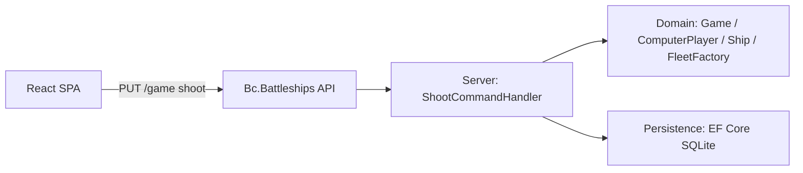
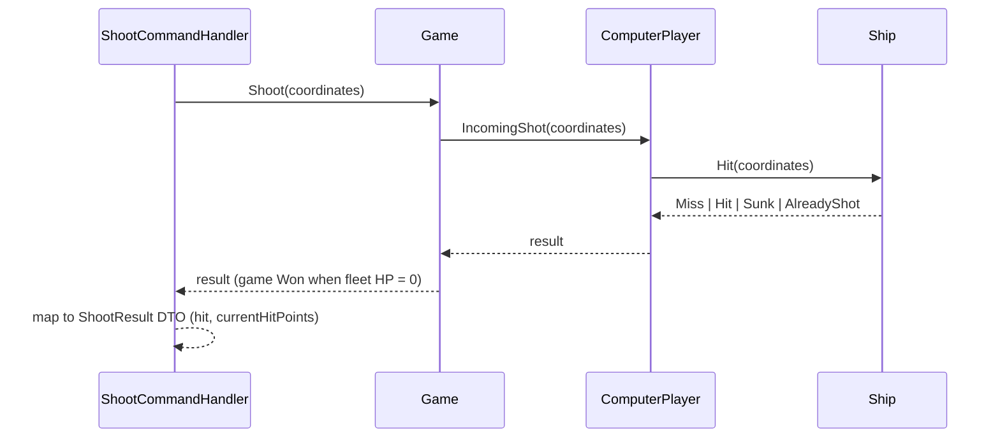

# Modernization Phase 4b: Domain Bug Fixes Plan

**Plan Status**: `FINAL`

**Story Type**: `Internal`

> This plan captures **what** to build and **why** — domain, architecture, decisions, and verified facts.
> It deliberately does **not** contain implementation code, pseudocode, line numbers, mock setups, or test bodies.
> The implementation agent discovers the **how** against live code. See §4 Task Breakdown.

---

## 1. Problem Statement

*   **Context**: Issue #4 (split on 2026-10-23) now covers only the remaining **domain bugs** listed in `docs/MODERNIZATION.md` → Phase 4 → "Bugs found while reading the code". Its dependency, #25 (static service locator / game-over as an aggregate invariant), is merged on `main` (`5e9ade5`). Verified against the code on `main`:
    1.  **Ships never occupy row 10 / column 10.** `FleetFactory` draws start coordinates with `Random.Next(1, BoardSize)` and `Random.Next(1, BoardSize - length)`. The upper bound is exclusive on 1-based coordinates, so the last row/column is unreachable, and the start of a ship along its length is cut one cell short (horizontal ships never reach column 9 or 10).
    2.  **Re-shooting a hit compartment returns `Hit`.** `Ship.Hit` treats `GetCompartmentAt(c)?.Hit() != null` as a hit. `ShipCompartment.Hit()` returns a non-null `bool`, so any shot at an existing compartment reports `Hit`, even if it is already flooded. The "re-emits the sinking event" part of the bug is gone since #25 (no event is published any more). The `Hit` result is still wrong.
    3.  **Placement can throw at random.** `FleetFactory` retries random positions while `currentAttempt < 10` (9 attempts), then throws `FleetFactoryPositioningFailedException`.
    4.  **No seam for randomness.** `FleetFactory` creates its own `new Random()`, so placement can't be tested deterministically or over many seeds.
*   **Goal**: Fix all four with a **failing regression test written first** for each bug (issue requirement), using explicit `Miss / Hit / Sunk / AlreadyShot` shot results and deterministic, injectable fleet placement.
*   **In scope**: Domain (`FleetFactory`, `Ship`, `ShipCompartment`, `ComputerPlayer`, `Game`, domain `ShootResult` enum), the mapping in `ShootCommandHandler`, and domain unit and API integration tests.
*   **Out of scope**: Design refactoring (`/games/{id}` resources, `GameContextProvider` → options, pragma cleanup, project consolidation) → #26. SQLite HTTP integration tests and the coverage gate → #27. Two-sided play → #5. The HTTP/JSON contract (`ShootResult { hit, currentHitPoints }`) and the client stay unchanged.

### 1.1 Technical Summary

*   **Touched projects**: `Bc.Battleships.Domain`, `Bc.Battleships.Server` (shoot-result mapping only), and the tests in `tests/Bc.Battleships.UnitTests.Domain` and `tests/Bc.Battleships.Tests.Integration.API`.
*   **New patterns / abstractions**: an injected `System.Random` for fleet placement. Placement enumerates the valid placements, then picks one at random.
*   **Infrastructure changes**: None. No EF model change, so no migration (the domain `ShootResult` enum is not persisted, and `ShipCompartmentState` is unchanged).
*   **End-state observable behaviour**: every board cell can hold a ship. A shot at a cell already shot reports `AlreadyShot` and never changes hit points. The shot that floods a ship's last compartment reports `Sunk`. Fleet placement never fails for the standard game context.

---

## 2. Architecture & Design

### 2.1 Architecture Overview

#### Involved services & owners

| Service | Technical Owner |
| :--- | :--- |
| `Bc.Battleships` (single ASP.NET Core app + Vite SPA) | bcichonski |

#### C2 diagram

#### Flow diagram

### 2.2 External Contracts & Evidence

N/A — Internal story.

#### Source Conflict Log

| Topic | Source A | Source B | Conflict | Chosen Handling |
| :--- | :--- | :--- | :--- | :--- |
| Name of the "repeat shot" result | Issue #4: `AlreadyShot` | `docs/MODERNIZATION.md`: `AlreadyHit` | Different names | Use the issue's `AlreadyShot`. It also covers repeat shots on water, which `AlreadyHit` doesn't describe. |
| Sinking event re-emission | Issue #4 bug 2 text | Code on `main` after #25 | No sinking event exists any more | Only the wrong `Hit` result is fixed. Nothing to remove for the event. |

### 2.3 Affected Areas

| Area / File (pointer) | Role in this change | Likely action |
| :--- | :--- | :--- |
| `src/Bc.Battleships.Domain/ValueObjects/Enums/ShootResult.cs` | Domain shot outcome, currently `Miss`, `Hit` | Change: add `Sunk`, `AlreadyShot` |
| `src/Bc.Battleships.Domain/AggregateRoots/Games/Ships/Ship.cs` | Resolves a shot against its compartments, collision check | Change: correct result per §2.4 |
| `src/Bc.Battleships.Domain/AggregateRoots/Games/Ships/ShipCompartment.cs` | Dry/Flooded state, `Hit()` | Reference / Change if needed |
| `src/Bc.Battleships.Domain/AggregateRoots/Games/Players/ComputerPlayer.cs` | Records shots (`CoordinatesShoot`), iterates ships, positions fleet | Change: repeat-shot detection, pass `Random` to the factory |
| `src/Bc.Battleships.Domain/AggregateRoots/Games/Game.cs` | Aggregate root: `Shoot`, game-over invariant, `CreateNewGame` | Change: accept an optional `Random` for creation. `Shoot` must not change state on `AlreadyShot` |
| `src/Bc.Battleships.Domain/Services/FleetFactory/FleetFactory.cs` | Random placement with bounded retries | Change: inject `Random`, enumerate valid placements |
| `src/Bc.Battleships.Domain/Services/FleetFactory/FleetFactoryPositioningFailedException.cs` | Thrown on placement failure | Keep, thrown only when no valid placement exists |
| `src/Bc.Battleships.Server/CommandHandlers/ShootCommandHandler.cs` | Maps the domain result to the `ShootResult` DTO | Change: mapping per §3.1 |
| `src/Bc.Battleships.Server/CommandHandlers/CreateNewGameCommandHandler.cs` | Creates a game | Reference: keeps the production default `Random` |
| `tests/Bc.Battleships.UnitTests.Domain/Games/**`, `tests/Bc.Battleships.Tests.Common/Builders/**` | Domain tests and builders | New / Change |
| `tests/Bc.Battleships.Tests.Integration.API/Games/WhenShooting.cs` | API-level shoot tests (existing SQLite harness) | Change: add the repeat-shot case |

### 2.4 Key Algorithms & Behaviour

**Shot resolution (bug 2)**, evaluated for one incoming shot at cell `c`:

*   `c` was already shot before (it's already in `ComputerPlayer.CoordinatesShoot`) → `AlreadyShot`. No compartment state changes, hit points are unchanged, and the shot isn't recorded twice. This applies whether the earlier shot hit or missed.
*   Otherwise, if no ship has a compartment at `c` → `Miss`.
*   Otherwise the compartment at `c` floods. If that ship now has zero dry compartments → `Sunk`, else → `Hit`.
*   As defence in depth, `Ship.Hit` on an already flooded compartment also returns `AlreadyShot` (never `Hit`), so the ship is correct on its own even without the player-level shot log.
*   `Game.Shoot` keeps the #25 invariant: the game becomes `Won` when fleet hit points reach 0. An `AlreadyShot` result never changes `GameState`.

**Fleet placement (bugs 1, 3, 4)**, for each blueprint in order:

*   Candidates are every `(layout, start)` pair whose compartments all lie inside the 1-based board `[1..BoardSize]` on both axes and don't intersect any ship placed earlier. For a ship of length `L` that means start positions `1..BoardSize−L+1` along its length axis and `1..BoardSize` across it.
*   Pick one candidate uniformly at random using the injected `Random`. Termination is deterministic: there are no retry loops.
*   If a blueprint has zero candidates, throw `FleetFactoryPositioningFailedException`. That is only possible for a context that can't fit (for example a ship longer than the board), never at random for the standard 10×10 context with ships 4, 4, 5.
*   The same seed gives the same fleet.

**Randomness seam (bug 4)**: the caller supplies the `Random`. Production keeps current behaviour through an overload or optional parameter that defaults to a shared/new `Random`. The application layer and DI wiring don't change.

---

## 3. Key Decisions & Assumptions

*   **Decision**: Keep the HTTP contract `ShootResult { hit, currentHitPoints }` unchanged. API reshaping belongs to #26, and the SPA paints the cell from `hit`.
*   **Decision**: The DTO's `hit` reflects the **state of the targeted cell after the shot**: `true` for `Hit`, `Sunk`, and `AlreadyShot` on a flooded compartment, `false` for `Miss` and `AlreadyShot` on water. This stops the client (`applyShot` in `ClientApp/src/logic/logic.ts`) from repainting a hit cell as a miss on a repeat click, without any client change.
*   **Decision**: Repeat-shot detection lives in `ComputerPlayer`, which already owns the shot log. `Ship` also guards against re-hitting a flooded compartment (§2.4).
*   **Decision**: Placement uses "enumerate valid placements, then pick at random" per ship, greedily in blueprint order. No backtracking: the standard context can't dead-end, because 13 cells on a 100-cell board always leave room.
*   **Decision**: The many-seeds reachability test is a deterministic unit test. It loops over a fixed range of seeds, so it's reproducible, and it needs no new property-testing package.
*   **Decision**: Every bug gets its regression test **before** the fix. The implementing agent confirms the new test fails on the unfixed code, then fixes it.
*   **Assumption**: The comment "Use testcontainers for integration testing" targets integration-test infrastructure, which is #27's scope (SQLite HTTP integration tests). This story adds one case to the existing `Tests.Integration.API` harness and doesn't introduce Testcontainers. The app uses SQLite, so there's no server database to containerize. Low stakes: it's additive and doesn't affect correctness.
*   **Assumption**: The comment "keep HumanPlayer" is honoured trivially: nothing here touches `HumanPlayer`, and no task may remove it.

### 3.1 Decision Lock (Constants & Policies)

| Constant / Policy | Selected Value | Why | Where it lives |
| :--- | :--- | :--- | :--- |
| Domain shot results | `Miss`, `Hit`, `Sunk`, `AlreadyShot` (keep `Miss = 0`, `Hit = 1`, append the others) | Issue AC. Stable numbering avoids surprises. | `Domain/ValueObjects/Enums/ShootResult.cs` |
| DTO `hit` mapping | `Hit`/`Sunk` → true, `Miss` → false, `AlreadyShot` → whether the cell holds a flooded compartment | Keeps the client correct without changes | `ShootCommandHandler` |
| Coordinates | 1-based, inclusive `[1..BoardSize]` | Existing convention (`Coordinates`, `GameToGameDtoConverter`) | Domain |
| Placement failure | Throw `FleetFactoryPositioningFailedException` only when a blueprint has zero valid candidates | Deterministic termination | `FleetFactory` |
| Many-seeds test size | At least 1,000 seeds on the standard context | Enough to cover all 100 cells with very high probability, still fast | Domain unit tests |
| `HumanPlayer` | Untouched | Owner comment on #4 | — |

### 3.2 Open Questions

No open questions.

---

## 4. Task Breakdown

| Task | Title | Depends on | Complexity |
| :--- | :--- | :--- | :--- |
| `T1` | Explicit shot results: Miss / Hit / Sunk / AlreadyShot | — | `High` |
| `T2` | Deterministic, injectable fleet placement covering the whole board | `T1` | `Medium` |

> `T2` depends on `T1` only because both edit `ComputerPlayer.cs` and `Game.cs`. Sequencing them avoids concurrent edits to the same files. The two are logically independent.

### T1 — Explicit shot results: Miss / Hit / Sunk / AlreadyShot

*   **Goal**: Repeat shots no longer report `Hit` or change hit points. The final hit on a ship reports `Sunk`.
*   **Depends on**: `—`
*   **Complexity**: `High`. Domain core: aggregate behaviour and the game-over invariant.
*   **Pointers**: `ShootResult.cs` (domain enum), `Ship.cs`, `ShipCompartment.cs`, `ComputerPlayer.cs` (`IncomingShot`), `Game.cs` (`Shoot`), `ShootCommandHandler.cs`, tests under `tests/Bc.Battleships.UnitTests.Domain/Games/` (`WhenShootWasFired`, `Players/WhenBeingShootAt`, `WhenGameIsWon`), `tests/Bc.Battleships.Tests.Integration.API/Games/WhenShooting.cs`.
*   **Definition of Done**:
    *   Regression test(s) for bug 2 written first and observed failing on the unfixed code.
    *   The domain enum has the four values per §3.1, and the behaviour matches §2.4 exactly.
    *   `ShootCommandHandler` maps per §3.1. The DTO shape is unchanged.
    *   `HumanPlayer` untouched. No EF model change, no migration.
    *   The full solution builds without new warnings, and all existing tests pass, updated only where they asserted the old buggy behaviour.
*   **Tests expected**:
    *   Unit (domain): first shot on a compartment → `Hit`. Repeat shot on the same compartment → `AlreadyShot` with unchanged HP. Repeat shot on water → `AlreadyShot`. Flooding the last dry compartment of a ship → `Sunk`. Fresh shot on water → `Miss`. The game stays `Won`/`Active` correctly, and a repeat shot never flips state.
    *   Integration (API, existing harness): shooting the same ship cell twice → the second result has `hit = true` and unchanged `currentHitPoints`.

### T2 — Deterministic, injectable fleet placement covering the whole board

*   **Goal**: Placement takes an injected `Random`, can reach every cell including row 10 and column 10, and never throws at random.
*   **Depends on**: `T1` (same-file sequencing only)
*   **Complexity**: `Medium`
*   **Pointers**: `FleetFactory.cs`, `FleetFactoryPositioningFailedException.cs`, `ComputerPlayer.cs` (`PositionShips`), `Game.cs` (`CreateNewGame` / `PositionFleets`), `GameContext.cs`, `ShipCompartmentsProvider.cs` (how compartments derive from start + layout), tests under `tests/Bc.Battleships.UnitTests.Domain/Games/Players/WhenPositioningFleet.cs`, builders in `tests/Bc.Battleships.Tests.Common/Builders/`.
*   **Definition of Done**:
    *   Regression tests for bugs 1 and 3 written first and observed failing (or demonstrably unable to pass) on the unfixed code.
    *   `Random` injectable from `Game` creation down to `FleetFactory`. Production callers (`CreateNewGameCommandHandler`, builders) keep working without passing one.
    *   Placement follows §2.4: candidates enumerated, uniform pick, no retry loop, and the exception only when no candidate exists.
    *   The same seed gives an identical fleet.
    *   `HumanPlayer` untouched. No EF model change, no migration. Solution builds, all tests pass.
*   **Tests expected** (unit, domain):
    *   Over ≥1,000 fixed seeds on the standard context, every one of the 100 cells is occupied by some ship at least once, including row 10 and column 10.
    *   For every seed, every ship lies fully on the board and no two ships intersect. Placement never throws.
    *   Same seed → same layout.
    *   A context that can't fit (for example a ship longer than the board) throws `FleetFactoryPositioningFailedException` deterministically.

---

## 5. Verification

*   **Build**: `dotnet build Bc.Battleships.slnx`: no errors, no new warnings.
*   **Unit tests**: `dotnet test tests/Bc.Battleships.UnitTests.Domain`: all green, including the new regression tests.
*   **Integration tests**: `dotnet test tests/Bc.Battleships.Tests.Integration.API` and `tests/Bc.Battleships.Tests.Integration.Database`: all green.
*   **Frontend**: unchanged. The existing client tests and the e2e smoke must still pass in CI.
*   **Full check**: `.claude/skills/continue-plan-implementation-orchestrator/verify.sh --repo <checkout>` → `PASS`.
*   **Observable behaviour**: clicking an already-hit cell twice keeps it painted as a hit, and the "Left to hit" count stays the same.

---

## 6. Fact-Integrity Checklist

| Check | Yes / No / N/A | Notes |
| :--- | :--- | :--- |
| External contracts verified from producer/contract source — not story text | N/A | Internal story |
| Evidence sources are reproducible | N/A | Internal story |
| Identifier directionality / ordering / freshness meaning evidenced | N/A | Internal story |
| Every `Assumption` is linked to an Open Question (§3.2) | Yes | Both assumptions are low-stakes and don't affect correctness. Rationale recorded in §3. |
| No unresolved Open Questions (for `FINAL`) | Yes | |
| Each Decision states a single committed approach | Yes | |
| Tasks are independent, each with a Definition of Done and test expectations | Yes | T2 → T1 is file-overlap sequencing only |
| Required infra reflected (toggle / bicep) | N/A | No toggle key, no messaging |

**Self-review note**: All four bugs were verified against `main` after #25. The sinking-event half of bug 2 no longer exists. The subtle point is the DTO `hit` mapping for `AlreadyShot`: it must report the cell's state, not "this shot hit", or the SPA repaints hit cells as misses. Take care that `Game.Shoot`'s game-over invariant still holds when the last compartment is sunk, and that the many-seeds test asserts reachability of row 10 and column 10 specifically, so it fails on the old bounds.
