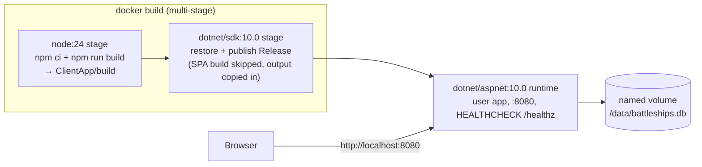
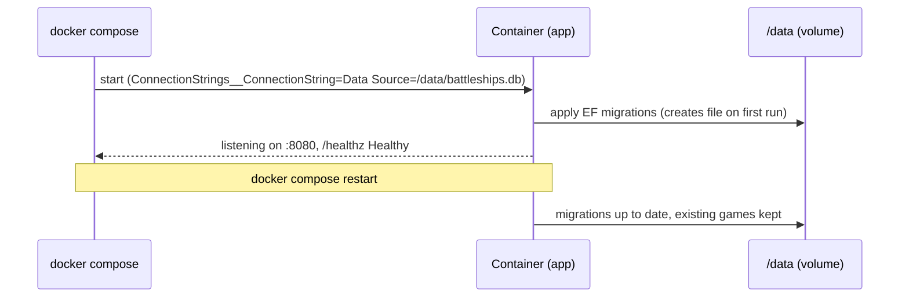

# Modernization Phase 5 – Docker Containerization Plan

**Plan Status**: `FINAL`

**Story Type**: `Internal`

> This plan captures **what** to build and **why** — domain, architecture, decisions, and verified facts.
> It deliberately does **not** contain implementation code, pseudocode, line numbers, mock setups, or test bodies.
> The implementation agent discovers the **how** against live code. See §4 Task Breakdown.

---

## 1. Problem Statement

*   **Context**: After phases 1–4 the app is a .NET 10 web host (`src/Bc.Battleships`) serving a Vite/React SPA (`src/Bc.Battleships/ClientApp`) and a minimal-API (`/games`) over SQLite with EF Core migrations applied on startup. Running it needs a local .NET 10 SDK + Node toolchain, a hand-made connection string (only `appsettings.Development.json` carries one), and `dotnet publish` invokes `npm install`/`npm run build` from an MSBuild target. There is no container image and no way to run it with one command.
*   **Goal**: `docker build -t bc-battleships .` from a clean checkout produces a runnable image; `docker compose up` serves the app on `http://localhost:8080` with the SQLite database on a named volume so games survive restarts; CI builds the image on every PR.
*   **In scope** (issue #5): multi-stage `Dockerfile` (Node 24 SPA build → .NET 10 SDK publish → `aspnet:10.0` runtime as non-root `app`), `.dockerignore`, SQLite on a configurable, volume-backed path with migrations still applied on startup, env-var configuration, a health endpoint + image `HEALTHCHECK`, `compose.yaml`, CI image build (no push), README "Run with Docker".
*   **Out of scope** (issue #5, explicit): publishing to GHCR, two-sided game / AI, .NET Aspire AppHost, public demo deployment, making the repo public.

### 1.1 Technical Summary

*   **Touched projects**: `Bc.Battleships` (web host: csproj publish target, health endpoint), repo root (new `Dockerfile`, `.dockerignore`, `compose.yaml`), `.github/workflows/ci.yml`, `README.md`, `tests/Bc.Battleships.Tests.Integration.API` (health endpoint test), new `scripts/docker-smoke.sh`.
*   **New patterns / abstractions**: ASP.NET Core health checks (`AddHealthChecks` / `MapHealthChecks`) — liveness only.
*   **Infrastructure changes**: container image + compose volume; no schema change.
*   **End-state observable behavior**: `docker compose up` → app on `:8080`, `GET /healthz` → `200 Healthy`, games persist across `docker compose restart`; CI has a job that runs `docker build`.

---

## 2. Architecture & Design

### 2.1 Architecture Overview

#### Involved services & owners

| Service | Technical Owner |
| :--- | :--- |
| `Bc.Battleships` (web host + SPA) | repo owner (bcichonski) |

#### C2 diagram

#### Flow diagram

### 2.2 External Contracts & Evidence

`N/A — Internal story`.

#### Source Conflict Log

| Topic | Source A | Source B | Conflict | Chosen Handling |
| :--- | :--- | :--- | :--- | :--- |
| Phase 5 scope | `docs/MODERNIZATION.md` Phase 5 (GHCR image, Aspire, two-sided game, demo deploy) | Issue #5 body ("Out of scope" list) | MODERNIZATION.md lists items the issue moved out | Issue wins. Only containerization is built; T3 updates the Phase 5 entry in `docs/MODERNIZATION.md` to say what was done in #5 and what was deferred. |
| Node version | Issue: Node 24 stage | `ci.yml` client jobs use Node 22 | Different majors | Docker build stage uses `node:24` per the issue; existing CI jobs are not changed (out of scope). |

### 2.3 Affected Areas

| Area / File (pointer) | Role in this change | Likely action |
| :--- | :--- | :--- |
| `src/Bc.Battleships/Bc.Battleships.csproj` (`PublishRunWebpack` target) | On publish it runs `npm install` + `npm run build` in `ClientApp` and copies `ClientApp/build/**` into `wwwroot`. The SDK image has no Node, so the npm part must be skippable while the copy still runs. | Change |
| `src/Bc.Battleships/Infrastructure/Services.cs`, `App.cs` | DI and pipeline of the web host; health checks get registered/mapped here. `App.Initialize` already applies migrations on startup (via `DatabaseMigrator`) and maps the SPA fallback. | Change |
| `src/Bc.Battleships/Infrastructure/ConfigurationProvider.cs` | Reads the SQLite connection string from env var `ConnectionString`, then `ConnectionStrings:ConnectionString`; throws if neither. `appsettings.json` (Production) has none, so the image must supply it. | Reference (no change) |
| `tests/Bc.Battleships.Tests.Common/BattleshipsWebApplicationFactory.cs`, `tests/Bc.Battleships.Tests.Integration.API/` | `WebApplicationFactory` HTTP test harness. | Reference / new test |
| `Dockerfile`, `.dockerignore`, `compose.yaml` (repo root) | Image definition, build context filter, local run. | New |
| `scripts/docker-smoke.sh` | Scripted check of the runtime AC (play a game, restart, game still there). | New |
| `.github/workflows/ci.yml` | Add an image-build job. | Change |
| `README.md`, `docs/MODERNIZATION.md` | "Run with Docker" section; Phase 5 status. | Change |

### 2.4 Key Algorithms & Behaviour

*   **SPA in the image**: the Node stage produces `ClientApp/build`; the SDK stage places that output where the publish target's copy step picks it up and publishes with the npm step disabled by an MSBuild property. A normal `dotnet publish` without the property keeps today's behaviour (runs npm itself).
*   **Database path**: the image sets `ConnectionStrings__ConnectionString=Data Source=/data/battleships.db`. `/data` is created in the image and owned by `app` (uid 1654), so a fresh named volume mounted there inherits writable ownership. SQLite creates the file; `DatabaseMigrator` applies migrations at startup (unchanged). Overridable by env var.
*   **HTTP**: the runtime listens on `ASPNETCORE_HTTP_PORTS=8080` (aspnet image default, verified: `docker run mcr.microsoft.com/dotnet/aspnet:10.0 env`). No TLS in the container. `UseHttpsRedirection` stays for non-Development; with no HTTPS port configured it does not redirect (logs a warning), so plain HTTP works — no code change to the pipeline.
*   **Health**: `GET /healthz` returns `200` with body `Healthy` (liveness: the process serves requests). It must not be swallowed by the SPA `index.html` fallback. The aspnet image ships neither `curl` nor `wget` (verified), so the runtime stage installs `curl` (`--no-install-recommends`, apt lists cleaned) for the `HEALTHCHECK` command.

---

## 3. Key Decisions & Assumptions

*   **Decision**: Skip-the-npm-step MSBuild property instead of installing Node in the SDK stage — matches the issue's separate Node stage and keeps the SDK stage small.
*   **Decision**: Liveness-only health check (no DB probe) — avoids an extra package; startup already fails hard if migrations can't run.
*   **Decision**: Install `curl` in the runtime image for `HEALTHCHECK` — the simplest reliable probe; the size cost is small. (Issue: "if it fits" — it fits.)
*   **Decision**: CI job runs `docker build` only (no push, no run) per issue; the runtime AC are checked by `scripts/docker-smoke.sh`, run locally during verification and documented in the README.
*   **Assumption**: Default compose port mapping `8080:8080` and named volume `battleships-data` — directly from the AC; no correctness risk.

### 3.1 Decision Lock (Constants & Policies)

| Constant / Policy | Selected Value | Why | Where it lives |
| :--- | :--- | :--- | :--- |
| Image tag in docs/CI | `bc-battleships` | AC text | README, ci.yml |
| Container port | `8080` (`ASPNETCORE_HTTP_PORTS`) | aspnet default, AC URL | Dockerfile / compose |
| DB path | `/data/battleships.db` | volume-backed, outside app dir | Dockerfile env, compose volume |
| Health route | `/healthz` | conventional, not under `/games` | web host |
| Base images | `node:24`, `mcr.microsoft.com/dotnet/sdk:10.0`, `mcr.microsoft.com/dotnet/aspnet:10.0` | issue | Dockerfile |
| Runtime user | `app` (non-root) | issue | Dockerfile |

### 3.2 Open Questions

No open questions.

---

## 4. Task Breakdown

| Task | Title | Depends on | Complexity |
| :--- | :--- | :--- | :--- |
| `T1` | Container-ready web host: health endpoint + skippable SPA build in publish | — | `Medium` |
| `T2` | Dockerfile, .dockerignore, compose.yaml, smoke script | `T1` | `Medium` |
| `T3` | CI image build + README / MODERNIZATION docs | `T2` | `Low` |

### T1 — Container-ready web host

*   **Goal**: The web host exposes `GET /healthz` and its publish step can be told to skip the npm install/build while still copying an existing `ClientApp/build` into `wwwroot`.
*   **Depends on**: `—`.
*   **Complexity**: `Medium`.
*   **Pointers**: `src/Bc.Battleships/Infrastructure/Services.cs`, `App.cs`, `src/Bc.Battleships/Bc.Battleships.csproj`.
*   **Definition of Done**: `/healthz` returns 200 `Healthy` and is not served `index.html`; a new MSBuild property (e.g. `SkipClientBuild=true`) disables only the npm execs of the publish target; default publish behaviour unchanged; solution builds with `TreatWarningsAsErrors`.
*   **Tests expected**: API integration test (WebApplicationFactory) — `/healthz` returns 200 with `Healthy`. Existing suites stay green.

### T2 — Dockerfile, .dockerignore, compose.yaml, smoke script

*   **Goal**: `docker build -t bc-battleships .` works from a clean checkout; `docker compose up` serves the app on `http://localhost:8080` with the DB on a named volume.
*   **Depends on**: `T1`.
*   **Complexity**: `Medium`.
*   **Pointers**: repo root; §2.4; §3.1.
*   **Definition of Done**: three-stage Dockerfile as in §2.1 (layer-cache friendly: restore/`npm ci` before copying the full source); runtime as `app`, `/data` owned by `app`, `ConnectionStrings__ConnectionString` set, `EXPOSE 8080`, `HEALTHCHECK` on `/healthz`; `.dockerignore` excludes `bin/`, `obj/`, `node_modules/`, `ClientApp/build`, Playwright/test output, coverage output, local `*.db*` files, `.git`, `.vs`, `.claude`; `compose.yaml` maps `8080:8080` and mounts a named volume at `/data`; `scripts/docker-smoke.sh` brings compose up, waits for healthy, creates a game, fires a shot, restarts the service, asserts the game is still returned by `GET /games/{id}`, and tears down.
*   **Tests expected**: `docker build` succeeds; `scripts/docker-smoke.sh` passes; the container runs as non-root (`docker compose exec … id -u` ≠ 0).

### T3 — CI image build + docs

*   **Goal**: Every PR builds the image in CI; README explains running with Docker; MODERNIZATION.md reflects Phase 5 status.
*   **Depends on**: `T2`.
*   **Complexity**: `Low`.
*   **Pointers**: `.github/workflows/ci.yml`, `README.md`, `docs/MODERNIZATION.md`.
*   **Definition of Done**: new `docker` job in `ci.yml` running `docker build -t bc-battleships .` (no push, no registry login); README "Run with Docker" section (build, `docker compose up`, port, volume, env vars incl. connection string override, smoke script); MODERNIZATION.md Phase 5 marks containerization done in #5 and lists the deferred items.
*   **Tests expected**: workflow YAML valid (parses); no code tests.

---

## 5. Verification

*   **Build**: `dotnet build Bc.Battleships.slnx -c Release` — no errors/warnings.
*   **Tests**: `dotnet test Bc.Battleships.slnx -c Release` — all green (incl. new `/healthz` test); client `npm run lint && npm run build && npm test` unchanged.
*   **Image**: `docker build -t bc-battleships .` from a clean tree.
*   **Runtime AC**: `bash scripts/docker-smoke.sh` — app on `:8080`, game created and shot, game survives restart.

---

## 6. Fact-Integrity Checklist

| Check | Yes / No / N/A | Notes |
| :--- | :--- | :--- |
| External contracts verified from producer/contract source | N/A | Internal |
| Evidence sources are reproducible | N/A | Internal |
| Identifier directionality / ordering / freshness meaning evidenced | N/A | Internal |
| Every `Assumption` is linked to an Open Question (§3.2) | Yes | The only assumption is taken from AC text, no correctness risk |
| No unresolved Open Questions (for `FINAL`) | Yes | |
| Each Decision states a single committed approach | Yes | |
| Tasks are independent, each with a Definition of Done and test expectations | Yes | Sequential by nature (T2 needs T1's publish switch) |
| Required infra reflected (toggle / bicep) | N/A | No toggle key, no Service Bus |

**Self-review note**: The main risks are mechanical: the SPA output path the publish target expects (`ClientApp/build`) must match what the Node stage produces, and `/data` ownership must allow the non-root `app` user to create the SQLite file (plus `-wal`/`-shm`) on a fresh volume. `global.json` pins SDK `10.0.100` with `latestFeature` roll-forward, which the `sdk:10.0` image satisfies. `UseHttpsRedirection` in Production is left as is; the implementation agent should confirm in the smoke run that HTTP requests aren't redirected.
